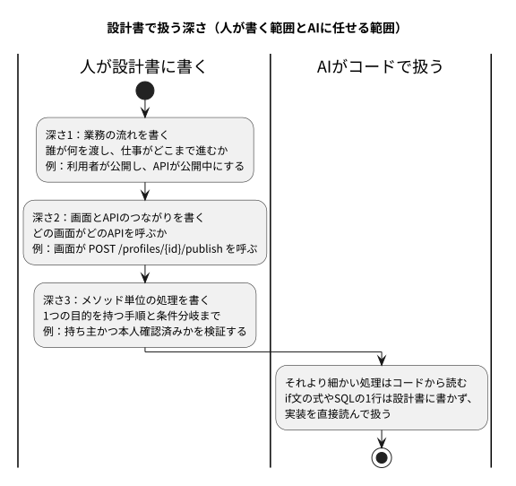

# 設計書テンプレート

人が読む設計書を、リポジトリに残す型です。人が書くのは深さ3までで、それより細かい処理はAIがコードを読んで扱います。

公開サイト：[設計書サイト（GitHub Pages）](https://masamasamasato.github.io/design-doc-template/)

## 目次

- [どこまで書くか](#どこまで書くか)
- [使い始める](#使い始める)
- [主要なファイル](#主要なファイル)

## どこまで書くか

業務の流れからメソッド単位の処理までを人が書き、それより細かい実装はAIに任せます。

## 使い始める

このリポジトリをテンプレートにして、新しいリポジトリを作ります。その後の流れは次のとおりです。

## 主要なファイル

領域の入口です。個別の業務フロー、API、テスト項目書は、各入口の一覧からたどります。

| ファイル | 役割 |
| --- | --- |
| [用語集.md](用語集.md) | 設計書で使う言葉を1か所にまとめたもの。利用者、セッション、注文の定義がわかります |
| [docs/business/index.md](docs/business/index.md) | 業務フローの入口。各フローの一覧から、個別の流れと使うAPIへ進めます |
| [apis/index.md](apis/index.md) | API設計書の入口。各APIの一覧から、設計書と変更履歴へ進めます |
| [tests/index.md](tests/index.md) | テスト項目書の入口。単体テストと結合テストの型と記入例の一覧から、対象のAPIや業務フローへ進めます |
| [docs/infra/index.md](docs/infra/index.md) | インフラ構成の記入例。ECS、サーバーレス、静的サイト、非同期処理のパターンがわかります |
| [docs/guide.md](docs/guide.md) | 書き方と自動化の決まり（AI向け）。図の書き方や、新しいAPIの足し方がわかります |
| [docs/setup.md](docs/setup.md) | GitHub の設定。権限、Pages、必要な Secret がわかります |
