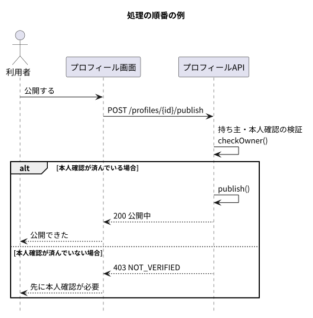
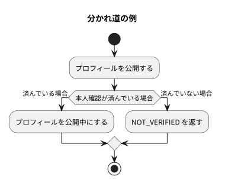
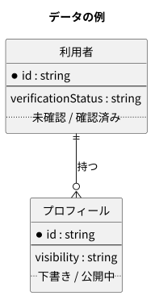
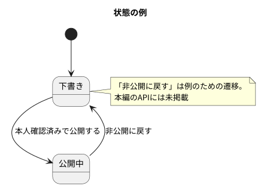

# 設計書テンプレート

人が読む設計書を、リポジトリに残す型です。リポジトリ名は `design-doc-template` です。GitHub の Template repository として使います。人が書くのは、業務の流れ（深さ1）、画面とAPIのつながり（深さ2）、メソッド単位の処理（深さ3）までです。それより細かい処理は、AIがコードを読んで扱います。

## 使い始める

1. このリポジトリをテンプレートにして、新しいリポジトリを作ります。
2. 業務フローは `docs/business/<業務>/` に、APIは `apis/_template` をコピーして書きます。
3. 図は PlantUML だけです。Mermaid は使いません。先に Java と Graphviz を入れ、`./scripts/install-plantuml.sh` を実行します。そのあと `./scripts/render-puml.sh` で SVG にします。
4. サイトは `NO_MKDOCS_2_WARNING=1 mkdocs serve -a 127.0.0.1:8765` で見ます。mkdocs の入れ方は、下の「図の変換とローカルプレビュー」にあります。
5. PRタイトルは、何をどう変えたかを日本語で書きます。`fix` などの接頭辞は使いません。

[GitHub の設定](docs/setup.md)

記入例は [ログインする](apis/login/README.md)、[ログインして商品を探す](docs/business/ログインして商品を探す/README.md)、[カードで支払う](docs/business/カードで支払う/README.md)、[AWSのインフラ構成](docs/infra/index.md) です。決めた理由は [ADR 0000](decisions/0000-template.md) にあります。

## フォルダ

```text
README.md              使い方
用語集.md              APIをまたいで使う言葉
docs/setup.md          GitHub の設定
docs/examples/         図の書き方の例
docs/business/<業務>/  業務フロー
docs/infra/            インフラ構成図
apis/_template/        新しいAPIの型
apis/<名前>/           APIの設計書
decisions/             決めたことと、捨てた案
```

<details markdown>
<summary>AI向け：書き方の決まり</summary>

README は、人が読む最低限だけを開いてすぐ見えるところに書きます。命名規則、書き方のルール、やってはいけないこと、手順の詳細、チェックリスト、図の書き方の細則は、`<details>` に入れて閉じます。`summary` は `AI向け：` で始めます。GitHub では `summary` のあと空行が必要です。MkDocs では `<details markdown>` を使い、`md_in_html` を有効にします。

**深さのルール**

| 深さ | 何を書くか | 図 | 例 |
| --- | --- | --- | --- |
| 1 業務 | 誰が何を渡し、仕事がどこまで進むか | PlantUML のスイムレーン | 利用者が公開し、APIが公開中にする |
| 2 機能 | 画面とAPIのつながり | PlantUML のシーケンス図 | 画面が `POST /profiles/{id}/publish` を呼ぶ |
| 3 サービスメソッド | 1つの目的を持つ処理と、メソッド名 | `flow.puml` のアクティビティ図 | `checkOwner()` で、持ち主かつ本人確認済みかを検証する |

深さ3の文は、次の形にします。

> 公開中にする処理。見ている人にプロフィールを見せるのが目的。対応メソッドは `publish()`。

`if` の中の式や、SQLの1行は書きません。確認済みかどうかは、`src/services/profile.ts` の `checkOwner()` を読めば足ります。

**APIと処理詳細の書き方**

APIの入口は `apis/<名前>/README.md` です。開いてすぐ見える部分は、何をするか1–2行、図、入力と結果、失敗するとき、関連リンクだけにします。

入力と結果の表の「必須」列は、記号で書きます。凡例「○＝必須、△＝条件付き必須、−＝任意」は、表の上に1回だけ置きます。

- ○: いつも必要
- △: 条件付きで必要。条件を横に書き切る。例: `△（支払い方法がカードの場合）`
- −: 無くてもよい

× は使いません。無いと `400` になる場合は、○ か △ にします。

処理詳細は、次の順で書きます。

1. 前提用語
2. 処理の概要
3. 処理のイメージ
4. 処理詳細
5. 入力と結果
6. 失敗するとき
7. コード（ファイルパス）

**フォルダ（詳細）**

```text
README.md                         使い方。詳細はAI向けの details
用語集.md                         APIをまたいで使う言葉
docs/setup.md                     GitHub の設定（権限、Pages、PREVIEW_TOKEN）
docs/examples/                    図の書き方の例（.puml と SVG）
docs/business/<業務>/             業務フロー（README、flow.puml、変更履歴.md）
docs/infra/                       記入例。AWSのインフラ構成図
apis/_template/                   新しいAPIを作るときにコピーする型
apis/publish-profile/             記入例。プロフィールを公開するAPI
apis/login/                       記入例。ログインするAPI
apis/logout/                      記入例。ログアウトするAPI
apis/get-product/                 記入例。商品詳細を取得するAPI
apis/list-products/               記入例。商品一覧を取得するAPI
apis/search-products/             記入例。商品を検索するAPI
apis/register-passkey/            記入例。パスキーを登録するAPI
apis/login-passkey/               記入例。パスキーでログインするAPI
apis/recover-account/             記入例。アカウントを復旧するAPI
apis/register-card/               記入例。カードを登録するAPI
apis/create-payment/              記入例。支払うAPI
apis/get-order/                   記入例。注文の状態を見るAPI
apis/payment-webhook/             記入例。決済の結果を受け取るAPI
decisions/                        決めたことと、捨てた案
mkdocs.yml                        サイトの設定
mkdocs/docs/                      サイトが読む原稿へのリンク
.github/workflows/                図の変換、公開、変更履歴
.github/pull_request_template.md  PRの書き方
.vscode/                          ローカルプレビューの設定
scripts/                          ローカル変換と、履歴の追記
```

**やってはいけないこと**

- 深さ3より細かいロジックを、設計書に写さない。
- 図の中身を、PlantUML.com や Kroki に送らない。
- 図に Mermaid を使わない。PlantUML で書き、SVG を Markdown から参照する。
- PlantUML で URL を `!include` しない。アイコンは jar 同梱の `<awslib/...>` を使う。
- PRタイトルを `fix` や `feat:` にしない。何をどう変えたかを日本語で書きます。例: `公開時に本人確認を追加`。
- draw.io を変えたのに、変更前と変更後のスクリーンショットを貼らない。

</details>

<details markdown>
<summary>AI向け：図の書き方</summary>

図は PlantUML だけです。Mermaid は使いません。`.puml` を書いて SVG に変換し、Markdown から画像で参照します。

| 見せたいもの | 図 | 記入例 |
| --- | --- | --- |
| 業務フロー | PlantUML のスイムレーン | [プロフィールを公開する](docs/business/プロフィールを公開する/README.md) |
| インフラ構成 | PlantUML（awslib のアイコン） | [AWSのインフラ構成](docs/infra/index.md) |
| 処理の順番 | PlantUML のシーケンス図 | [プロフィール公開APIの入口](apis/publish-profile/README.md) |
| 分かれ道 | PlantUML のアクティビティ図 | この下の図 |
| データ | PlantUML の ER 図 | この下の図 |
| 状態 | PlantUML の状態図 | この下の図 |

画面がAPIを呼び、本人確認のあとで公開する例です。



ソース: [処理の順番.puml](docs/examples/処理の順番.puml)

確認済みの人だけ公開中にする例です。



ソース: [分かれ道.puml](docs/examples/分かれ道.puml)

利用者がプロフィールを複数持てる例です。



ソース: [データ.puml](docs/examples/データ.puml)

本人確認済みで公開すると、下書きから公開中になる例です。



ソース: [状態.puml](docs/examples/状態.puml)

スイムレーンの書き方は次のとおりです。全文は [業務フロー](docs/business/プロフィールを公開する/flow.puml) にあります。

```plantuml
|利用者|
start
:公開するボタンを押す;
|プロフィールAPI|
:本人確認済みかを検証する;
```

**構成図（PlantUML）の書き方**

インフラ構成図は PlantUML と awslib のアイコンで書きます。記入例は [AWSのインフラ構成](docs/infra/index.md) です。

箱の中には、名前と概要・役割を1行書きます。詳しい補足と具体例は、黄色い付箋に書きます。付箋は対象の箱の真横（または真下）に置き、短い点線でつなぎます。付箋は、対象と同じ枠の内側に置きます。枠をまたぎません。矢印は交差させません。

例です。箱は `ElastiCache プライマリ（1a）／セッションを置く`、付箋は `どのAPIでもログインが続く` です。NAT と ALB も、箱の中に役割を1行書きます。

**draw.io を使うとき**

draw.io の差分は、レビューで追いにくいです。使う場合は次の2つを守ります。

- `.drawio` ファイルもリポジトリに入れる。
- PRに、変更前と変更後のスクリーンショットを貼る。

PlantUML で足りる図は、draw.io にしません。

</details>

<details markdown>
<summary>AI向け：新しいAPIと業務フローを足す手順</summary>

`apis/_template` をコピーして、中身を埋めます。

```bash
cp -a apis/_template apis/予約を確定する
```

コピーした `変更履歴.md` は空の説明に戻します。型に付いている例の行は残しません。

記入例は [プロフィールを公開する](apis/publish-profile/README.md) です。本人確認が済んでいる人だけ、プロフィールを公開中にします。コードのパスは架空で、`src/services/profile.ts` です。

ほかの記入例は、[ログインする](apis/login/README.md)、[ログアウトする](apis/logout/README.md)、[商品詳細を取得する](apis/get-product/README.md)、[商品一覧を取得する](apis/list-products/README.md)、[商品を検索する](apis/search-products/README.md)、[パスキーを登録する](apis/register-passkey/README.md)、[パスキーでログインする](apis/login-passkey/README.md)、[アカウントを復旧する](apis/recover-account/README.md)、[カードを登録する](apis/register-card/README.md)、[支払う](apis/create-payment/README.md)、[注文の状態を見る](apis/get-order/README.md)、[決済の結果を受け取る](apis/payment-webhook/README.md) です。認証は `src/services/auth.ts`、パスキーは `src/services/passkey.ts`、商品は `src/services/product.ts`、支払いは `src/services/payment.ts` です。業務フローの記入例は、[ログインして商品を探す](docs/business/ログインして商品を探す/README.md)、[カードで支払う](docs/business/カードで支払う/README.md)、[パスキーの端末をなくす](docs/business/パスキーの端末をなくす/README.md) です。

新しい業務フローを足すときは、既存のフォルダをコピーして、中身を書き換えます。

```bash
cp -a docs/business/プロフィールを公開する docs/business/予約を確定する
```

コピーした `変更履歴.md` は空の説明に戻します。`mkdocs.yml` の nav に、新しいフォルダの README と変更履歴を追加します。フォルダ名に `/` は使いません。パスが壊れるためです。

</details>

<details markdown>
<summary>AI向け：図の変換とローカルプレビュー</summary>

図は、自分のマシンと GitHub Actions の中だけで変換します。PlantUML.com や Kroki には、図の中身を送りません。

**1. 変換ツールを入れる**

Java と Graphviz が必要です。日本語の図には、Noto CJK フォントがあると字形が揃います。

Ubuntu / Debian:

```bash
sudo apt-get install -y default-jre-headless graphviz fonts-noto-cjk
./scripts/install-plantuml.sh
```

macOS:

```bash
brew install --cask temurin
brew install graphviz
./scripts/install-plantuml.sh
```

`scripts/install-plantuml.sh` は、PlantUML 1.2026.10 の jar を `tools/plantuml.jar` に置きます。ダウンロードするのは変換ツールだけで、図のテキストは送りません。

SVGにするときは、次を実行します。

```bash
./scripts/render-puml.sh docs/business/プロフィールを公開する/flow.puml
```

`.svg` は `.puml` と同じ場所に置きます。

**2. VS Code / Cursor で見る**

推奨拡張は `.vscode/extensions.json` に書いてあります。

- PlantUML（`jebbs.plantuml`）
- Markdown Preview Enhanced（`shd101wyy.markdown-preview-enhanced`）

ワークスペース設定で、プレビューはローカル変換です。

- `plantuml.render` は `Local`、`plantuml.server` は空です。`.puml` を開いて `Alt+D`（Mac は `Option+D`）でプレビューします。
- Markdown Preview Enhanced の `plantumlServer` も空です。空のときだけ、`tools/plantuml.jar` を使います。ここに URL を書くと、図の中身がそのサーバーへ送られます。
- jar が見つからないときは、`markdown-preview-enhanced.plantumlJarPath` を `tools/plantuml.jar` の絶対パスに変えます。`scripts/install-plantuml.sh` が絶対パスを表示します。
- Kroki と WebSequenceDiagrams の送信先は `127.0.0.1:9` にしてあります。この2つの記法は使いません。

**3. mkdocs serve で見る**

サイトは MkDocs Material です。PlantUML から作った SVG を表示します。検索は日本語です。

```bash
python3 -m venv .venv
source .venv/bin/activate   # Windows は .venv\Scripts\activate
pip install -r requirements.txt
NO_MKDOCS_2_WARNING=1 mkdocs serve -a 127.0.0.1:8765
```

ブラウザで <http://127.0.0.1:8765> を開きます。`NO_MKDOCS_2_WARNING=1 mkdocs build --strict` で、リンク切れも確認できます。結果は `site/` に出ます。

MkDocs は、設定ファイルのあるフォルダ自体を原稿フォルダにできません。そのため `mkdocs/docs` から、このリポジトリの原稿へリンクしています。リンクが無いときや、Windows でリンクが実体にならないときは、`./scripts/prepare-docs.sh` を実行します。

Material for MkDocs は 2027-05-05 まで保守されます。起動時の案内は、上の環境変数で消せます。

</details>

<details markdown>
<summary>AI向け：自動化</summary>

| いつ | 何をする |
| --- | --- |
| `.puml` を push したとき | Actions の中で SVG に変換し、同じ場所へコミットする |
| PRで図が変わったとき | 変わった図を「追記した図」「修正した図」「削除した図」に分けて PR コメントに出す。追記と修正は、変換した SVG を画像で載せる。削除はパスだけ。PRで足した・変えた部分は赤く描き、消したものは図の下に文字で並べる（`PREVIEW_TOKEN` が無いときはリンクだけで、色は付かない） |
| PRを開いた・push したとき | 変わったドキュメント（`.md`、`.puml`）を「追記ドキュメント」「修正ドキュメント」「削除ドキュメント」に分けて、PR コメントと Job Summary に出す。追記と修正は公開ページへのリンク、削除はリンクなしのパス、無いときは「なし」。SVG と `変更履歴.md` は出さない。リネームは削除と追記として出す |
| `main` へマージしたとき | 変わった `apis/<名前>/変更履歴.md` と `docs/business/<業務>/変更履歴.md` に1行足す。追記したときだけ、サイト公開のワークフローを起動する。同じ3つの分類の一覧を Job Summary に出す |
| `main` へ push したとき、または手動で実行したとき | MkDocs Material を GitHub Pages へ公開する。Pages が使えないときは、公開を飛ばさずジョブを失敗にする |
| PRを開いた・タイトルを変えたとき | タイトルが日本語で、`fix` などの接頭辞でないことを確認する |

PRコメントの赤い図は、`scripts/highlight-puml-diff.py` が作ります。比較元のブランチと PR の `.puml` を行ごとに比べ、足した・変えた行に色の指定を付けた一時コピーを、Actions の中で SVG にします。リポジトリにコミットする SVG は、ふだんの色のままです。

| 行の種類 | コメントの図でどうなるか |
| --- | --- |
| アクティビティ `:処理;`（複数行も） | 背景を薄い赤、枠を赤くする |
| 分岐・繰り返し `if` `elseif` `while` `repeat while` `switch` | ひし形を薄い赤にする |
| ノート `note right: …`、`note … end note` | ノートを薄い赤にする |
| 矢印 `-> ラベル;`、`A -> B : メッセージ` | 線とラベルを赤くする |
| 要素の宣言 `participant` `class` `component` など | 背景を薄い赤にする。クラスの中の行を変えたときは、クラスごと赤くする |
| `else` `endif` `start` `stop` スイムレーン `skinparam` `title` など | 色を付けない。コメントの「色は付けていませんが、図の形には入っています」に出す |

- 消した行は図に出せないため、「消したもの」として図の下に並べます。変えた行は「変えたもの（前 → 後）」にも出ます。
- 並べ替えただけの行（同じ文が比較元にも PR にもある行）は、足した・変えた・消したにしません。
- 新しい図は全体が新しいため、色を付けません。名前を変えた図も、追記した図と削除した図として扱います。
- 図を消しただけの PR にも、「削除した図」のコメントを付けます。
- `#pink :処理;` のような古い書き方の色は、赤くするときに外します。
- 色を付けると変換できない図は、警告を出して、ふだんの色で載せます。
- Actions の成果物 PNG も、赤くした図です。

SVGのコミットメッセージには `[plantuml-svg]` が付きます。`GITHUB_TOKEN` による push は、次の workflow を起動しません。図の変換が無限に繰り返されないためです。

変更履歴の1行は、次の形です。日付は日本時間です。対象のAPIと業務フローは、マージしたPRが触ったファイルだけを見て決めます。`_template` など、`_` で始まるフォルダは対象外です。以前 main に入った変更は含めません。1行足して main に push できたときだけ、サイト公開のワークフローを起動します。

```text
2026-11-16 #12 公開時に本人確認を追加
```

作業ブランチでは、サイトを公開しません。Pages へ出すのは `main` だけです。公開は、`main` への push か、手動実行で動きます。人がやる GitHub の設定は [GitHub の設定](docs/setup.md) です。

</details>
