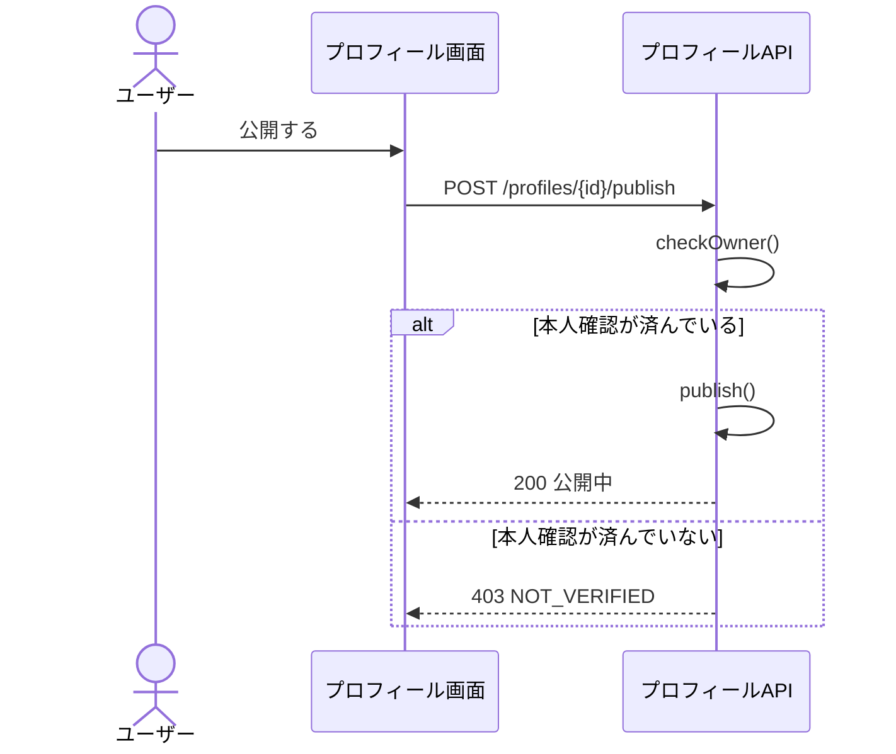
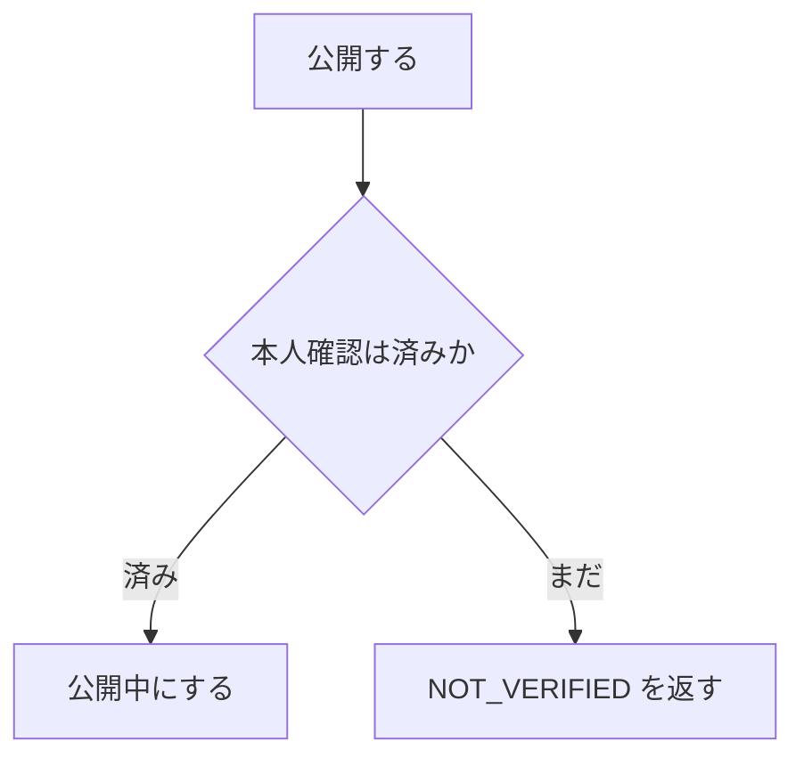
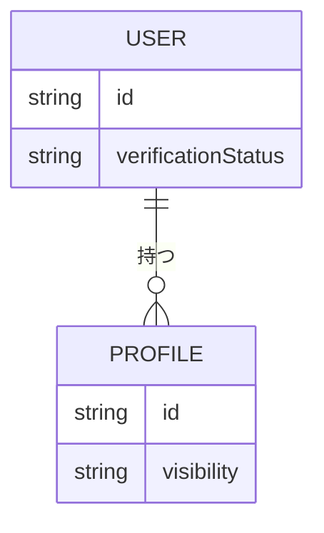
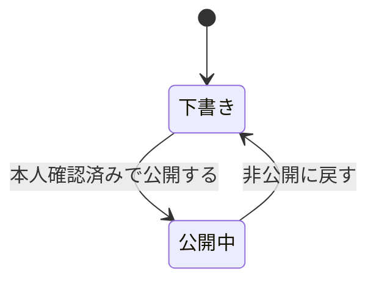

# 設計書テンプレート

人が読む設計書を、リポジトリで残すための型です。公開するときの名前は `design-doc-template` です。GitHub の Template repository として使います。

人が書くのは深さ3までです。それより細かい処理は、AIがコードを読んで扱います。

## 深さのルール

| 深さ | 何を書くか | 図 | 例 |
| --- | --- | --- | --- |
| 1 業務 | 誰が何を渡し、仕事がどこまで進むか | PlantUML のスイムレーン | 利用者が公開を依頼し、APIが公開中にする |
| 2 機能 | 画面とAPIのつながり | Mermaid のシーケンス図 | 画面が `POST /profiles/{id}/publish` を呼ぶ |
| 3 サービスメソッド | 1つの目的を持つ処理と、メソッド名 | `flow.puml` のアクティビティ図 | `checkOwner()` で本人確認を見る |

深さ3の文は、次の形にします。

> 公開中にする処理。見ている人にプロフィールを見せるのが目的。対応メソッドは `publish()`。

`if` の中の式や、SQLの1行は書きません。例として、確認済みかの判定そのものは `src/services/profile.ts` の `checkOwner()` を読めば足ります。

## 図の使い分け

基本は Mermaid です。スイムレーンだけ PlantUML の `|レーン名|` 形式にします。

| 見せたいもの | 図 | 記入例 |
| --- | --- | --- |
| 業務フロー | PlantUML のスイムレーン | [プロフィールを公開する](docs/business/index.md) |
| 処理の順番 | Mermaid のシーケンス図 | [公開APIの入口](apis/publish-profile/README.md) |
| 分かれ道 | Mermaid のフローチャート | この下の図 |
| データ | Mermaid の ER 図 | この下の図 |
| 状態 | Mermaid の状態遷移図 | この下の図 |

処理の順番の例です。画面がAPIを呼び、本人確認のあとで公開します。



分かれ道の例です。確認済みの人だけ公開中にします。



データの例です。利用者はプロフィールを複数持てます。



状態の例です。下書きから、確認済みの公開で公開中になります。



スイムレーンの書き方は次のとおりです。全文は [業務フロー](docs/business/プロフィールを公開する.puml) にあります。

```plantuml
|ユーザー|
start
:公開するボタンを押す;
|プロフィールAPI|
:本人確認が済んでいるか確認する;
```

### draw.io を使うとき

draw.io の差分は、レビューで追いにくいです。使う場合は次の2つを守ります。

- `.drawio` ファイルもリポジトリに入れる。
- PRに、変更前と変更後のスクリーンショットを貼る。

PlantUML と Mermaid で足りる図は、draw.io にしません。

## フォルダ

```text
README.md                         使い方、深さ、図の使い分け
用語集.md                         APIをまたいで使う言葉
docs/business/                    業務フロー（.puml と、変換した .svg）
apis/_template/                   新しいAPIを作るときにコピーする型
apis/publish-profile/             記入例。プロフィールを公開するAPI
decisions/                        決めたことと、捨てた案
mkdocs.yml                        読み物サイトの設定
mkdocs/docs/                      サイトが読む原稿へのリンク
.github/workflows/                図の変換、公開、変更履歴
.github/pull_request_template.md  PRの書き方
.vscode/                          ローカルプレビューの設定
scripts/                          ローカル変換と、履歴の追記
```

APIの入口は `apis/<名前>/README.md` です。概要、入力と結果、失敗するとき、各文書へのリンクを書きます。

処理詳細は、次の順で書きます。

1. 前提用語
2. 処理の概要
3. 処理のイメージ
4. 処理詳細
5. 入力と結果
6. 失敗するとき
7. コード（ファイルパス）

## 新しいAPIを追加する

`apis/_template` をコピーして、中身を埋めます。

```bash
cp -a apis/_template apis/予約を確定する
```

コピーした `変更履歴.md` は空の説明に戻します。型に付いている例の行は残しません。

記入例は [プロフィールを公開する](apis/publish-profile/README.md) です。本人確認が済んでいる人だけ、プロフィールを公開中にします。コードのパスは架空で、`src/services/profile.ts` です。

## ローカルプレビュー

図の変換は、自分のマシンと GitHub Actions の中だけで行います。PlantUML.com や Kroki には、図の中身を送りません。

### 1. 変換ツールを入れる

Java と Graphviz が必要です。日本語の図には、Noto CJK フォントがあると字形が揃います。

Ubuntu / Debian:

```bash
sudo apt-get install -y default-jre-headless graphviz fonts-noto-cjk
./scripts/install-plantuml.sh
```

macOS:

```bash
brew install --cask temurin
brew install graphviz
./scripts/install-plantuml.sh
```

`scripts/install-plantuml.sh` は、PlantUML 1.2026.10 の jar を `tools/plantuml.jar` に置きます。ダウンロードするのは変換ツールだけで、図のテキストは送りません。

SVGにするときは、次を実行します。

```bash
./scripts/render-puml.sh docs/business/プロフィールを公開する.puml
```

`.svg` は `.puml` と同じ場所にできます。

### 2. VS Code / Cursor で見る

推奨拡張は `.vscode/extensions.json` に書いてあります。

- PlantUML（`jebbs.plantuml`）
- Markdown Preview Enhanced（`shd101wyy.markdown-preview-enhanced`）

ワークスペース設定で、プレビューはローカル変換です。

- `plantuml.render` は `Local`、`plantuml.server` は空です。`.puml` を開いて `Alt+D`（Mac は `Option+D`）でプレビューします。
- Markdown Preview Enhanced の `plantumlServer` も空です。空のときだけ、`tools/plantuml.jar` を使います。ここに URL を書くと、図の中身がそのサーバーへ送られます。
- jar が見つからないときは、`markdown-preview-enhanced.plantumlJarPath` を `tools/plantuml.jar` の絶対パスに変えます。`scripts/install-plantuml.sh` が絶対パスを表示します。
- Kroki と WebSequenceDiagrams の送信先は `127.0.0.1:9` にしてあります。この2つの記法は使わないでください。

Mermaid は、Markdown Preview Enhanced のプレビューにそのまま出ます。

### 3. mkdocs serve で見る

読み物サイトは MkDocs Material です。Mermaid と、PlantUML から作った SVG を表示します。検索は日本語です。

```bash
python3 -m venv .venv
source .venv/bin/activate   # Windows は .venv\Scripts\activate
pip install -r requirements.txt
NO_MKDOCS_2_WARNING=1 mkdocs serve -a 127.0.0.1:8765
```

ブラウザで <http://127.0.0.1:8765> を開きます。`NO_MKDOCS_2_WARNING=1 mkdocs build --strict` で、リンク切れも確認できます。結果は `site/` に出ます。

MkDocs は、設定ファイルのあるフォルダ自体を原稿フォルダにできません。そのため `mkdocs/docs` から、このリポジトリの原稿へリンクしています。リンクが無いときは `./scripts/prepare-docs.sh` を実行します。Windows でリンクが実体にならないときは、同じスクリプトを実行します。

Material for MkDocs は 2027-05-05 まで保守されます。起動時の案内は、上の環境変数で消せます。

## 自動化

| いつ | 何をする |
| --- | --- |
| `.puml` を push したとき | Actions の中で SVG に変換し、同じ場所へコミットする |
| PRで図が変わったとき | 変換した SVG を PR コメントに画像で載せる。PRで足した・変えた部分は赤く描き、消したものは図の下に文字で並べる（個人トークンが無いときはリンクだけで、色は付かない） |
| `main` へマージしたとき | 変わった `apis/<名前>/変更履歴.md` に1行足す。追記したときだけ、サイト公開のワークフローを起動する |
| `main` へ push したとき、または手動で実行したとき | MkDocs Material を GitHub Pages へ公開する |
| PRを開いた・タイトルを変えたとき | タイトルが日本語で、`fix` などの接頭辞でないことを確認する |

PRコメントの赤い図は、`scripts/highlight-puml-diff.py` が作ります。比較元のブランチと PR の `.puml` を行ごとに比べ、足した・変えた行に色の指定を付けた一時コピーを、Actions の中で SVG にします。リポジトリにコミットする SVG は、ふだんの色のままです。

| 行の種類 | コメントの図でどうなるか |
| --- | --- |
| アクティビティ `:処理;`（複数行も） | 背景を薄い赤、枠を赤くする |
| 分岐・繰り返し `if` `elseif` `while` `repeat while` `switch` | ひし形を薄い赤にする |
| ノート `note right: …`、`note … end note` | ノートを薄い赤にする |
| 矢印 `-> ラベル;`、`A -> B : メッセージ` | 線とラベルを赤くする |
| 要素の宣言 `participant` `class` `component` など | 背景を薄い赤にする。クラスの中の行を変えたときは、クラスごと赤くする |
| `else` `endif` `start` `stop` スイムレーン `skinparam` `title` など | 色を付けない。コメントの「色を付けられなかった変更」に出す |

- 消した行は図に出せないため、「消したもの」として図の下に並べます。変えた行は「変えたもの（前 → 後）」にも出ます。
- 並べ替えただけの行（同じ文が比較元にも PR にもある行）は、足した・変えた・消したにしません。
- 新しい図は全体が新しいため、色を付けません。名前を変えた図も、新しい図と消した図として扱います。
- 図を消しただけの PR にも、「消した図」のコメントを付けます。
- `#pink :処理;` のような古い書き方の色は、赤くするときに外します。
- 色を付けると変換できない図は、警告を出して、ふだんの色で載せます。
- アーティファクトの PNG も、赤くした図です。

SVGのコミットメッセージには `[plantuml-svg]` が付きます。`GITHUB_TOKEN` による push は、次の workflow を起動しません。図の変換が無限に繰り返されないためです。

変更履歴の1行は、次の形です。日付は日本時間です。対象のAPIは、マージしたPRが触ったファイルだけを見て決めます。以前 main に入った変更は含めません。1行足して main に push できたときだけ、サイト公開のワークフローを起動します。

```text
2026-11-16 #12 公開時に本人確認を追加
```

作業ブランチでは、サイトを公開しません。Pages へ出すのは `main` だけです。公開は、`main` への push か、手動実行で動きます。

### 公開に必要な GitHub の設定

テンプレートからリポジトリを作ったあと、次を有効にします。

1. Settings → Actions → General → Workflow permissions を **Read and write permissions** にする。SVGと変更履歴のコミットに必要です。
2. Settings → Pages → Build and deployment → Source を **GitHub Actions** にする。
3. Settings → General → **Template repository** にチェックを入れる。
4. Settings → General → Pull Requests → Allow squash merging の既定メッセージを **Pull request title and description** にする。全コミット文が本文に入ると、bot のコミット文が混ざり、main の自動処理が止まることがあります。
5. 一人で使うリポジトリだけ、Settings → Secrets and variables → Actions に `PREVIEW_TOKEN` を登録する。中身は、このリポジトリだけを選んだ fine-grained の個人トークンで、権限は Contents と Pull requests の Read and write です。期限を付けます。
   - **共同編集者がいるリポジトリでは設定しません。** 書き込みできる人は、ワークフローを書き換えてこのトークンを外へ送れます。送られると、期限まであなたとして書き込まれます。
   - 図のコメントは、bot ではなくトークンの持ち主の名前で付きます。
   - 無い・期限切れのときは、警告を出して、図をリンクで載せます。

ブランチ保護で bot の push が拒否されるときは、`github-actions[bot]` の更新を許可します。

## やってはいけないこと

- 深さ3より細かいロジックを、設計書に写さない。
- 図の中身を、PlantUML.com や Kroki に送らない。
- PRタイトルを `fix` や `feat:` にしない。何をどう変えたかを日本語で書きます。例: `公開時に本人確認を追加`。
- draw.io を変えたのに、変更前と変更後のスクリーンショットを貼らない。

決めた理由と、捨てた案は [ADR 0000](decisions/0000-template.md) にあります。
