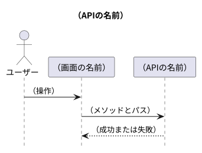

# （APIの名前）

（このAPIが何をするかを、1文書く。例: 本人確認が済んでいる人のプロフィールを、公開中にします。）

ソース: [入口.puml](入口.puml)

## 入力と結果

○＝必須、△＝条件付き必須、−＝任意

| 名前 | 必須 | 説明 |
| --- | --- | --- |
| （例: セッションの Cookie） | ○ | （例: ログイン時に付いた Cookie。ここから呼んだ人の利用者ID `user_123` を取る） |

成功したときの結果を1文書きます。例: 状態が公開中になり、`publishedAt` に日時が入ります。

## 失敗するとき

| コード | いつ | 結果 |
| --- | --- | --- |
| （例: NOT_VERIFIED） | （〜の場合。例: 持ち主だが、本人確認が済んでいない場合） | （HTTPステータスと結果。例: `403`。公開中にしない） |

## 関連リンク

- [用語](用語.md)
- [処理詳細](処理詳細.md)
- [入口の図](入口.puml)
- [処理のイメージ](flow.puml)
- [変更履歴](変更履歴.md)
- 共通の言葉は [用語集](../../用語集.md)

AI向け：書き方と補足

人向けは、何をするか1–2行、図、入力と結果、失敗するとき、関連リンクだけにします。AI向けの決まりと補足は、この details に書きます。`summary` は `AI向け：` で始めます。

これは深さ2です。画面とAPIのつながりだけを書きます。

入力と結果の表の「必須」列は、○（必須）、△（条件付き必須）、−（任意）で書きます。△ は `△（支払い方法がカードの場合）` のように、条件を横に書き切ります。× は使いません。凡例は表の上に1回だけ置きます。無いと `400` になる入力は、○ か △ にします。

図は PlantUML だけです。Mermaid は使いません。

（誰が、何を、どの状態に変えるかの補足があれば、ここに書きます。）

