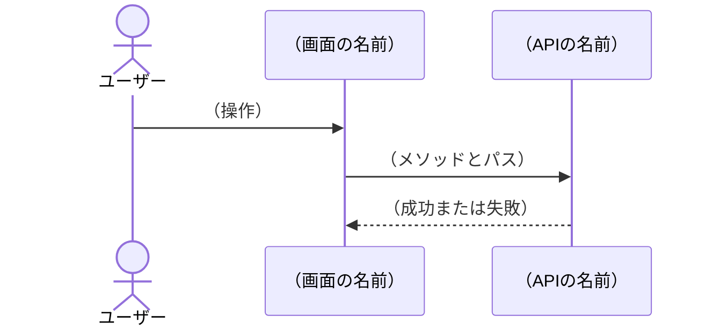

# （APIの名前）

（このAPIが何を達成するかを、1文書く。例: 本人確認が済んでいる人のプロフィールを、公開中にします。）

## 概要

（誰が、何を、どの状態に変えるかを書く。）

画面とAPIのつながり（深さ2）は、次のシーケンス図に書きます。

## 入力と結果

| 名前 | 必須 | 説明 |
| --- | --- | --- |
| （例: 利用者ID） | はい | （例: 公開する人。`user_123`） |

成功したときの結果を1文書きます。例: 状態が公開中になり、`publishedAt` に日時が入ります。

## 失敗するとき

| コード | いつ | 結果 |
| --- | --- | --- |
| （例: NOT_VERIFIED） | （例: 本人確認が済んでいない） | （例: 公開中にしない） |

## 各ドキュメント

- [用語](用語.md)
- [処理詳細](処理詳細.md)
- [処理のイメージ](flow.puml)
- [変更履歴](変更履歴.md)
- 共通の言葉は [用語集](../../用語集.md)
