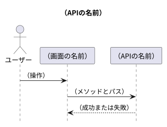
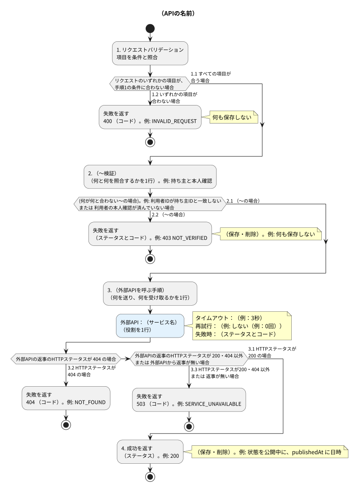

# （APIの名前）（設計書）

## 目次

- [概要](#概要)
- [説明](#説明)
- [エンドポイント](#エンドポイント)
- [メソッド](#メソッド)
- [リクエスト例](#リクエスト例)
- [レスポンス例](#レスポンス例)
- [処理フローの図](#処理フローの図)
- [処理詳細](#処理詳細)
    - [1. リクエストバリデーション](#1-リクエストバリデーション)
    - [2. （〜検証）](#2-検証)
    - [3. （外部APIを呼ぶ手順の例。呼ばないなら、この手順を消す）](#3-外部apiを呼ぶ手順の例呼ばないならこの手順を消す)
    - [4. 成功を返す](#4-成功を返す)

## 概要

（このAPIが何をするかを1文書く。例: 本人確認が済んでいる人のプロフィールを、公開中にします。）

## 説明

- 呼ぶのは、（画面や他のサービス）です。例: プロフィール画面。
- 決めたこと：（例: 本人確認が済んでいない人は、公開できない）
- 正にする場所：条件と結果、保存・削除は「処理詳細」の番号の手順が正です。外部APIの5項目は、呼ぶ手順の表が正です。
- このAPIの言葉は [用語](用語.md) にあります。共通の言葉は [用語集](../../用語集.md) にあります。
- 関連：[入口](README.md)、[変更履歴](変更履歴.md)

## エンドポイント

`（パス）`。例: `/profiles/{id}/publish`

## メソッド

`（HTTPメソッド）`。例: `POST`

## リクエスト例

○＝必須、△＝条件付き必須、−＝任意

| 項目 | 名前 | 位置 | 型 | 必須 | 説明 |
| --- | --- | --- | --- | --- | --- |
| （例: `Cookie`） | （例: セッションの Cookie） | （例: ヘッダー） | （例: 文字列） | ○ | （例: ログイン時に付いた Cookie。ここから呼んだ人の利用者ID `user_123` を取る） |
| （例: `id`） | （例: プロフィールID） | （例: パス） | （例: 文字列） | ○ | （例: `profile_456`） |

項目ごとの条件は、処理詳細の「1. リクエストバリデーション」に書きます。

```bash
curl -X POST https://api.example.com/profiles/profile_456/publish \
  -H "Cookie: session=session_789"
```

## レスポンス例

本文の形は例です。どの場合に返すかは、処理詳細の番号の手順に書きます。

成功（`200`、手順N）。

```json
{"status": "published", "publishedAt": "2026-11-16T18:00:00+09:00"}
```

主な失敗（例: `403`、手順2.2）。

```json
{"code": "NOT_VERIFIED"}
```

## 処理フローの図

画面とAPIのつながりです。



ソース: [入口.puml](入口.puml)

APIの中の手順です。番号は、下の処理詳細の番号と同じです。スイムレーンにはしません。



ソース: [flow.puml](flow.puml)

## 処理詳細

番号の手順が正です。各手順で、何と何を照合するかを書き、「N.M …の場合」に分けて、返すステータスとエラーコード、保存・削除、次に進む手順を書きます。メソッドの中の細かい分岐は書きません。

### 1. リクエストバリデーション

- 対応メソッド: `（methodName()）`
- コード: `src/services/（名前）.ts`

次の項目を、条件と照合します。

- （項目名）：（条件）。例: `id`：あること。`profile_` で始まる文字列であること

- 1.1 すべての項目が条件に合う場合：2. へ進む
- 1.2 どれかの項目が条件に合わない場合：400 エラー（（コード）。例: `INVALID_REQUEST`）を返す。何も保存しない

### 2. （〜検証）

- 対応メソッド: `（methodName()）`
- コード: `src/services/（名前）.ts`

（何を、何と照合するか。例: セッションの利用者IDをプロフィールの持ち主と照合し、本人確認が済んでいるかを見る。）

- 2.1 （〜の場合。例: 持ち主で、本人確認が済んでいる場合）：3. へ進む
- 2.2 （〜の場合。例: 持ち主だが、本人確認が済んでいない場合）：（ステータス）エラー（（コード）。例: `403`、`NOT_VERIFIED`）を返す。（保存・削除。例: 何も保存しない）

### 3. （外部APIを呼ぶ手順の例。呼ばないなら、この手順を消す）

- 対応メソッド: `（methodName()）`
- コード: `src/services/（名前）.ts`

（外部のサービスへ何を送り、何を受け取るか。例: 検索条件は利用者ID。取得する情報はメールアドレスと名前。）外部APIの5項目は、次の表が正です。図の付箋には、タイムアウト・再試行・失敗時の3項目だけを書きます。

| 外部API | 送る相手 | タイムアウト | 再試行 | 失敗時のステータスとエラーコード | 保存するもの |
| --- | --- | --- | --- | --- | --- |
| （例: メール送信サービス（例: SES）） | （例: 登録したメールアドレス） | （例：3秒） | （例: しない（例：0回）） | （例: `200` のまま。エラーコードは返さない） | （例: 何も保存しない） |

- 3.1 （HTTPステータスが 200 の場合）：（例: 取得した情報を持って 4. へ進む）
- 3.2 （HTTPステータスが 404 の場合）：（例: 404 エラー（`NOT_FOUND`）を返す）
- 3.3 （HTTPステータスが 200・404 以外、または返事が無い場合）：（例: 503 エラー（`SERVICE_UNAVAILABLE`）を返す）

### 4. 成功を返す

（返すステータスと、保存・削除。例: `200` を返す。保存：状態を公開中に、`publishedAt` に日時。本文の例は「レスポンス例」の成功にある。）
