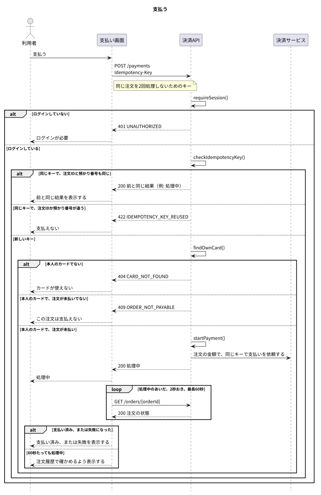

# 支払う

ログインしている利用者が、自分で登録したカードで注文の支払いを始めます。**同じ注文の支払いを2回押しても、2回は請求しません**。受け付けた場合の応答は「処理中」で、確定は決済サービスの通知のあとです。支払額は、画面からは受け取らず、サーバーが注文から決めます。

二重請求を防ぐのは、ヘッダーの `Idempotency-Key`（画面が注文ごとに作る UUID）です。同じキーで中身が違えば、`422 IDEMPOTENCY_KEY_REUSED` にします。決済サービスへも、同じキーを渡します。

支払い済みまたは失敗になるのは、[決済の結果を受け取る](../payment-webhook/README.md) で、通知の署名検証と注文照合検証が通ったときです。**画面は [注文の状態を見る](../get-order/README.md) を2秒おきに呼び、結果を表示します**。60秒たっても処理中なら、「60秒たっても処理中です。注文履歴で結果を見てください」と表示します。注文履歴の画面とAPIは、まだ載せていません。途中で `401` が返ったら、呼ぶのをやめてログイン画面へ移ります。`404` が返ったら、やめて「注文を表示できません」と表示します。

ソース: [入口.puml](入口.puml)

## 入力と結果

| 名前 | 必須 | 説明 |
| --- | --- | --- |
| セッションの Cookie | はい | ログイン時に付いた Cookie。例: `session_789` |
| 注文ID | はい | 支払う注文。例: `order_5001` |
| 預かり番号 | はい | 本人が登録したカード。例: `pm_1A2b3C` |
| Idempotency-Key | はい | 画面が注文ごとに作る UUID。HTTP ヘッダーで送ります |

成功すると、注文の状態は 未払い から 処理中 になります。決済サービスが依頼を断った場合は、注文がまだ処理中なら未払いに戻して `402` を返します。支払い済みや失敗になっていれば変えません。返事が無い場合は、注文を処理中のまま残して `502` を返します。決済サービスが実は請求していたかもしれないので、未払いに戻さず、通知を待ちます。既に支払い済みの注文へ、新しい請求はしません。

`Idempotency-Key` は、利用者ごとに分けて保存します。保存期間は、最初に受け取ってから24時間です。保存するかどうかは、結果で分かれます。

- キーと結果を保存する場合: `200` 処理中、`402 PAYMENT_DECLINED`、`502 PAYMENT_PROVIDER_ERROR`（結果は処理中として保存）
- キーを保存しない場合: `400`、`401`、`404`、`409`、`422`

- 同じキーで、注文ID と預かり番号も同じ場合: 前の結果（`200` の処理中、または `402` の `PAYMENT_DECLINED`）をそのまま返す。`502` のあとは `200` の処理中を返し、決済サービスへ依頼し直さない
- 同じキーで、注文ID または預かり番号が違う場合: `IDEMPOTENCY_KEY_REUSED`

例: キー `K` で `order_5001` を払ったあと、同じ `K` で `order_5002` を送ると、`422 IDEMPOTENCY_KEY_REUSED` になります。

## 失敗するとき

| コード | いつ | 結果 |
| --- | --- | --- |
| UNAUTHORIZED | セッションの Cookie が無い、または無効な場合 | `401`。支払いを始めない。何も保存しない |
| MISSING_IDEMPOTENCY_KEY | ヘッダーに `Idempotency-Key` が無い場合 | `400`。支払いを始めない。何も保存しない |
| IDEMPOTENCY_KEY_REUSED | 同じキーで、注文ID または預かり番号が前と違う場合 | `422`。支払いを始めない。何も保存しない |
| CARD_NOT_FOUND | 預かり番号が、本人が登録したカードでない場合 | `404`。支払いを始めない。キーも含め、何も保存しない。他人のカードか、無いカードかは区別しない |
| ORDER_NOT_PAYABLE | 注文が無い、処理中・支払い済み・失敗のどれか、または他人の注文の場合 | `409`。支払いを始めない。キーも含め、何も保存しない |
| PAYMENT_DECLINED | 決済サービスが依頼を断った場合（カードが使えない など） | `402`。注文がまだ処理中なら未払いに戻す（支払い済みや失敗になっていれば変えない）。キーと結果を保存し（例：24時間）、同じキーなら同じ `402` を返す。別のカードでやり直すときは、画面が新しいキーを作る |
| PAYMENT_PROVIDER_ERROR | 決済サービスから返事が無い、または通信に失敗した場合（例：10秒で打ち切る） | `502`。注文は処理中のまま残す。キーと結果（処理中）を保存する（例：24時間）。同じキーなら `200` 処理中を返し、決済サービスへ依頼し直さない。新しいキーなら `409 ORDER_NOT_PAYABLE`。画面は処理中と同じく状態を取りに行く。通知が例：30分来なければ、運用者へ警告する |

## 関連リンク

- [用語](用語.md)
- [処理詳細](処理詳細.md)
- [入口の図](入口.puml)
- [処理のイメージ](flow.puml)
- [変更履歴](変更履歴.md)
- [カードを登録する](../register-card/README.md)
- [注文の状態を見る](../get-order/README.md)
- [決済の結果を受け取る](../payment-webhook/README.md)
- [カードで支払う](../../docs/business/カードで支払う/README.md)
- 共通の言葉は [用語集](../../用語集.md)

AI向け：書き方と補足

これは深さ2です。画面とAPIのつながりだけを書きます。

- 同じボタンを2回押されても、同じ `Idempotency-Key` なら決済サービスへも同じキーを渡し、二重に請求しません。
- キーは「利用者ID＋キー」で保存します。他の利用者が同じ値を送っても、前の結果は返しません。
- 保存するのは、注文ID と預かり番号です。比べるのもこの2つです。
- 24時間を過ぎたキーは、新しいキーとして扱います。その注文が処理中・支払い済み・失敗なら、`ORDER_NOT_PAYABLE` で止まります。
- 預かり番号は、本人が [カードを登録する](../register-card/README.md) で登録したものだけ使えます。他人の `pm_...` は、無い番号と同じ `CARD_NOT_FOUND`（`404`）にします。他人がどんなカードを登録しているかを探られないためです。カード登録は、画面が決済サービスからいま受け取った番号を送るので、`403` で「登録できない」と返しています。
- 支払額は、リクエストに含めません。サーバーが注文の金額と通貨から決め、決済サービスへ渡します。
- 失敗した注文は、この画面からやり直しません（`ORDER_NOT_PAYABLE`）。遅れて届いた、注文ID・金額・通貨が合う成功の通知だけが、失敗から支払い済みに進めます。
- このAPIでは注文を支払い済みにしません。確定は通知側です。
- 例：`402 PAYMENT_DECLINED`、`502 PAYMENT_PROVIDER_ERROR`、10秒の打ち切り、30分で警告は、例として決めた値です。
- `502` で注文を未払いに戻さないのは、二重請求を防ぐためです。未払いに戻すと、新しいキーの依頼が通り、決済サービスは別の依頼として、もう一度請求します。処理中のままなら、新しいキーでも `409 ORDER_NOT_PAYABLE` で止まります。
- `502` のあとは、[決済の結果を受け取る](../payment-webhook/README.md) の通知で、支払い済みか失敗になります。通知が例：30分来なければ、運用者へ警告し、人が決済サービスの記録を見て直します。
- 無い注文と他人の注文も、`404` ではなく `409 ORDER_NOT_PAYABLE` にまとめます。支払えない理由を区別して返さないためです。[注文の状態を見る](../get-order/README.md) は読むだけのAPIなので、同じ条件を `404 ORDER_NOT_FOUND` にしています。

