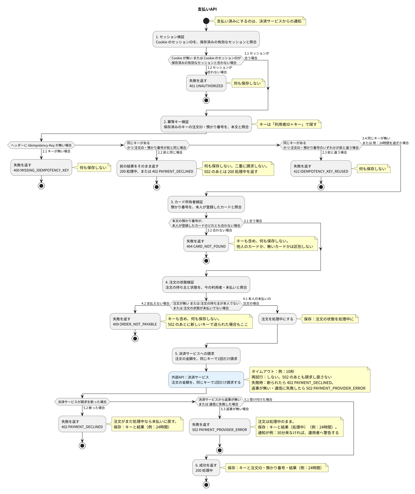

# 処理詳細

## 目次

- [前提用語](#前提用語)
- [処理の概要](#処理の概要)
- [処理のイメージ](#処理のイメージ)
- [処理詳細](#処理詳細-1)
    - [1. セッション検証。リクエストの Cookie を、保存済みの有効なセッションと照合する。ログインした人だけ次へ進めるのが目的](#1-セッション検証リクエストの-cookie-を保存済みの有効なセッションと照合するログインした人だけ次へ進めるのが目的)
    - [2. 冪等キー検証。保存済みのキーと、注文ID・預かり番号を照合する。二重に請求しないのが目的](#2-冪等キー検証保存済みのキーと注文id預かり番号を照合する二重に請求しないのが目的)
    - [3. カード所有者検証。預かり番号を、本人が登録したカードと照合する。他人のカードで払わせないのが目的](#3-カード所有者検証預かり番号を本人が登録したカードと照合する他人のカードで払わせないのが目的)
    - [4. 注文の状態検証と支払いの開始。注文の持ち主と状態を、今の利用者・未払いと照合する。決済サービスへ一度だけ依頼するのが目的](#4-注文の状態検証と支払いの開始注文の持ち主と状態を今の利用者未払いと照合する決済サービスへ一度だけ依頼するのが目的)
- [入力と結果](#入力と結果)
- [失敗するとき](#失敗するとき)
- [コード（ファイルパス）](#コードファイルパス)

## 前提用語

このAPIの言葉は [用語](用語.md) にあります。利用者、セッション、決済サービス、預かり番号、注文の状態、Idempotency-Key は [用語集](../../用語集.md) にあります。

## 処理の概要

ログインしている利用者だけ、自分で登録したカードで支払いを始められます。同じ `Idempotency-Key` で同じ中身なら前の結果を返し、二重に請求しません。中身が違えばエラーにします。決済サービスが受け付けた場合と、返事が無い場合の状態は処理中です。断られた場合（`402`）は、まだ処理中の場合だけ未払いに戻します。通知で先に支払い済みや失敗になっていれば変えません。未払いの注文に、注文ID・金額・通貨が合う成功の通知が来た場合は、[決済の結果を受け取る](../payment-webhook/処理詳細.md) が支払い済みにして運用者へ警告します。支払い済みになるのは、決済サービスからの通知を受け取ったときです。画面は [注文の状態を見る](../get-order/README.md) で結果を取りに行きます。

## 処理のイメージ

ソース: [flow.puml](flow.puml)

## 処理詳細

### 1. セッション検証。リクエストの Cookie を、保存済みの有効なセッションと照合する。ログインした人だけ次へ進めるのが目的

- 対応メソッド: `requireSession()`
- コード: `src/services/auth.ts`

リクエストの Cookie を、保存済みの有効なセッションと比べます。Cookie が無い、合わない、または無効（例：ログインから24時間を過ぎた）の場合は `UNAUTHORIZED`（`401`）を返し、支払いは始めません。何も保存しません。

### 2. 冪等キー検証。保存済みのキーと、注文ID・預かり番号を照合する。二重に請求しないのが目的

- 対応メソッド: `checkIdempotencyKey()`
- コード: `src/services/payment.ts`

ヘッダーの `Idempotency-Key` を見ます。キーが無ければ `MISSING_IDEMPOTENCY_KEY`（`400`）を返します。何も保存しません。

キーは「利用者ID＋キー」で探します。他の利用者の同じキーとは混ざりません。保存期間は、最初に受け取ってから24時間です。

- 同じキーがあり、注文ID と預かり番号も同じ場合: 前の結果（`200` の処理中、または `402` の `PAYMENT_DECLINED`）をそのまま返す。新たに請求しない。何も保存しない。`502` のあとは、保存した結果（処理中）から `200` の処理中を返し、決済サービスへ依頼し直さない
- 同じキーがあり、注文ID または預かり番号が違う場合: `IDEMPOTENCY_KEY_REUSED`（`422`）を返す。何も保存せず、状態は変えない
- 同じキーが無い、または24時間を過ぎた場合: 新しい依頼として次へ進む

### 3. カード所有者検証。預かり番号を、本人が登録したカードと照合する。他人のカードで払わせないのが目的

- 対応メソッド: `findOwnCard()`
- コード: `src/services/payment.ts`

預かり番号を、その利用者が [カードを登録する](../register-card/README.md) で保存した番号と比べます。違えば `CARD_NOT_FOUND`（`404`）を返します。他人のカードか、無いカードかは区別しません。キーも含め、何も保存しません。同じキーで正しい預かり番号を送り直せば、新しい依頼として扱います。

### 4. 注文の状態検証と支払いの開始。注文の持ち主と状態を、今の利用者・未払いと照合する。決済サービスへ一度だけ依頼するのが目的

- 対応メソッド: `startPayment()`
- コード: `src/services/payment.ts`

本人の注文で未払いなら、状態を処理中にして保存し、決済サービスへ同じキーで依頼します。支払額は、画面からは受け取りません。サーバーが注文の金額と通貨から決めます。決済サービスの返事で、次のように分かれます。

- 依頼を受け付けた場合: `200` で処理中を返す。キーと注文ID・預かり番号・結果を保存する（例：24時間）。支払い済みにはしない
- 依頼を断った場合（カードが使えない など）: `PAYMENT_DECLINED`（`402`）を返す。注文がまだ処理中の場合だけ未払いに戻す。支払い済みや失敗になっていれば変えない。キーと結果を保存する（例：24時間）。同じキーで送り直すと、同じ `402` を返す。別のカードでやり直すときは、画面が新しいキーを作る
- 返事が無い、または通信に失敗した場合（例：返事を10秒待って打ち切る）: `PAYMENT_PROVIDER_ERROR`（`502`）を返す。注文は処理中のまま残す。キーと結果（処理中）を保存する（例：24時間）。同じキーで送り直すと `200` 処理中を返し、決済サービスへ依頼し直さない。新しいキーなら、注文が処理中なので `ORDER_NOT_PAYABLE`（`409`）になる。画面は処理中と同じく、注文の状態を取りに行く

`502` で未払いに戻さないのは、二重請求を防ぐためです。決済サービスが実は請求していた場合、未払いに戻すと、新しいキーの依頼でもう一度請求されます。処理中のまま止まらないように、通知が例：30分来なければ、運用者へ警告します。

注文が無い、処理中、支払い済み、失敗、他人の注文、のときは `ORDER_NOT_PAYABLE`（`409`）を返します。キーも含め、何も保存しません。既に支払い済みや失敗の注文へ、新しい請求はしません。失敗した注文を、画面からやり直すことはありません。遅れて届いた、注文ID・金額・通貨が合う成功の通知だけが、失敗から支払い済みに進めます（[決済の結果を受け取る](../payment-webhook/処理詳細.md)）。

## 入力と結果

| 入力 | 結果 | 保存・削除 |
| --- | --- | --- |
| セッション `session_789` が有効で、本人の未払いの注文 `order_5001`（19800円）、本人の預かり番号 `pm_1A2b3C`、新しいキー `K` の場合 | `200`。応答は処理中。決済サービスへ、19800円を同じキーで依頼し、受け付けられた | 保存：注文の状態を処理中に。キー `K` と注文ID・預かり番号・結果（例：24時間） |
| 上と同じキー `K` で、同じ注文と預かり番号をもう一度送った場合 | 前の結果（`200` の処理中）をそのまま返す。新たに請求しない | 何も保存しない |
| `502` のあと、同じキー `K` で、同じ注文と預かり番号をもう一度送った場合 | `200` の処理中を返す。決済サービスへ依頼し直さない | 何も保存しない |
| `502` のあと、新しいキー `K2` で同じ注文を送った場合 | `ORDER_NOT_PAYABLE`（`409`）。注文が処理中のため。新たに請求しない | 何も保存しない。キーも保存しない |

## 失敗するとき

| 条件 | 結果 | 保存・削除 |
| --- | --- | --- |
| セッションの Cookie が無い、または無効な場合 | `UNAUTHORIZED`（`401`）。支払いを始めない | 何も保存しない |
| `Idempotency-Key` が無い場合 | `MISSING_IDEMPOTENCY_KEY`（`400`）。状態は変えない | 何も保存しない |
| 同じキー `K` で、注文ID または預かり番号が前と違う場合。例: `order_5002` を送った | `IDEMPOTENCY_KEY_REUSED`（`422`）。前の結果は返さない | 何も保存しない |
| 新しいキーで、他人の預かり番号、または無い預かり番号の場合 | `CARD_NOT_FOUND`（`404`）。新たに請求しない | 何も保存しない。キーも保存しない |
| 新しいキーで、本人のカードだが、注文が無い、他人の注文、または処理中・支払い済み・失敗のどれかの場合 | `ORDER_NOT_PAYABLE`（`409`）。新たに請求しない | 何も保存しない。キーも保存しない |
| 本人の未払いの注文で、決済サービスが依頼を断った場合（カードが使えない など） | `PAYMENT_DECLINED`（`402`） | 保存：注文がまだ処理中なら、状態を未払いに戻す（支払い済みや失敗になっていれば変えない）。キーと結果（例：24時間） |
| 本人の未払いの注文で、決済サービスから返事が無い、または通信に失敗した場合（例：10秒で打ち切る） | `PAYMENT_PROVIDER_ERROR`（`502`）。同じキーなら `200` 処理中、新しいキーなら `409`。通知が例：30分来なければ運用者へ警告する | 保存：キーと結果（処理中）（例：24時間）。注文は処理中のまま |

## コード（ファイルパス）

- `src/services/auth.ts` の `requireSession()`
- `src/services/payment.ts` の `checkIdempotencyKey()`
- `src/services/payment.ts` の `findOwnCard()`
- `src/services/payment.ts` の `startPayment()`

この4つのメソッドより細かい分岐は、設計書には書きません。実装は、上のコードを読んで判断します。
