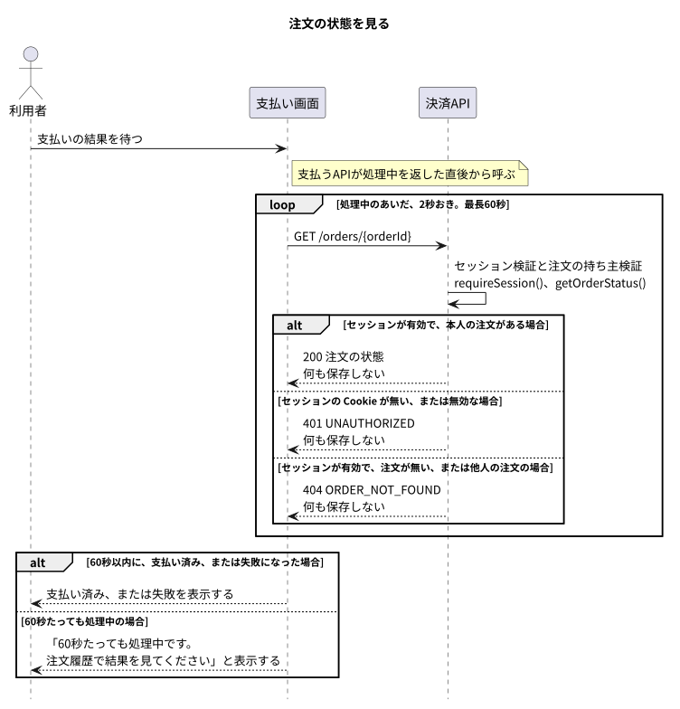

# 注文の状態を見る

ログインしている利用者に、自分の注文の状態（未払い、処理中、支払い済み、失敗のどれか）と金額を返します。支払い画面は、[支払う](../create-payment/README.md) が処理中か `502` を返したあと、このAPIを2秒おきに呼びます。支払い済みか失敗になったら、結果を表示します。

ソース: [入口.puml](入口.puml)

## 入力と結果

○＝必須、△＝条件付き必須、−＝任意

| 名前 | 必須 | 説明 |
| --- | --- | --- |
| セッションの Cookie | ○ | ログイン時に付いた Cookie。例: `session_789` |
| 注文ID | ○ | 見たい注文。例: `order_5001` |

成功すると、注文の状態が返ります。例: `order_5001`、支払い済み、19800円。

画面が呼ぶのは最長60秒です。60秒たっても処理中なら、呼ぶのをやめ、「60秒たっても処理中です。注文履歴で結果を見てください」と表示します。注文履歴の画面とAPIは、このテンプレートにはまだ載せていません。

途中で失敗が返ったときも、呼ぶのをやめます。

- `401` の場合: ログイン画面へ移る
- `404` の場合: 「注文を表示できません」と表示する

## 失敗するとき

| コード | いつ | 結果 |
| --- | --- | --- |
| UNAUTHORIZED | セッションの Cookie が無い、または無効な場合 | `401`。状態を返さない。何も保存しない。画面は呼ぶのをやめ、ログイン画面へ移る |
| ORDER_NOT_FOUND | 注文が無い、または他人の注文の場合 | `404`。状態を返さない。何も保存しない。画面は呼ぶのをやめ、「注文を表示できません」と表示する |

## 関連リンク

- [用語](用語.md)
- [処理詳細](処理詳細.md)
- [入口の図](入口.puml)
- [処理のイメージ](flow.puml)
- [変更履歴](変更履歴.md)
- [支払う](../create-payment/README.md)
- [決済の結果を受け取る](../payment-webhook/README.md)
- [カードで支払う](../../docs/business/カードで支払う/README.md)
- 共通の言葉は [用語集](../../用語集.md)

AI向け：書き方と補足

これは深さ2です。画面とAPIのつながりだけを書きます。

- このAPIは読むだけです。注文の状態は変えません。状態を変えるのは、[支払う](../create-payment/README.md) と [決済の結果を受け取る](../payment-webhook/README.md) だけです。
- 決済の通知はサーバーにしか届きません。画面が結果を知る手段は、このAPIです。
- 例：2秒おき、最長60秒は、例として決めた値です。
- 他人の注文は、無い注文と同じ `ORDER_NOT_FOUND` にします。

