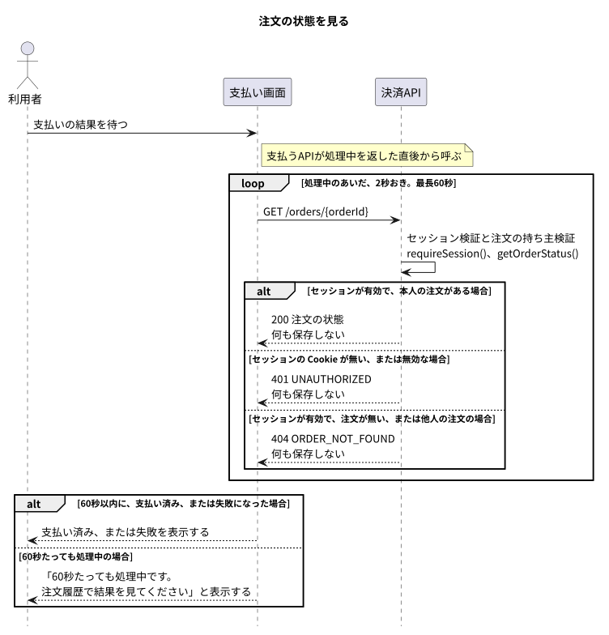
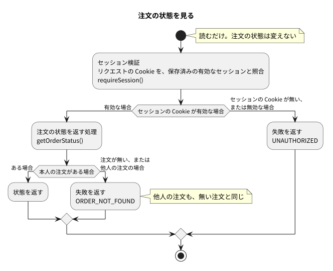

# 注文の状態を見る（設計書）

## 目次

- [概要](#概要)
- [説明](#説明)
- [エンドポイント](#エンドポイント)
- [メソッド](#メソッド)
- [リクエスト例](#リクエスト例)
- [レスポンス例](#レスポンス例)
- [処理フローの図](#処理フローの図)
- [処理詳細](#処理詳細)
    - [1. セッション検証](#1-セッション検証)
    - [2. 注文の持ち主検証](#2-注文の持ち主検証)
    - [3. 成功を返す](#3-成功を返す)

## 概要

ログインしている利用者に、自分の注文の状態（未払い、処理中、支払い済み、失敗のどれか）と金額を返します。

## 説明

- 呼ぶのは、支払い画面です。[支払う](../create-payment/README.md) が処理中か `502` を返したあと、例：2秒おきに、最長で例：60秒呼びます。
    - 支払い済みか失敗になったら、呼ぶのをやめて結果を表示します。
    - 例：60秒たっても処理中なら、呼ぶのをやめ、例：「60秒たっても処理中です。注文履歴で結果を見てください」と表示します。注文履歴の画面とAPIは、このテンプレートにはまだ載せていません。
    - `401` が返ったら、呼ぶのをやめてログイン画面へ移ります。`404` が返ったら、呼ぶのをやめて「注文を表示できません」と表示します。
- 決めたこと：
    - このAPIは読むだけです。注文の状態は変えません。状態を変えるのは、[支払う](../create-payment/README.md) と [決済の結果を受け取る](../payment-webhook/README.md) だけです。
    - 決済の通知はサーバーにしか届きません。画面が結果を知る手段は、このAPIです。
    - 他人の注文は、無い注文と同じ `ORDER_NOT_FOUND` にします。
- このAPIで使う言葉（利用者、セッション、注文の状態）は、[用語集](../../用語集.md) にあります。
- 関連：[入口](README.md)、[変更履歴](変更履歴.md)、業務フロー [カードで支払う](../../docs/business/カードで支払う/README.md)

## エンドポイント

`/orders/{orderId}`

ホストは環境ごとに変わります。例: `https://api.example.com`。

## メソッド

`GET`

## リクエスト例

○＝必須、△＝条件付き必須、−＝任意

| 項目 | 名前 | 位置 | 型 | 必須 | 説明 |
| --- | --- | --- | --- | --- | --- |
| `Cookie` | セッションの Cookie | ヘッダー | 文字列 | ○ | ログイン時に付いた Cookie。例: `session=session_789` |
| `orderId` | 注文ID | パス | 文字列 | ○ | 見たい注文。例: `order_5001` |

```bash
curl https://api.example.com/orders/order_5001 \
  -H "Cookie: session=session_789"
```

## レスポンス例

本文の形は例です。

成功（`200`、手順3）。

```json
{"orderId": "order_5001", "status": "paid", "amount": 19800, "currency": "JPY"}
```

セッションの Cookie が無い または 保存済みの有効なセッションと合わない（`401`、手順1.2）。

```json
{"code": "UNAUTHORIZED"}
```

パスの注文IDの注文が無い または その注文の利用者IDがセッションの利用者IDと一致しない（`404`、手順2.2）。

```json
{"code": "ORDER_NOT_FOUND"}
```

## 処理フローの図

画面とAPIのつながりです。



APIの中の手順です。



## 処理詳細

### 1. セッション検証

- リクエストの Cookie のセッションIDを、保存済みの有効なセッションと照合する
- 1.1 Cookie のセッションIDが、保存済みの有効なセッションと合う場合
    - 手順2へ進む
- 1.2 Cookie が無い または Cookie のセッションIDが保存済みの有効なセッションと合わない場合
    - 401 エラー（`UNAUTHORIZED`）を返す。状態は返さない
    - 保存も削除もしない
    - 例：有効なセッションは、ログインから24時間

### 2. 注文の持ち主検証

- パスの注文IDで注文を探し、その注文の利用者IDを、セッションの利用者IDと照合する
- 2.1 パスの注文IDの注文がある かつ その注文の利用者IDがセッションの利用者IDと一致する場合
    - 手順3へ進む
- 2.2 パスの注文IDの注文が無い または その注文の利用者IDがセッションの利用者IDと一致しない場合
    - 404 エラー（`ORDER_NOT_FOUND`）を返す。状態は返さない。無いのか他人のものかは区別しない
    - 保存も削除もしない

### 3. 成功を返す

- `200` を返し、注文ID、状態、金額を本文に入れる
    - 例: `order_5001`、支払い済み、19800円
    - 保存も削除もしない
