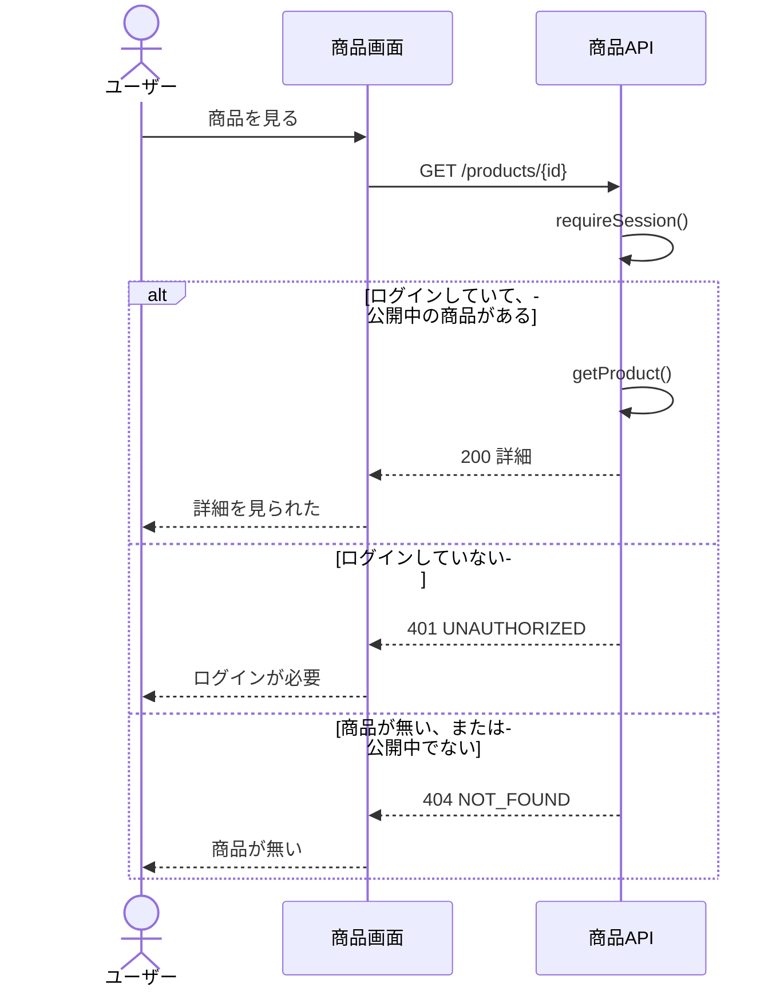

# 商品詳細を取得する

ログインしている利用者に、公開中の商品の詳細を返します。

## 入力と結果

| 名前 | 必須 | 説明 |
| --- | --- | --- |
| セッションID | はい | 今ログインしている印。例: `session_789` |
| 商品ID | はい | 見たい商品。例: `product_1001` |

成功すると、その商品の詳細が返ります。例: 名前「木製デスク」、価格 19800円、在庫 12。

## 失敗するとき

| コード | いつ | 結果 |
| --- | --- | --- |
| UNAUTHORIZED | ログインしていない | 詳細を返さない |
| NOT_FOUND | 商品が無い、または公開中でない | 詳細を返さない |

## 関連リンク

- [用語](用語.md)
- [処理詳細](処理詳細.md)
- [処理のイメージ](flow.puml)
- [変更履歴](変更履歴.md)
- [ログインして商品を探す](../../docs/business/ログインして商品を探す/README.md)
- 共通の言葉は [用語集](../../用語集.md)

AI向け：書き方と補足

これは深さ2です。画面とAPIのつながりだけを書きます。

ログインしていなければ返しません。公開中でなければ、無いときと同じ結果です。

