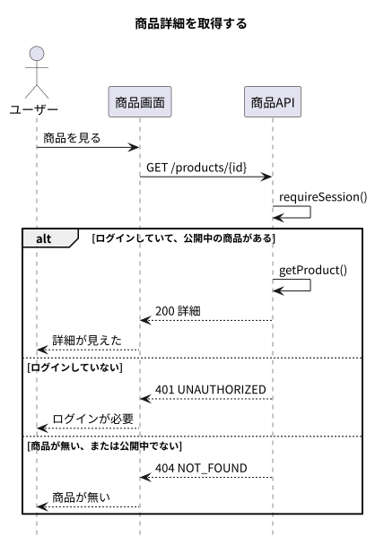
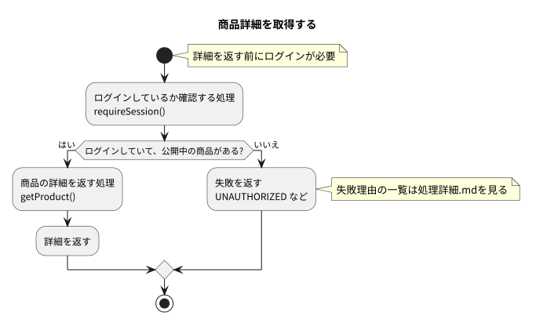

# 商品詳細取得API

## 目次

- [概要](#概要)
- [説明](#説明)
- [エンドポイント](#エンドポイント)
- [メソッド](#メソッド)
- [リクエスト例](#リクエスト例)
- [レスポンス例](#レスポンス例)
- [処理フローの図](#処理フローの図)
- [処理詳細](#処理詳細)
    - [1. セッション検証](#1-セッション検証)
    - [2. 公開状態の検証](#2-公開状態の検証)
    - [3. 成功を返す](#3-成功を返す)

## 概要

ログインしている利用者に、公開中の商品の詳細（名前、価格、在庫）を返します。

## 説明

- 呼ぶのは、商品画面です。
- 決めたこと：
    - 公開中でない商品は、無い商品と同じ `NOT_FOUND` にします。
    - このAPIは読むだけです。どの場合も、保存も削除もしません。
- このAPIで使う言葉（利用者、セッション、商品、在庫、公開中の商品）は、[用語集](../../用語集.md) にあります。
- 関連：[入口](README.md)、[変更履歴](変更履歴.md)

## エンドポイント

`/products/{id}`

## メソッド

`GET`

## リクエスト例

○＝必須、△＝条件付き必須、−＝任意

| 項目 | 名前 | 位置 | 型 | 必須 | 説明 |
| --- | --- | --- | --- | --- | --- |
| `Cookie` | セッションの Cookie | ヘッダー | 文字列 | ○ | ログイン時に付いた Cookie。例: `session=session_789` |
| `id` | 商品ID | パス | 文字列 | ○ | 見たい商品。例: `product_1001` |

```bash
curl https://api.example.com/products/product_1001 \
  -H "Cookie: session=session_789"
```

## レスポンス例

成功（`200`、手順3）。

```json
{"id": "product_1001", "name": "木製デスク", "price": 19800, "stock": 12}
```

セッションの Cookie が無い または 保存済みの有効なセッションと合わない（`401`、手順1.2）。

```json
{"code": "UNAUTHORIZED"}
```

パスの商品IDの商品が無い または その商品の状態が公開中でない（`404`、手順2.2）。

```json
{"code": "NOT_FOUND"}
```

## 処理フローの図



APIの中の手順です。



## 処理詳細

### 1. セッション検証

- リクエストの Cookie のセッションIDを、保存済みの有効なセッションと照合する
- 1.1 Cookie のセッションIDが、保存済みの有効なセッションと合う場合
    - 手順2へ進む
- 1.2 Cookie が無い または Cookie のセッションIDが保存済みの有効なセッションと合わない場合
    - 401 エラー（`UNAUTHORIZED`）を返す。詳細は返さない
    - 保存も削除もしない
    - 例：有効なセッションは、ログインから24時間

### 2. 公開状態の検証

- パスの商品IDで商品を探し、その商品の状態を公開中と照合する
- 2.1 パスの商品IDの商品がある かつ その商品の状態が公開中の場合
    - 手順3へ進む
- 2.2 パスの商品IDの商品が無い または その商品の状態が公開中でない場合
    - 404 エラー（`NOT_FOUND`）を返す。詳細は返さない。無いのか公開中でないのかは区別しない
    - 保存も削除もしない

### 3. 成功を返す

- `200` を返し、商品の名前、価格、在庫を本文に入れる
    - 例: 商品ID `product_1001`、名前「木製デスク」、価格 19800円、在庫 12
    - 保存も削除もしない
