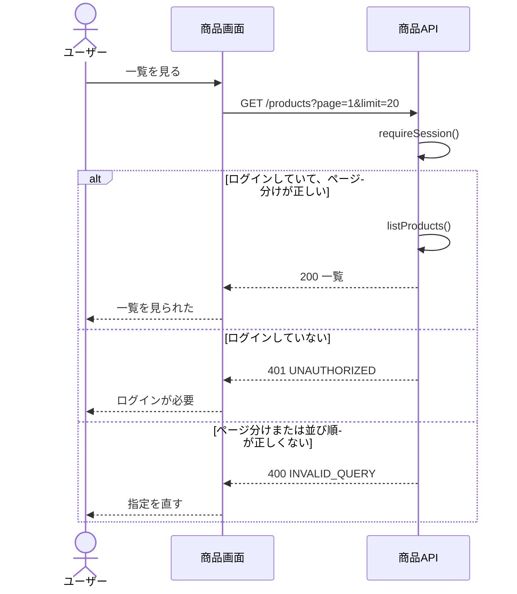

# 商品一覧を取得する

ログインしている利用者に、公開中の商品の一覧を、ページに分けて返します。

## 入力と結果

| 名前 | 必須 | 説明 |
| --- | --- | --- |
| セッションID | はい | 今ログインしている印。例: `session_789` |
| page | いいえ | 何ページ目か。既定は `1`。決まりは [ページ分け](../../用語集.md) |
| limit | いいえ | 1ページの件数。既定は `20`。上限は `100`。決まりは [ページ分け](../../用語集.md) |
| sort | いいえ | 並びのキー。既定は `created_at`。決まりは [並び順](../../用語集.md) |
| order | いいえ | 昇順か降順か。既定は `desc`。決まりは [並び順](../../用語集.md) |

成功すると、公開中の商品の一覧が返ります。例: 全120件のうち、1件目から20件目。0件のときも、指定したページが最後より後ろのときも、空の一覧です。

## 失敗するとき

| コード | いつ | 結果 |
| --- | --- | --- |
| UNAUTHORIZED | ログインしていない | 一覧を返さない |
| INVALID_QUERY | ページ分けまたは並び順が正しくない | 一覧を返さない |

## 関連リンク

- [用語](用語.md)
- [処理詳細](処理詳細.md)
- [処理のイメージ](flow.puml)
- [変更履歴](変更履歴.md)
- [ログインして商品を探す](../../docs/business/ログインして商品を探す/README.md)
- 共通の言葉は [用語集](../../用語集.md)

AI向け：書き方と補足

これは深さ2です。画面とAPIのつながりだけを書きます。

ログインしていて、ページ分けが正しければ、公開中の商品の一覧を返します。0件のときも成功です。同じ日時や同じ価格のときは、商品IDの昇順です。並び順の決まりは [並び順](../../用語集.md) です。

