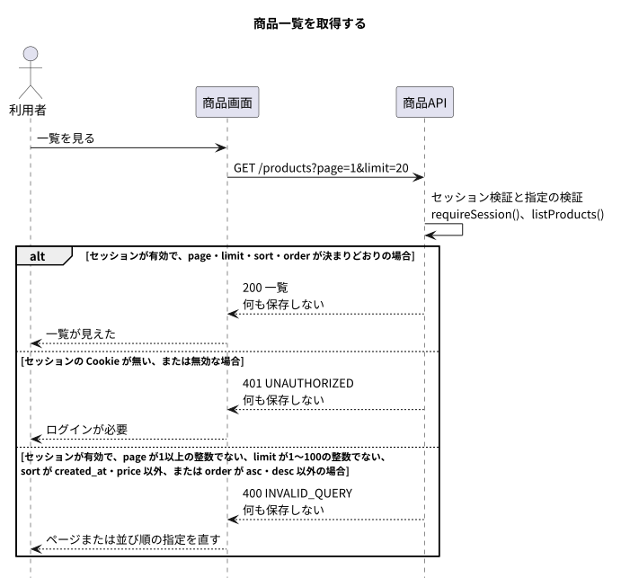

# 商品一覧取得API

## 目次

- [概要](#概要)
- [説明](#説明)
- [エンドポイント](#エンドポイント)
- [メソッド](#メソッド)
- [リクエスト例](#リクエスト例)
- [レスポンス例](#レスポンス例)
- [処理フローの図](#処理フローの図)
- [処理詳細](#処理詳細)
    - [1. セッション検証](#1-セッション検証)
    - [2. リクエストバリデーション](#2-リクエストバリデーション)
    - [3. 一覧を返す](#3-一覧を返す)

## 概要

ログインしている利用者に、公開中の商品の一覧を、ページに分けて返します。既定は1ページ例：20件、新しい順です。

## 説明

- 呼ぶのは、商品画面です。
- 決めたこと：
    - 公開中の商品だけを返します。
    - 0件のときも、指定したページが最後より後ろのときも、成功として空の一覧を返します。
    - `created_at` や `price` が同じときは、商品IDの昇順で並べます。
    - このAPIは読むだけです。どの場合も、保存も削除もしません。
- このAPIで使う言葉（利用者、セッション、商品、公開中の商品、ページ分け、並び順）は、[用語集](../../用語集.md) にあります。
- 関連：[入口](README.md)、[変更履歴](変更履歴.md)、業務フロー [ログインして商品を探す](../../docs/business/ログインして商品を探す/README.md)

## エンドポイント

`/products`

ホストは環境ごとに変わります。例: `https://api.example.com`。

## メソッド

`GET`

## リクエスト例

○＝必須、△＝条件付き必須、−＝任意

| 項目 | 名前 | 位置 | 型 | 必須 | 説明 |
| --- | --- | --- | --- | --- | --- |
| `Cookie` | セッションの Cookie | ヘッダー | 文字列 | ○ | ログイン時に付いた Cookie。例: `session=session_789` |
| `page` | 何ページ目か | クエリ | 整数 | − | 既定は `1`。決まりは [ページ分け](../../用語集.md) |
| `limit` | 1ページの件数 | クエリ | 整数 | − | 既定は例：`20`。上限は例：`100`。決まりは [ページ分け](../../用語集.md) |
| `sort` | 並びのキー | クエリ | 文字列 | − | `created_at` か `price`。既定は `created_at`。決まりは [並び順](../../用語集.md) |
| `order` | 昇順か降順か | クエリ | 文字列 | − | `asc` か `desc`。既定は `desc`。決まりは [並び順](../../用語集.md) |

```bash
curl "https://api.example.com/products?page=1&limit=20" \
  -H "Cookie: session=session_789"
```

## レスポンス例

本文の形は例です。

成功（`200`、手順3）。例: 全120件のうち、1件目から20件目。

```json
{"items": [{"id": "product_1001", "name": "木製デスク", "price": 19800}], "page": 1, "limit": 20, "total": 120}
```

セッションの Cookie が無い または 保存済みの有効なセッションと合わない（`401`、手順1.2）。

```json
{"code": "UNAUTHORIZED"}
```

クエリのいずれかの項目が、手順2の条件に合わない（`400`、手順2.2）。

```json
{"code": "INVALID_QUERY"}
```

## 処理フローの図

画面とAPIのつながりです。



APIの中の手順です。


## 処理詳細

### 1. セッション検証

- リクエストの Cookie のセッションIDを、保存済みの有効なセッションと照合する
- 1.1 Cookie のセッションIDが、保存済みの有効なセッションと合う場合
    - 手順2へ進む
- 1.2 Cookie が無い または Cookie のセッションIDが保存済みの有効なセッションと合わない場合
    - 401 エラー（`UNAUTHORIZED`）を返す。一覧は返さない
    - 保存も削除もしない
    - 例：有効なセッションは、ログインから24時間

### 2. リクエストバリデーション

- クエリの項目を、次の条件と照合する。無い項目は既定の値にする
    - `page`：1以上の整数であること
    - `limit`：例：1〜100の整数であること
    - `sort`：`created_at` か `price` であること
    - `order`：`asc` か `desc` であること
- 2.1 クエリのすべての項目が、手順2の条件に合う場合
    - 手順3へ進む
- 2.2 クエリのいずれかの項目が、手順2の条件に合わない場合
    - 400 エラー（`INVALID_QUERY`）を返す。一覧は返さない
    - 保存も削除もしない
    - 例: `limit=200`、`page=0`、`sort=name`

### 3. 一覧を返す

- 公開中の商品を、指定の並び順で並べ、指定のページの分だけ取り出す
- 3.1 取り出した商品が1件以上の場合
    - `200` を返し、商品の一覧と全件数を本文に入れる
- 3.2 公開中の商品が0件 または 指定したページが最後のページより後ろの場合
    - `200` を返し、空の一覧を本文に入れる
