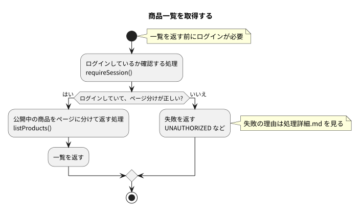

# 処理詳細

## 前提用語

このAPIの言葉は [用語](用語.md) にあります。利用者、セッション、商品、公開中の商品、ページ分け、並び順は [用語集](../../用語集.md) にあります。

## 処理の概要

ログインしている利用者だけ、公開中の商品の一覧を、ページに分けて返します。セッションが無効な人と、指定が決まりどおりでない場合は、ここで止まります。

## 処理のイメージ

ソース: [flow.puml](flow.puml)

## 処理詳細

### 1. セッション検証。リクエストの Cookie を、保存済みの有効なセッションと照合する。ログインした人だけ次へ進めるのが目的

- 対応メソッド: `requireSession()`
- コード: `src/services/auth.ts`

リクエストの Cookie を、保存済みの有効なセッションと比べます。Cookie が無い、合わない、または無効（例：ログインから24時間を過ぎた）の場合は `UNAUTHORIZED` を返し、一覧は返しません。

### 2. 公開中の商品をページに分けて返す処理。見ている人に一覧を見せるのが目的

- 対応メソッド: `listProducts()`
- コード: `src/services/product.ts`

ページ分けと並び順の決まりは [用語集](../../用語集.md) にあります。`created_at` や `price` が同じときは、商品IDの昇順で並べます。指定が決まりどおりでなければ `INVALID_QUERY` を返します。公開中の商品だけを返します。0件のときも、指定したページが最後より後ろのときも、成功として空の一覧を返します。

## 入力と結果

| 入力 | 結果 |
| --- | --- |
| セッション `session_789` が有効で、`page=1&limit=20`（既定の並び順）の場合 | 公開中の商品の1件目から20件目。例: 全120件なら20件が返る |

## 失敗するとき

| 条件 | 結果 |
| --- | --- |
| セッションの Cookie が無い、または無効な場合 | `UNAUTHORIZED`。一覧は返さない |
| ページ分けまたは並び順が、用語集の決まりどおりでない場合 | `INVALID_QUERY`。一覧は返さない |

## コード（ファイルパス）

- `src/services/auth.ts` の `requireSession()`
- `src/services/product.ts` の `listProducts()`

この2つのメソッドより細かい分岐は、設計書には書きません。実装は、上のコードを読んで判断します。
