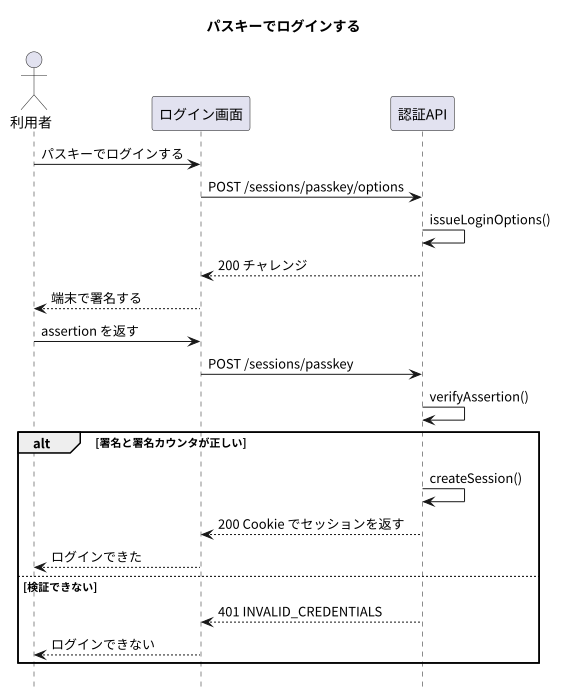

# パスキーでログインする

登録した端末のパスキーでログインし、ログイン状態にします。メールは入れません。成功したときは、パスワードのログインと同じく、ログイン通知メールも送ります。失敗したときは、どこが違うかは返しません。

端末をなくしたときは、メールの確認リンクで復旧します。今までのセッションとパスキーはすべて無効になり、新しい端末で登録し直します。流れは [アカウントを復旧する](../recover-account/README.md) と [パスキーの端末をなくす](../../docs/business/パスキーの端末をなくす/README.md) にあります。

ソース: [入口.puml](入口.puml)

## 入力と結果

| 名前 | 必須 | 説明 |
| --- | --- | --- |
| assertion | はい | 端末がチャレンジへ付けた署名。2回目の `POST /sessions/passkey` で送ります |

流れは2段階です。`POST /sessions/passkey/options` でチャレンジ（このログインだけに使う、5分で消える一度きりの値）を発行します。画面はそれを端末に渡し、端末は PIN か生体認証のあと assertion（チャレンジへの署名）を返します。`POST /sessions/passkey` で、署名がチャレンジに合うか、署名カウンタ（署名のたびに増える数）が前より増えているかを確かめます。成功すると、セッションの Cookie を返し、登録したメールアドレスにログイン通知メールを送ります。例: `session_789`。Cookie の属性は、[ログインする](../login/README.md) と同じです。

## 失敗するとき

| コード | いつ | 結果 |
| --- | --- | --- |
| INVALID_CREDENTIALS | 署名を検証できない、署名カウンタが古い、チャレンジが使えない、ブラウザの一時的な印が無いか違う、またはパスキーが無い | セッションは作らない。どこが違うかは返さない |

## 関連リンク

- [用語](用語.md)
- [処理詳細](処理詳細.md)
- [入口の図](入口.puml)
- [処理のイメージ](flow.puml)
- [変更履歴](変更履歴.md)
- [パスキーを登録する](../register-passkey/README.md)
- [アカウントを復旧する](../recover-account/README.md)
- [ログインする](../login/README.md)
- [パスキーの端末をなくす](../../docs/business/パスキーの端末をなくす/README.md)
- [カードで支払う](../../docs/business/カードで支払う/README.md)
- 共通の言葉は [用語集](../../用語集.md)

AI向け：書き方と補足

これは深さ2です。画面とAPIのつながりだけを書きます。

- セッションIDは、HttpOnly、Secure、SameSite=Lax の Cookie で返し、本文には入れません。
- 失敗の種類を分けると、どこが違うかが分かるため、同じ `INVALID_CREDENTIALS` にします。
- ログイン用のチャレンジは、発行した画面（ブラウザ）に付ける一時的な印と組にします。ログイン前なので、利用者はまだ分かりません。印はログイン用のセッションとは別の、5分で消える Cookie です。確かめるときに組が違えば、`INVALID_CREDENTIALS` です。assertion の credential ID で利用者を特定し、その利用者の公開鍵で確かめます。
- 検証では、origin（呼んだ画面のURL）と rpId（このサービスのドメイン）が自社のものか、端末で PIN か生体認証をしたか（user verification）も確かめます。
- ログイン通知メールは [ログインする](../login/README.md) と同じ `notifyLogin()` で送ります。送信に失敗しても、ログインは成功のままです。

