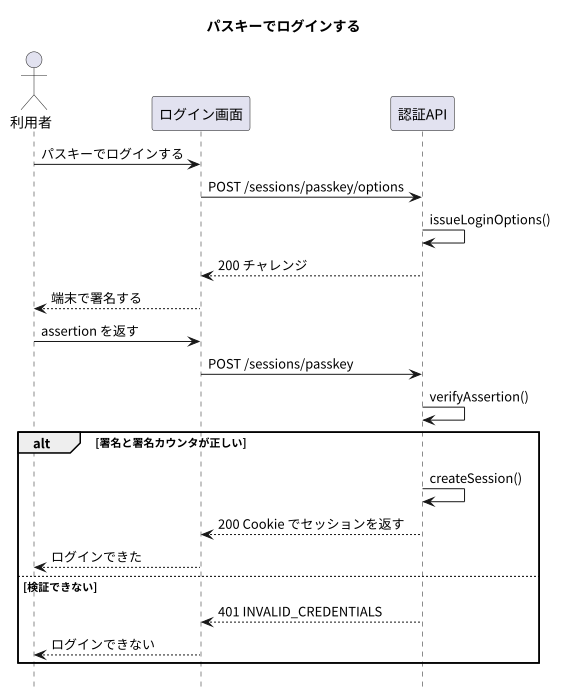
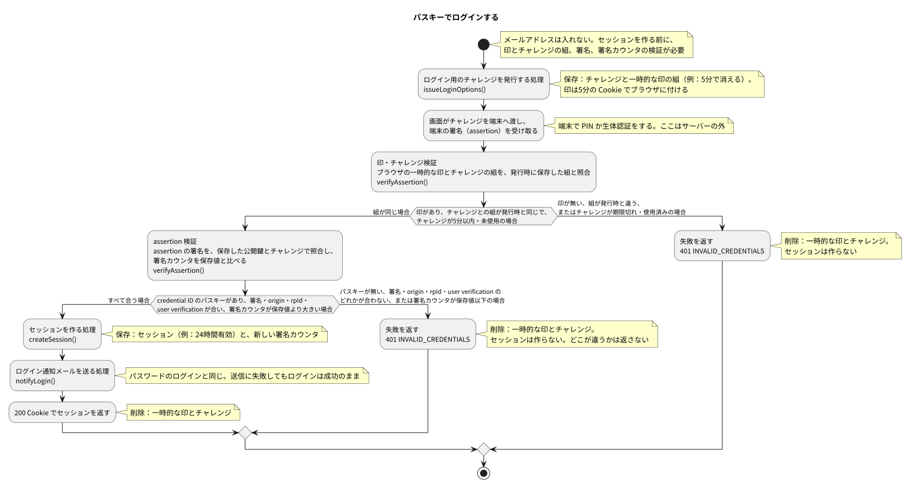

# パスキーログインAPI

## 目次

- [概要](#概要)
- [説明](#説明)
- [エンドポイント](#エンドポイント)
- [メソッド](#メソッド)
- [リクエスト例](#リクエスト例)
- [レスポンス例](#レスポンス例)
- [処理フローの図](#処理フローの図)
- [処理詳細](#処理詳細)
    - [1. チャレンジ発行](#1-チャレンジ発行)
    - [2. 印・チャレンジ検証](#2-印チャレンジ検証)
    - [3. assertion 検証](#3-assertion-検証)
    - [4. セッション作成](#4-セッション作成)
    - [5. 成功を返す](#5-成功を返す)

## 概要

登録した端末のパスキーの署名が合えば、セッションを作ってログイン状態にし、ログイン通知メールを送ります。

## 説明

- 呼ぶのは、ログイン画面です。ログイン前に呼ぶので、セッションの Cookie は要りません。メールアドレスは入れません。
- 呼び出しは2回です。1回目でチャレンジを受け取り、端末が PIN か生体認証のあと署名（assertion）を作り、2回目でその署名を送ります。
- 決めたこと：
    - どこが違うかは返しません。失敗はすべて `INVALID_CREDENTIALS` です。
    - ログイン前で利用者はまだ分からないため、チャレンジは、発行した画面（ブラウザ）に付ける一時的な印と組にします。印はセッションとは別の Cookie で、例：5分で消えます。
    - 成功しても失敗しても、2回目の呼び出しで一時的な印とチャレンジを消します。
    - ログイン通知メールは [ログインAPI](../login/処理詳細.md#5-ログイン通知メール送信) と同じものを送ります。送信に失敗しても、ログインは成功のままです。
    - 端末をなくしたときは、[アカウント復旧API](../recover-account/README.md) を使います。今までのセッションとパスキーはすべて無効になり、新しい端末を [パスキー登録API](../register-passkey/README.md) で登録し直します。
- このAPIで使う言葉（assertion、ログイン用の一時的な印、チャレンジ、credential ID、署名カウンタ、利用者、セッション、ログイン、パスキー）は、[用語集](../../用語集.md) にあります。
- 関連：[入口](README.md)、[変更履歴](変更履歴.md)

## エンドポイント

呼ぶ順に2つあります。

1. `/sessions/passkey/options`（チャレンジを受け取る）
2. `/sessions/passkey`（署名を送ってログインする）

ホストは環境ごとに変わります。例: `https://api.example.com`。

## メソッド

どちらも `POST` です。

## リクエスト例

○＝必須、△＝条件付き必須、−＝任意

| 項目 | 名前 | 位置 | 型 | 必須 | 説明 |
| --- | --- | --- | --- | --- | --- |
| `Cookie` | ログイン用の一時的な印 | ヘッダー | 文字列 | △（`POST /sessions/passkey` の場合） | 1回目の呼び出しで付いた Cookie。例: `passkey_login=passkey_login_42` |
| `Content-Type` | 本文の形式 | ヘッダー | 文字列 | △（`POST /sessions/passkey` の場合） | `application/json` |
| `assertion` | 端末の署名 | 本文 | オブジェクト | △（`POST /sessions/passkey` の場合） | 端末がチャレンジへ付けた署名。credential ID、署名、署名カウンタ、origin、rpId、user verification のフラグを含む |

```bash
curl -X POST https://api.example.com/sessions/passkey/options

curl -X POST https://api.example.com/sessions/passkey \
  -H "Cookie: passkey_login=passkey_login_42" \
  -H "Content-Type: application/json" \
  -d '{"assertion": {"credentialId": "cred_88a1", "signature": "...", "signCount": 8}}'
```

## レスポンス例

本文の形は例です。

チャレンジを返す（`200`、手順1）。一時的な印は Cookie で返します。

```http
HTTP/1.1 200 OK
Set-Cookie: passkey_login=passkey_login_42; HttpOnly; Secure; SameSite=Lax; Path=/; Max-Age=300
Content-Type: application/json

{"challenge": "ch_51f2", "rpId": "example.com", "userVerification": "required"}
```

ログインできた（`200`、手順5）。セッションIDは Cookie で返し、本文には入れません。

```http
HTTP/1.1 200 OK
Set-Cookie: session=session_789; HttpOnly; Secure; SameSite=Lax; Path=/
Set-Cookie: passkey_login=; Max-Age=0; Path=/
Content-Type: application/json

{}
```

一時的な印とチャレンジの組が使えない または 署名・署名カウンタが合わない（`401`、手順2.2・3.2）。

```json
{"code": "INVALID_CREDENTIALS"}
```

## 処理フローの図

画面とAPIのつながりです。



APIの中の手順です。



## 処理詳細

### 1. チャレンジ発行

`POST /sessions/passkey/options` の手順です。

- 1回限りのチャレンジを作り、一時的な印と組にして保存する
    - 保存：チャレンジと印の組（例：5分で消える）
    - 印は、セッションとは別の Cookie で返す。例: `passkey_login_42`
- 1.1 チャレンジと印の組の保存が終わった場合
    - `200` を返し、チャレンジを本文に、印を `Set-Cookie` に入れる
    - 画面はチャレンジを端末に渡す。端末は PIN か生体認証のあと、チャレンジに署名して assertion を返す。ここはサーバーの外

### 2. 印・チャレンジ検証

ここから `POST /sessions/passkey` の手順です。

- リクエストの一時的な印を、手順1で保存した印とチャレンジの組と照合する
- 2.1 リクエストの印が保存済みの組の印と合う かつ その組のチャレンジが例：5分以内 かつ 未使用の場合
    - 手順3へ進む
- 2.2 リクエストに印が無い または 印が保存済みの組と合わない または その組のチャレンジが期限切れ または 使用済みの場合
    - 401 エラー（`INVALID_CREDENTIALS`）を返す。どこが違うかは返さない。セッションは作らない
    - 削除：一時的な印とチャレンジ
    - 例: 別のブラウザが、同じチャレンジで送ってきたとき

### 3. assertion 検証

- assertion の credential ID で、保存済みのパスキーを探す。そのパスキーの公開鍵で、assertion の署名を手順2のチャレンジと照合する
    - あわせて、assertion の origin を自社画面の origin と、rpId を自社ドメインと照合し、user verification のフラグを見る
    - assertion の署名カウンタを、保存済みの署名カウンタと比べる
- 3.1 credential ID のパスキーがある かつ 署名・origin・rpId が合う かつ user verification のフラグがある かつ 署名カウンタが保存値より大きい場合
    - 手順4へ進む
- 3.2 credential ID のパスキーが無い または 署名・origin・rpId のいずれかが合わない または user verification のフラグが無い または 署名カウンタが保存値以下の場合
    - 401 エラー（`INVALID_CREDENTIALS`）を返す。どこが違うかは返さない。セッションは作らない
    - 削除：一時的な印とチャレンジ。署名カウンタは変えない

### 4. セッション作成

- セッションIDを作って保存し（例：ログインから24時間有効）、名前 `session` の Cookie に入れる
    - Cookie の属性は、[ログインAPI](../login/処理詳細.md#4-セッション作成) と同じ
    - 保存：セッションと、新しい署名カウンタ
- 4.1 セッションと署名カウンタの保存が終わった場合
    - 登録したメールアドレスへ、ログイン通知メールを送る。送り方と失敗時は [ログインAPI](../login/処理詳細.md#5-ログイン通知メール送信) と同じ。送信に失敗しても、ログインは成功のまま
    - 手順5へ進む

### 5. 成功を返す

- `200` を返し、手順4で作ったセッションの Cookie を `Set-Cookie` で付ける
    - 削除：一時的な印とチャレンジ
    - 本文の例は「レスポンス例」の、ログインできた場合にある
