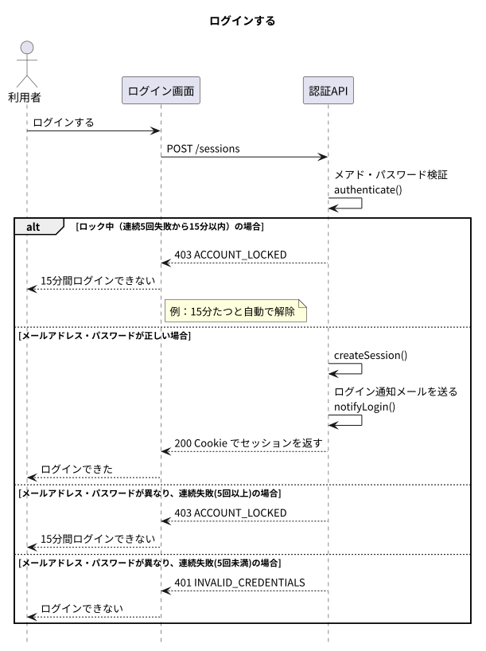

# ログインする

メールアドレス・パスワード検証が通った利用者を、ログイン状態にします。成功したときは、ログイン通知メールも送ります。

ソース: [入口.puml](入口.puml)

## 入力と結果

| 名前 | 必須 | 説明 |
| --- | --- | --- |
| メールアドレス | はい | ログインする人の宛先。例: `masato@example.com` |
| パスワード | はい | 利用者が画面に入れた値。ログには残しません |

成功すると、セッション（例：24時間有効）を保存し、その Cookie を返します。例: `session_789`。失敗回数は消します。続けて、登録したメールアドレスにログイン通知メールを送ります。送信に失敗しても、ログインは成功のままです。

例：同じメールアドレスで連続5回失敗すると15分ロックし、15分たつと自動で解除します。解除の手順は「15分待つ」です。

## 失敗するとき

| コード | いつ | 結果 |
| --- | --- | --- |
| INVALID_CREDENTIALS | メールアドレス・パスワードが異なり、連続失敗(5回未満)の場合。未登録のメールアドレスも含む | `401`。セッションは作らない。失敗回数を1増やす（例：15分で消える）。どちらが違うかは返さない |
| ACCOUNT_LOCKED | メールアドレス・パスワードが異なり、連続失敗(5回以上)の場合 | `403`。セッションは作らない。ロックを保存する（例：15分）。画面は「15分間ログインできません」と出す |
| ACCOUNT_LOCKED | ロック中（連続5回失敗から15分以内）の場合 | `403`。何も保存しない。パスワードが正しくてもログインしない。15分たつと自動で解除 |

## 関連リンク

- [用語](用語.md)
- [処理詳細](処理詳細.md)
- [入口の図](入口.puml)
- [処理のイメージ](flow.puml)
- [変更履歴](変更履歴.md)
- [ログインして商品を探す](../../docs/business/ログインして商品を探す/README.md)
- 共通の言葉は [用語集](../../用語集.md)

AI向け：書き方と補足

これは深さ2です。画面とAPIのつながりだけを書きます。

セッションIDは、HttpOnly、Secure、SameSite=Lax の Cookie で返し、本文には入れません。

未登録のメールアドレスでも、ダミーのパスワード照合をして、同じ処理時間になるようにします。ロック中なら、パスワードの成否より先に失敗します。どちらが違うかは返しません。ロックが解除されたら、失敗回数は0に戻します。

