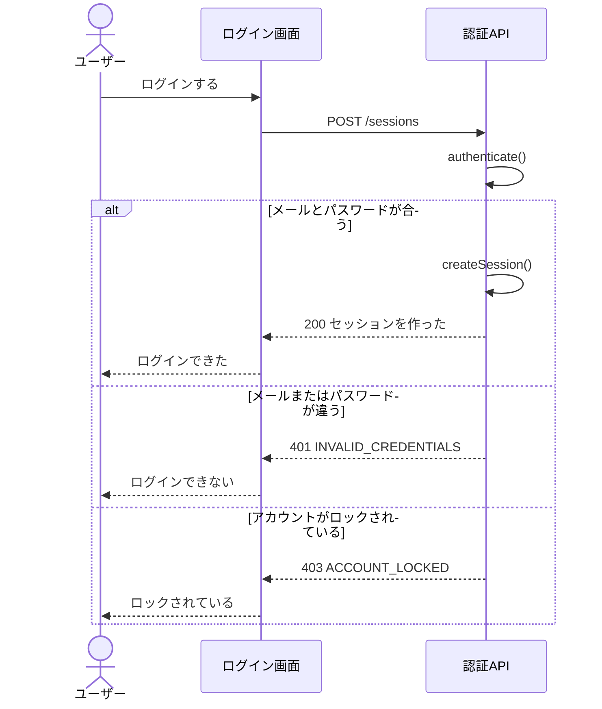

# ログインする

メールとパスワードが合う利用者に、セッションを作ります。

## 概要

利用者が画面で「ログインする」を押すと、認証APIがメールとパスワードを見ます。合っていて、ロックされていなければ、セッションを作ります。合わなければ、セッションは作りません。どちらが違うかは返しません。

これは深さ2です。画面とAPIのつながりだけを書きます。

業務全体のレーンは [ログインして商品を探す](../../docs/business/ログインして商品を探す.md) です。メソッドの目的は [処理詳細](処理詳細.md) です。

## 入力と結果

| 名前 | 必須 | 説明 |
| --- | --- | --- |
| メール | はい | ログインする人。例: `hana@example.com` |
| パスワード | はい | 利用者が画面に入れた値。ログには残しません |

成功すると、セッションが作られます。例: セッションID `session_789`。

## 失敗するとき

| コード | いつ | 結果 |
| --- | --- | --- |
| INVALID_CREDENTIALS | メールが無い、またはパスワードが違う | セッションは作らない。どちらが違うかは返さない |
| ACCOUNT_LOCKED | 連続して5回失敗し、アカウントがロックされている | セッションは作らない。パスワードが合っていてもログインしない |

## 各ドキュメント

- [用語](用語.md)
- [処理詳細](処理詳細.md)
- [処理のイメージ](flow.puml)
- [変更履歴](変更履歴.md)
- 共通の言葉は [用語集](../../用語集.md)
