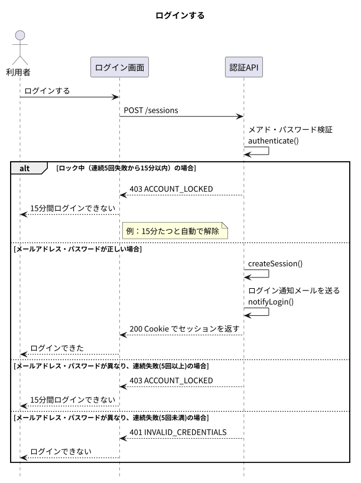
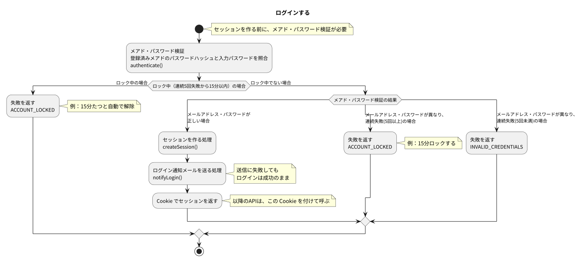

# ログインする（設計書）

## 目次

- [概要](#概要)
- [説明](#説明)
- [エンドポイント](#エンドポイント)
- [メソッド](#メソッド)
- [リクエスト例](#リクエスト例)
- [レスポンス例](#レスポンス例)
- [処理フローの図](#処理フローの図)
- [処理詳細](#処理詳細)
    - [1. リクエストバリデーション](#1-リクエストバリデーション)
    - [2. ロック判定](#2-ロック判定)
    - [3. メールアドレス・パスワード検証](#3-メールアドレスパスワード検証)
    - [4. セッション作成](#4-セッション作成)
    - [5. ログイン通知メール送信](#5-ログイン通知メール送信)
    - [6. 成功を返す](#6-成功を返す)

## 概要

メールアドレスとパスワードが合っていれば、セッションを作ってログイン状態にし、ログイン通知メールを送ります。

## 説明

- 呼ぶのは、ログイン画面です。ログイン前に呼ぶので、セッションの Cookie は要りません。
- 決めたこと：
    - 連続5回失敗すると15分ロックし、15分たつと自動で解除します。失敗回数はメールアドレスごとに数えます。
    - メールアドレスとパスワードのどちらが違うかは返しません。応答の内容と時間の差から、アカウントの有無は分かりません。
    - ログイン通知メールの送信に失敗しても、ログインは成功のままです。
- 正にする場所：条件と結果、保存・削除は「処理詳細」の番号の手順が正です。外部APIの5項目は、手順5の表が正です。
- このAPIの言葉は [用語](用語.md) にあります。利用者、セッション、ログインは [用語集](../../用語集.md) にあります。
- 関連：[入口](README.md)、[変更履歴](変更履歴.md)、業務フロー [ログインして商品を探す](../../docs/business/ログインして商品を探す/README.md)

## エンドポイント

`/sessions`

ホストは環境ごとに変わります。例: `https://api.example.com`。

## メソッド

`POST`

## リクエスト例

○＝必須、△＝条件付き必須、−＝任意

| 項目 | 名前 | 位置 | 型 | 必須 | 説明 |
| --- | --- | --- | --- | --- | --- |
| `Content-Type` | 本文の形式 | ヘッダー | 文字列 | ○ | `application/json` |
| `email` | メールアドレス | 本文 | 文字列 | ○ | ログインする人の宛先。例: `masato@example.com` |
| `password` | パスワード | 本文 | 文字列 | ○ | 利用者が画面に入れた値。ログには残しません |

項目ごとの条件は、処理詳細の「1. リクエストバリデーション」にあります。

```bash
curl -X POST https://api.example.com/sessions \
  -H "Content-Type: application/json" \
  -d '{"email": "masato@example.com", "password": "example-password"}'
```

## レスポンス例

本文の形は例です。どの場合に返すかは、処理詳細の番号の手順にあります。

成功（`200`、手順6）。セッションIDは Cookie で返し、本文には入れません。

```http
HTTP/1.1 200 OK
Set-Cookie: session=session_789; HttpOnly; Secure; SameSite=Lax; Path=/
Content-Type: application/json

{}
```

項目が条件に合わない（`400`、手順1.2）。

```json
{"code": "INVALID_REQUEST"}
```

メールアドレス・パスワードが違う（`401`、手順3.2）。

```json
{"code": "INVALID_CREDENTIALS"}
```

ロック中、またはこの失敗でロックした（`403`、手順2.1・3.3）。

```json
{"code": "ACCOUNT_LOCKED"}
```

## 処理フローの図

画面とAPIのつながりです。



ソース: [入口.puml](入口.puml)

APIの中の手順です。番号は、下の処理詳細の番号と同じです。



ソース: [flow.puml](flow.puml)

## 処理詳細

番号の手順が正です。各手順で、何と何を照合するかを書き、「N.M …の場合」に分けて、返すステータスとエラーコード、保存・削除、次に進む手順を書きます。メソッドの中の細かい分岐は書きません。実装は、各手順のコードを読んで判断します。

### 1. リクエストバリデーション

- 対応メソッド: `validateLoginRequest()`
- コード: `src/services/auth.ts`

本文の項目を、次の条件と照合します。

- `email`：あること。文字列で、`@` を含むメールアドレスの形であること。例：254文字以内
- `password`：あること。文字列で、例：1〜128文字であること

分かれ方は、次のとおりです。

- 1.1 すべての項目が条件に合う場合：2. へ進む
- 1.2 どれかの項目が条件に合わない場合：400 エラー（`INVALID_REQUEST`）を返す。何も保存しない。失敗回数も増やさない

### 2. ロック判定

- 対応メソッド: `authenticate()`
- コード: `src/services/auth.ts`

メールアドレスを、保存済みのロックと照合します。パスワードの成否より先に見ます。未登録のメールアドレスも、登録済みと同じように数えてロックします。

- 2.1 ロック中（連続5回失敗から15分以内）の場合：403 エラー（`ACCOUNT_LOCKED`）を返す。パスワードが正しくてもログインしない。未登録のメールアドレスでも同じ。何も保存しない。失敗回数もロックの期限も変えない。画面は「15分間ログインできません」と出す
- 2.2 ロック中でない場合：3. へ進む。15分たったロックは自動で解除し、失敗回数を0に戻している。解除の手順は「15分待つ」

### 3. メールアドレス・パスワード検証

- 対応メソッド: `authenticate()`
- コード: `src/services/auth.ts`

入力パスワードを、そのメールアドレスに保存したハッシュ（例：Argon2id）と照合します。パスワードは平文では保存せず、ログにも出しません。未登録のメールアドレスでもダミーのハッシュと照合し、同じ処理時間になるようにします。失敗回数はメールアドレスごとに数えます。

- 3.1 パスワードがハッシュと合う場合：4. へ進む
- 3.2 合わず（未登録のメールアドレスも含む）、この失敗で連続失敗が4回以下の場合：401 エラー（`INVALID_CREDENTIALS`）を返す。どちらが違うかは返さない。セッションは作らない。保存：失敗回数を1増やす（例：15分で消える）
- 3.3 合わず（未登録のメールアドレスも含む）、この失敗が連続5回目の場合：403 エラー（`ACCOUNT_LOCKED`）を返す。セッションは作らない。未登録のメールアドレスでも、同じ回数で同じ応答。画面は「15分間ログインできません」と出す。保存：ロック（例：15分で自動解除）

### 4. セッション作成

- 対応メソッド: `createSession()`
- コード: `src/services/auth.ts`

セッションIDを作って保存し（例：ログインから24時間有効）、名前 `session` の Cookie に入れます。属性は HttpOnly、Secure、SameSite=Lax、`Path=/` です。本文には入れません。例: Cookie の値 `session_789`。

- 4.1 セッションを保存した場合：そのメールアドレスの失敗回数を消して0に戻し、5. へ進む

### 5. ログイン通知メール送信

- 対応メソッド: `notifyLogin()`
- コード: `src/services/auth.ts`

外部APIのメール送信サービス（例: SES）で、登録したメールアドレスへログイン通知メールを送ります。外部APIの5項目は、次の表が正です。図の付箋は、このうちタイムアウト・再試行・失敗時の要約です。

| 外部API | 送る相手 | タイムアウト | 再試行 | 失敗時のステータスとエラーコード | 保存するもの |
| --- | --- | --- | --- | --- | --- |
| メール送信サービス（例: SES） | 登録したメールアドレス。ログイン通知メールを送る | 例：3秒 | しない（例：0回） | ログインは `200` のまま。エラーコードは返さない | 何も保存しない。セッションは取り消さない |

- 5.1 送信できた場合：6. へ進む
- 5.2 送信に失敗した、またはタイムアウトした場合：表の「失敗時」のとおり、ログインは成功のまま 6. へ進む

### 6. 成功を返す

- 対応メソッド: なし（4. と 5. の結果を返す）

`200` を返し、4. で作ったセッションの Cookie を `Set-Cookie` で付けます。Cookie 名は `session`、属性は HttpOnly、Secure、SameSite=Lax、`Path=/` です。本文の例は「レスポンス例」の成功にあります。以降のAPIは、この Cookie を付けて呼びます。

<details markdown>
<summary>AI向け：入口（README）との分け方</summary>

入口の `README.md` は、「何をするか」1行と、このページ・用語・変更履歴へのリンクだけにしています。概要、説明、エンドポイント、メソッド、リクエスト例、レスポンス例、処理フローの図、処理詳細は、このページにまとめました。同じことを2か所に書きません。

入口の図は深さ2で、画面とAPIのつながりだけを書きます。このページの「処理詳細」は深さ3（サービスメソッド）までです。

</details>
