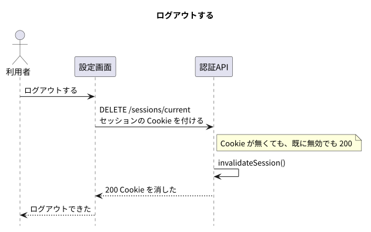

# ログアウトする

今のログイン状態をやめ、ログインしていない状態に戻します。サーバー側では、今のセッションを無効にします。

ソース: [入口.puml](入口.puml)

## 入力と結果

○＝必須、△＝条件付き必須、−＝任意

| 名前 | 必須 | 説明 |
| --- | --- | --- |
| セッションの Cookie | − | ログイン時に付いた Cookie。本文では送りません。例: `session_789`。無くても成功する |

成功すると `200` を返します。セッションの Cookie が有効な場合は、保存済みのセッションを削除して無効にします。Cookie が無い、または既に無効な場合は、サーバーでは何も削除しません。どちらの場合も、セッションの Cookie を消します。画面は、ログインしていない状態に戻して構いません。

## 失敗するとき

このAPIは失敗を返しません。セッションが無いときも、既に無効なときも、成功として扱います。

## 関連リンク

- [用語](用語.md)
- [処理詳細](処理詳細.md)
- [入口の図](入口.puml)
- [処理のイメージ](flow.puml)
- [変更履歴](変更履歴.md)
- 共通の言葉は [用語集](../../用語集.md)

AI向け：書き方と補足

これは深さ2です。画面とAPIのつながりだけを書きます。

