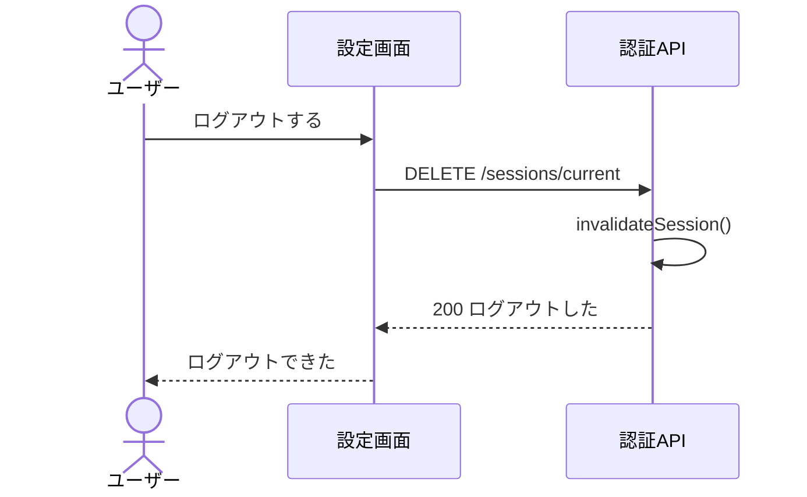

# ログアウトする

今のセッションを無効にし、ログインしていない状態に戻します。

## 概要

利用者が画面で「ログアウトする」を押すと、認証APIが今のセッションを無効にします。セッションが無いときも、既に無効なときも、成功として扱います。

これは深さ2です。画面とAPIのつながりだけを書きます。

メソッドの目的は [処理詳細](処理詳細.md) です。

## 入力と結果

| 名前 | 必須 | 説明 |
| --- | --- | --- |
| セッションID | いいえ | 今のセッション。例: `session_789`。無くても成功する |

成功すると、そのセッションは無効になります。既に無効なときも、同じ結果です。画面は、ログインしていない状態に戻してよいです。

## 失敗するとき

このAPIは失敗を返しません。セッションが無いときも、既に無効なときも、成功として扱います。

## 各ドキュメント

- [用語](用語.md)
- [処理詳細](処理詳細.md)
- [処理のイメージ](flow.puml)
- [変更履歴](変更履歴.md)
- 共通の言葉は [用語集](../../用語集.md)
