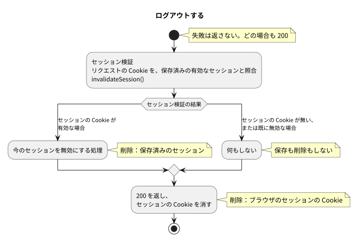

# 処理詳細

## 前提用語

このAPIの言葉は [用語](用語.md) にあります。利用者、セッション、ログアウトは [用語集](../../用語集.md) にあります。

## 処理の概要

今のセッションを無効にし、ログインしていない状態に戻します。セッションが無いときも、既に無効なときも、成功として扱います。

## 処理のイメージ

ソース: [flow.puml](flow.puml)

## 処理詳細

### 1. 今のセッションを無効にする処理。ログインしていない状態に戻すのが目的

- 対応メソッド: `invalidateSession()`
- コード: `src/services/auth.ts`

セッションがあれば無効にします。セッションの Cookie を消します。セッションが無いときも、既に無効なときも、成功を返します。失敗は返しません。セッションIDはログに出しません。

## 入力と結果

| 入力 | 結果 |
| --- | --- |
| セッション `session_789` | そのセッションは無効になり、Cookie を消す |
| セッションが無い、または既に無効 | 成功。サーバー上のセッションは無効のまま。Cookie は消す |

## 失敗するとき

| 条件 | 結果 |
| --- | --- |
| （失敗はない） | 成功として扱う |

## コード（ファイルパス）

- `src/services/auth.ts` の `invalidateSession()`

この1つのメソッドより細かい分岐は、設計書には書きません。実装は、上のコードを読んで判断します。
