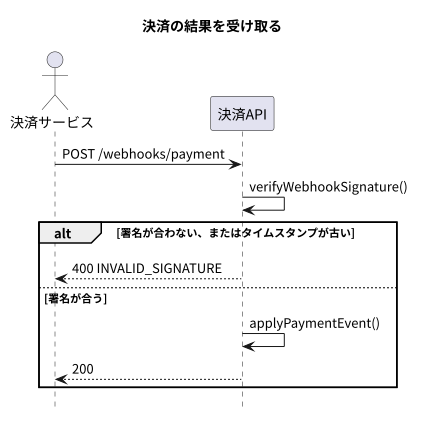

# 決済の結果を受け取る

決済サービスからの通知を `POST /webhooks/payment` で受け取り、注文を支払い済みまたは失敗にします。受け取る前に、署名（通知が本当に決済サービスから来たことを示す印）を確かめます。確かめないと、誰でも偽の通知で支払い済みにできます。署名を確かめるための秘密は、Secrets Manager（秘密の値を置くAWSのサービス）に置きます。

**反映するのは、通知の注文ID・金額・通貨が注文と合うときだけです。**合わなければ注文は変えず、記録して警告を出します。**支払い済みの注文は、あとから失敗の通知が来ても戻しません。**失敗の注文は、合う成功の通知が来たときだけ支払い済みに進めます。

ソース: [入口.puml](入口.puml)

## 入力と結果

| 名前 | 必須 | 説明 |
| --- | --- | --- |
| 署名 | はい | 決済サービスが付けた署名。ヘッダーで送ります |
| タイムスタンプ | はい | 通知を作った時刻。5分より古いときは受け取りません |
| イベントID | はい | 同じ通知を見分ける値。例: `evt_9Zx` |
| 注文ID | はい | 支払いを依頼したときに渡した注文。例: `order_5001` |
| 金額と通貨 | はい | 決済サービスが請求した額。例: `19800`、`JPY` |
| 注文の結果 | はい | 支払い済み、または失敗 |

| 通知 | 注文 | どうなるか |
| --- | --- | --- |
| 支払い済み、19800 JPY | `order_5001`、19800円、処理中 | 支払い済みにする |
| 支払い済み、100 JPY | `order_5001`、19800円、処理中 | 変えない。記録して警告する |
| 失敗 | `order_5001`、支払い済み | 変えない。支払い済みのまま |
| 支払い済み、19800 JPY | `order_5001`、19800円、失敗 | 支払い済みにする |
| 同じイベントIDの再送 | どれでも | 変えない |

どの場合も、署名が合えば、通知を保存してすぐ `200` を返します。注文への反映は、そのあとで行います。

## 失敗するとき

| コード | いつ | 結果 |
| --- | --- | --- |
| INVALID_SIGNATURE | 署名が合わない、またはタイムスタンプが5分より古い（再送攻撃） | `400` を返す。注文は変えない |

通知を保存できなかったときは `2xx` を返しません。決済サービスが、同じ通知を再送します。

## 関連リンク

- [用語](用語.md)
- [処理詳細](処理詳細.md)
- [入口の図](入口.puml)
- [処理のイメージ](flow.puml)
- [変更履歴](変更履歴.md)
- [支払う](../create-payment/README.md)
- [注文の状態を見る](../get-order/README.md)
- [カードで支払う](../../docs/business/カードで支払う/README.md)
- 共通の言葉は [用語集](../../用語集.md)

AI向け：書き方と補足

これは深さ2です。決済サービスとAPIのつながりだけを書きます。利用者の画面は出しません。

- 署名を確かめる秘密は、コードやログ、図に出しません。Secrets Manager から読みます。通知は決済サービスのイベントIDと一緒に保存し、反映に失敗したら `processSavedPaymentEvents()` が同じ保存からやり直します。保存が重なっても、反映は1回です。
- 金額・通貨・注文ID が合わない通知にも `200` を返します。再送されても結果は同じで、直らないためです。代わりに記録し、運用者へ警告を出します。
- 状態は一方向です。処理中から、支払い済みか失敗へ進みます。失敗から支払い済みへは、注文ID・金額・通貨が合う成功の通知のときだけ進めます。支払い済みは最後の状態で、どの通知でも変えません。
- 署名は、受け取ったもとの本文（バイト列のまま）で確かめます。JSON として読み直した本文では、空白や順番が変わり、署名が合わなくなります。
- 署名を確かめたら、すぐ `2xx` を返します。注文の反映は、そのあと非同期で行います。決済サービスは、返事が遅いと失敗とみなして再送するためです。

