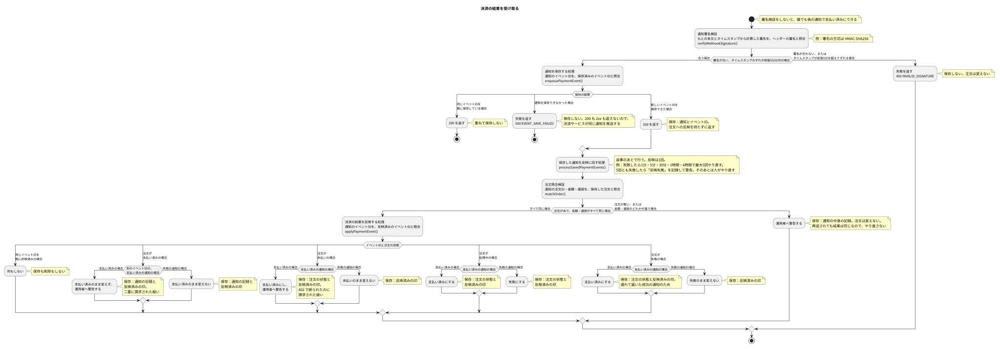

# 処理詳細

## 前提用語

このAPIの言葉は [用語](用語.md) にあります。決済サービス、注文の状態は [用語集](../../用語集.md) にあります。

## 処理の概要

決済サービスからの通知を、署名を確かめてから受け取ります。確かめないと、誰でも偽の通知で支払い済みにできます。署名が合えば、通知を保存してすぐ `200` を返します。そのあとで、通知の注文ID・金額・通貨が注文と合うかを確かめます。合うときだけ、同じイベントIDを1回処理し、注文を支払い済みまたは失敗にします。支払い済みの注文は戻しません。この通知が、支払い済みを確定する唯一のタイミングです。

## 処理のイメージ

ソース: [flow.puml](flow.puml)

## 処理詳細

### 1. 署名を確かめる処理。偽の通知を受け取らないのが目的

- 対応メソッド: `verifyWebhookSignature()`
- コード: `src/services/payment.ts`

`POST /webhooks/payment` の先頭で、決済サービスの署名を確かめます。受け取ったもとの本文（バイト列のまま）とタイムスタンプから、Secrets Manager の秘密で署名を計算し、ヘッダーの署名と比べます。JSON として読み直した本文では、空白や順番が変わって合わなくなるため使いません。秘密はコードやログには出しません。署名が合わないとき、タイムスタンプが5分より古いとき（再送攻撃）は `400 INVALID_SIGNATURE` を返し、注文は変えません。

### 2. 通知を保存してすぐ返す処理。決済サービスに再送させないのが目的

- 対応メソッド: `enqueuePaymentEvent()`
- コード: `src/services/payment.ts`

署名が合った通知を、決済サービスのイベントID（例: `evt_9Zx`）と一緒に保存し、すぐ `200` を返します。決済サービスは、返事が遅いと失敗とみなして再送するためです。同じイベントIDの通知がもう保存されていれば、重ねて保存せず `200` を返します。保存できなかったときは `2xx` を返さず、決済サービスに再送させます。ここから先は、返事のあとで行います。

### 3. 保存した通知を反映に回す処理。返事のあとで、1回だけ反映するのが目的

- 対応メソッド: `processSavedPaymentEvents()`
- コード: `src/services/payment.ts`

返事のあと、保存した通知のうち、まだ反映していないものを取り出し、次の `matchOrder()` と `applyPaymentEvent()` に回します。反映の途中で失敗したら、同じ保存からやり直します。**同じイベントIDは、保存が重なっても、再実行しても、反映は1回です。**

### 4. 注文と合うか確かめる処理。違う額の通知で支払い済みにしないのが目的

- 対応メソッド: `matchOrder()`
- コード: `src/services/payment.ts`

通知の注文IDで注文を探し、金額と通貨が注文と同じかを確かめます。注文が無いとき、金額か通貨が違うときは、注文を変えません。通知の中身を記録し、運用者へ警告します。例: `order_5001` は19800円なのに、通知が 100 JPY。

### 5. 決済の結果を反映する処理。同じ通知を一度だけ、一方向に反映するのが目的

- 対応メソッド: `applyPaymentEvent()`
- コード: `src/services/payment.ts`

イベントIDを見ます。同じIDを既に処理していれば、状態は変えません。

まだなら、注文の状態を進めます。状態は一方向です。

- 処理中 → 支払い済み、または失敗: 変える
- 失敗 → 支払い済み: 注文ID・金額・通貨が合う成功の通知のときだけ変える。遅れて届いた成功の通知のため
- 支払い済み → 失敗: 変えない。あとから来た失敗の通知は記録だけする

反映の途中で失敗したときは、`processSavedPaymentEvents()` が、保存した通知からやり直します。

## 入力と結果

| 入力 | 結果 |
| --- | --- |
| 署名が合う通知。新しいイベントID `evt_9Zx`。`order_5001`、19800 JPY、支払い済み | すぐ `200` を返す。注文 `order_5001` を支払い済みにする |
| 上と同じイベントIDをもう一度受け取る | `200` を返す。状態は変えない |
| 支払い済みの `order_5001` に、新しいイベントIDで失敗の通知 | `200` を返す。支払い済みのまま |
| 失敗の `order_5001`（19800円）に、19800 JPY の支払い済みの通知 | `200` を返す。支払い済みにする |
| `order_5001`（19800円）に、100 JPY の支払い済みの通知 | `200` を返す。注文は変えない。運用者へ警告する |

## 失敗するとき

| 条件 | 結果 |
| --- | --- |
| 署名が合わない、またはタイムスタンプが5分より古い | `INVALID_SIGNATURE`。`400` を返す。注文は変えない |
| 署名は合うが、通知を保存できなかった | `2xx` を返さない。決済サービスが再送する |
| 保存したあと、反映の途中で失敗した | `processSavedPaymentEvents()` が、同じ保存からやり直す。反映は1回 |

## コード（ファイルパス）

- `src/services/payment.ts` の `verifyWebhookSignature()`
- `src/services/payment.ts` の `enqueuePaymentEvent()`
- `src/services/payment.ts` の `processSavedPaymentEvents()`
- `src/services/payment.ts` の `matchOrder()`
- `src/services/payment.ts` の `applyPaymentEvent()`

この5つのメソッドより細かい分岐は、設計書には書きません。実装は、上のコードを読んで判断します。
