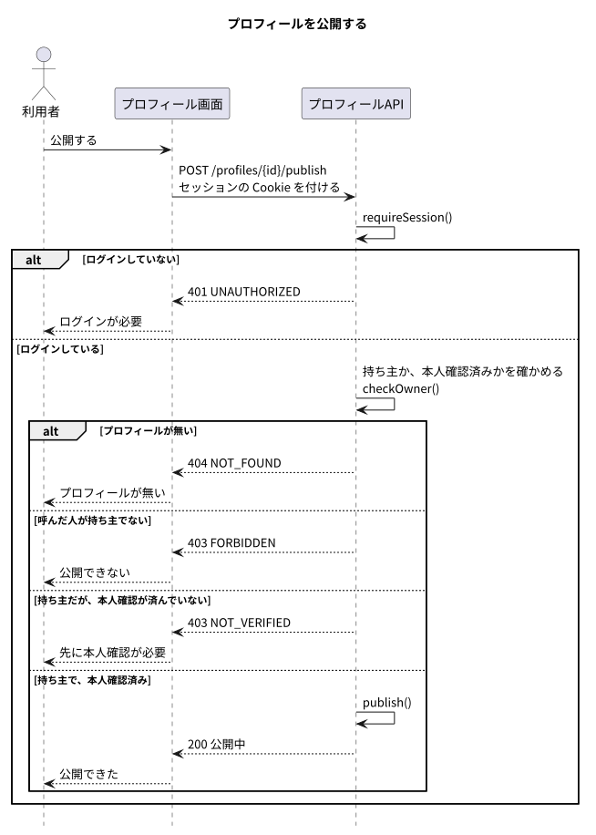

# プロフィールを公開する

ログインしていて、本人確認が済んでいる利用者だけ、自分のプロフィールを公開中にします。呼んだ人が誰かは、セッションの Cookie で分かります。

ソース: [入口.puml](入口.puml)

## 入力と結果

| 名前 | 必須 | 説明 |
| --- | --- | --- |
| セッションの Cookie | はい | ログイン時に付いた Cookie。ここから、呼んだ人の利用者ID（例: `user_123`）が分かります |
| プロフィールID | はい | 公開するプロフィール。パスで送ります。例: `profile_456` |

成功すると、そのプロフィールは公開中になります。`publishedAt` に日時が入ります。例: `2026-11-16T18:00:00+09:00`。

## 失敗するとき

| コード | いつ | 結果 |
| --- | --- | --- |
| UNAUTHORIZED | ログインしていない | 何も変えない |
| NOT_VERIFIED | 本人確認が済んでいない | 公開中にしない |
| NOT_FOUND | プロフィールが無い | 何も変えない |
| FORBIDDEN | 他人のプロフィールを公開しようとした | 何も変えない |

## 関連リンク

- [用語](用語.md)
- [処理詳細](処理詳細.md)
- [入口の図](入口.puml)
- [処理のイメージ](flow.puml)
- [変更履歴](変更履歴.md)
- [プロフィールを公開する（業務）](../../docs/business/プロフィールを公開する/README.md)
- 共通の言葉は [用語集](../../用語集.md)

AI向け：書き方と補足

これは深さ2です。画面とAPIのつながりだけを書きます。

利用者が画面で「公開する」を押すと、プロフィールAPIは次の順で確かめます。

1. セッションの Cookie から、呼んだ人の利用者IDを取る。無ければ `UNAUTHORIZED`
2. プロフィールがあるか。無ければ `NOT_FOUND`
3. その利用者IDが、プロフィールの持ち主と同じか。違えば `FORBIDDEN`
4. 本人確認が済んでいるか。まだなら `NOT_VERIFIED`

本人確認の手段は、例えば登録したメールアドレスに届いた確認リンクを開くことです。その手順のAPIは、このテンプレートには未掲載です。

