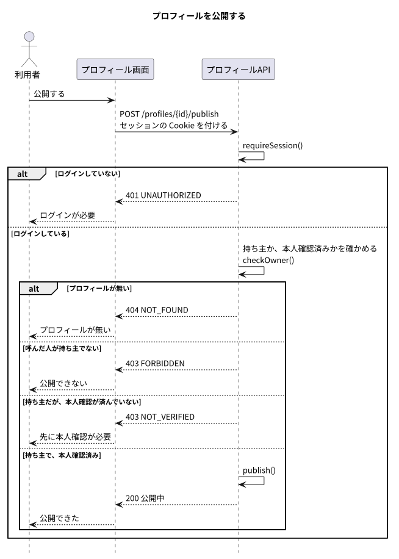

# プロフィールを公開する（設計書）

## 目次

- [概要](#概要)
- [説明](#説明)
- [エンドポイント](#エンドポイント)
- [メソッド](#メソッド)
- [リクエスト例](#リクエスト例)
- [レスポンス例](#レスポンス例)
- [処理フローの図](#処理フローの図)
- [処理詳細](#処理詳細)
    - [1. セッション検証](#1-セッション検証)
    - [2. 持ち主検証](#2-持ち主検証)
    - [3. 本人確認検証](#3-本人確認検証)
    - [4. 公開中にする](#4-公開中にする)
    - [5. 成功を返す](#5-成功を返す)

## 概要

ログインしていて本人確認が済んでいる持ち主だけ、自分のプロフィールを公開中にします。

## 説明

- 呼ぶのは、プロフィール画面です。利用者が「公開する」を押したときに呼びます。
- 決めたこと：
    - 持ち主でない人は `FORBIDDEN`、持ち主でも本人確認が済んでいない人は `NOT_VERIFIED` と、別の失敗にします。
    - 既に公開中なら `200` を返し、何も保存しません。`publishedAt` は最初に公開した日時のまま変えません。同じ依頼を2回しても、結果は同じです。
    - 本人確認の手段は、例えば登録したメールアドレスの確認リンクです。そのAPIは、このテンプレートにはまだ載せていません。
- このAPIの言葉は [用語](用語.md) にあります。利用者、プロフィール、公開中、本人確認は [用語集](../../用語集.md) にあります。
- 関連：[入口](README.md)、[変更履歴](変更履歴.md)、業務フロー [プロフィールを公開する](../../docs/business/プロフィールを公開する/README.md)

## エンドポイント

`/profiles/{id}/publish`

ホストは環境ごとに変わります。例: `https://api.example.com`。

## メソッド

`POST`

## リクエスト例

○＝必須、△＝条件付き必須、−＝任意

| 項目 | 名前 | 位置 | 型 | 必須 | 説明 |
| --- | --- | --- | --- | --- | --- |
| `Cookie` | セッションの Cookie | ヘッダー | 文字列 | ○ | ログイン時に付いた Cookie。ここから呼んだ人の利用者ID（例: `user_123`）を取る |
| `id` | プロフィールID | パス | 文字列 | ○ | 公開するプロフィール。例: `profile_456` |

```bash
curl -X POST https://api.example.com/profiles/profile_456/publish \
  -H "Cookie: session=session_789"
```

## レスポンス例

本文の形は例です。

成功（`200`、手順5）。既に公開中だった場合も同じ形で、`publishedAt` は最初に公開した日時のままです。

```json
{"status": "published", "publishedAt": "2026-11-16T18:00:00+09:00"}
```

セッションの Cookie が無い または 保存済みの有効なセッションと合わない（`401`、手順1.2）。

```json
{"code": "UNAUTHORIZED"}
```

パスのプロフィールIDのプロフィールが無い（`404`、手順2.1）。

```json
{"code": "NOT_FOUND"}
```

セッションの利用者IDがプロフィールの持ち主IDと一致しない（`403`、手順2.2）。

```json
{"code": "FORBIDDEN"}
```

セッションの利用者IDが持ち主IDと一致する かつ その利用者の本人確認が済んでいない（`403`、手順3.2）。

```json
{"code": "NOT_VERIFIED"}
```

## 処理フローの図

画面とAPIのつながりです。



ソース: [入口.puml](入口.puml)

APIの中の手順です。


ソース: [flow.puml](flow.puml)

## 処理詳細

### 1. セッション検証

- リクエストの Cookie のセッションIDを、保存済みの有効なセッションと照合し、呼んだ人の利用者IDを取る。例: `user_123`
- 1.1 Cookie のセッションIDが、保存済みの有効なセッションと合う場合
    - 手順2へ進む
- 1.2 Cookie が無い または Cookie のセッションIDが保存済みの有効なセッションと合わない場合
    - 401 エラー（`UNAUTHORIZED`）を返す
    - 何も保存しない
    - 例：有効なセッションは、ログインから24時間

### 2. 持ち主検証

- パスのプロフィールIDでプロフィールを探し、その持ち主IDを、セッションの利用者IDと照合する
- 2.1 パスのプロフィールIDのプロフィールが無い場合
    - 404 エラー（`NOT_FOUND`）を返す
    - 何も保存しない
- 2.2 プロフィールがある かつ セッションの利用者IDがプロフィールの持ち主IDと一致しない場合
    - 403 エラー（`FORBIDDEN`）を返す
    - 何も保存しない
- 2.3 プロフィールがある かつ セッションの利用者IDがプロフィールの持ち主IDと一致する場合
    - 手順3へ進む

### 3. 本人確認検証

- セッションの利用者の本人確認の状態を、確認済みと照合する
- 3.1 その利用者の本人確認が済んでいる場合
    - 手順4へ進む
- 3.2 その利用者の本人確認が済んでいない場合
    - 403 エラー（`NOT_VERIFIED`）を返す。公開中にはしない
    - 何も保存しない
    - 画面は、先に本人確認が必要と出す

### 4. 公開中にする

- プロフィールの状態を、公開中と照合する
- 4.1 プロフィールの状態が既に公開中の場合
    - 何も保存しない。`publishedAt` は変えない
    - 手順5へ進む
- 4.2 プロフィールの状態が公開中でない場合
    - 保存：状態を公開中に。`publishedAt` に現在日時（例: `2026-11-16T18:00:00+09:00`）
    - 手順5へ進む

### 5. 成功を返す

- `200` を返す
    - 本文の例は「レスポンス例」の成功にある
