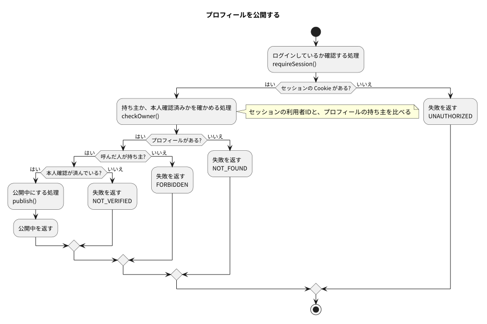

# 処理詳細

## 前提用語

このAPIの言葉は [用語](用語.md) にあります。利用者、プロフィール、公開中、本人確認は [用語集](../../用語集.md) にあります。

## 処理の概要

ログインしていて、本人確認が済んでいる持ち主だけ、プロフィールを公開中にします。セッションが無効な人、他人、本人確認が済んでいない人は、ここで止まります。

## 処理のイメージ

ソース: [flow.puml](flow.puml)

## 処理詳細

### 1. セッション検証。リクエストの Cookie を、保存済みの有効なセッションと照合し、利用者IDを取る。呼んだ人が誰かを知るのが目的

- 対応メソッド: `requireSession()`
- コード: `src/services/auth.ts`

リクエストの Cookie を、保存済みの有効なセッションと比べ、呼んだ人の利用者IDを取ります。例: `user_123`。Cookie が無い、合わない、または無効（例：ログインから24時間を過ぎた）の場合は `UNAUTHORIZED` を返します。

### 2. 持ち主・本人確認の検証。セッションの利用者IDとプロフィールの持ち主を照合する。公開してよい人だけ次へ進めるのが目的

- 対応メソッド: `checkOwner()`
- コード: `src/services/profile.ts`

プロフィールが無いときは `NOT_FOUND` を返します。セッションの利用者IDと、公開しようとしているプロフィールの持ち主を比べ、違うときは `FORBIDDEN` を返します。持ち主でも本人確認が済んでいなければ `NOT_VERIFIED` を返し、公開中にはしません。本人確認の手段（例: 登録したメールアドレスの確認リンクを開く）のAPIは、このテンプレートには未掲載です。

### 3. プロフィールを公開中にする処理。見ている人にプロフィールを見せるのが目的

- 対応メソッド: `publish()`
- コード: `src/services/profile.ts`

状態を公開中にし、`publishedAt` に現在日時を入れます。例: `2026-11-16T18:00:00+09:00`。

## 入力と結果

| 入力 | 結果 |
| --- | --- |
| `user_123` のセッションが有効で、`user_123` のプロフィール `profile_456` を指定した場合 | 公開中。`publishedAt` が入る |

## 失敗するとき

| 条件 | 結果 |
| --- | --- |
| セッションの Cookie が無い、または無効な場合 | `UNAUTHORIZED`。何も変えない |
| プロフィールが無い場合 | `NOT_FOUND`。何も変えない |
| 呼んだ人がプロフィールの持ち主でない場合 | `FORBIDDEN`。何も変えない |
| 持ち主だが、本人確認が済んでいない場合 | `NOT_VERIFIED`。公開中にはしない |

## コード（ファイルパス）

- `src/services/auth.ts` の `requireSession()`
- `src/services/profile.ts` の `checkOwner()`
- `src/services/profile.ts` の `publish()`

この3つのメソッドより細かい分岐は、設計書には書きません。実装は、上のコードを読んで判断します。
