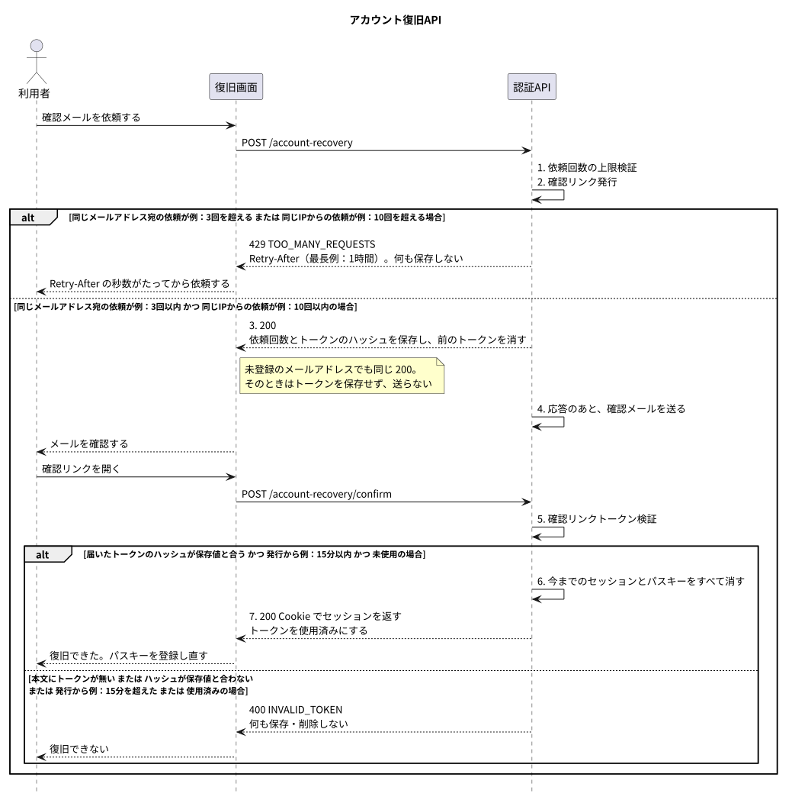

# アカウントを復旧する

パスキーの端末をなくした利用者が、登録したメールアドレスの確認リンクで本人確認し、新しいログイン状態にします。**復旧すると、今までのセッションとパスキーはすべて使えなくなります**。なくした端末からは、もうログインできません。利用者は、新しい端末でパスキーを登録し直します。

ソース: [入口.puml](入口.puml)

## 入力と結果

○＝必須、△＝条件付き必須、−＝任意

| 名前 | 必須 | 説明 |
| --- | --- | --- |
| メールアドレス | △（`POST /account-recovery` の場合） | 登録した宛先。例: `masato@example.com`。確認リンクの依頼で使います |
| 確認リンクのトークン | △（`POST /account-recovery/confirm` の場合） | メールに付いた1回限りの値。期限は15分。リンクを開いたときに送ります |

流れは2段階です。

1. `POST /account-recovery` で確認リンクを送ります。依頼できるのは、依頼した時刻から過去1時間で、同じメールアドレス宛に3回、同じIPから10回までです。上限内なら、依頼回数を1増やします（例：1時間で消える）。登録したメールアドレスなら、トークンの SHA-256 ハッシュも保存します。新しく依頼すると、前のトークンは消して使えなくします。
2. `POST /account-recovery/confirm` で確認リンクトークン検証をします。届いたトークンの SHA-256 ハッシュを保存したハッシュと照合し、発行から15分以内で未使用かも見ます。通れば、トークンを使用済みにし、今までのセッションとパスキーをすべて削除します。そのあと、新しいセッション（例：24時間有効）を保存し、その Cookie を返します。例: `session_789`。Cookie の属性は、[ログインする](../login/処理詳細.md) と同じです。

例: 雅人がスマホをなくして復旧すると、なくしたスマホのセッション `session_456` とパスキーはどちらも使えなくなります。

## 失敗するとき

| コード | いつ | 結果 |
| --- | --- | --- |
| TOO_MANY_REQUESTS | 過去1時間で、同じメールアドレス宛が3回を超えた、または同じIPが10回を超えた場合 | `429`。`Retry-After` に、次に依頼できるまでの秒数（最長1時間）を入れる。リンクは送らない。何も保存せず、この依頼は回数に数えない。メールアドレスの有無は返さない |
| INVALID_TOKEN | トークンが送られていない、ハッシュが保存値と合わない、発行から15分を超えた、既に使った、または新しい依頼で無効になった場合 | `400`。セッションは作らない。何も保存・削除しない。今までのセッションとパスキーも変えない |

## 関連リンク

- [用語](用語.md)
- [処理詳細](処理詳細.md)
- [入口の図](入口.puml)
- [処理のイメージ](flow.puml)
- [変更履歴](変更履歴.md)
- [パスキーを登録する](../register-passkey/README.md)
- [パスキーでログインする](../login-passkey/README.md)
- [パスキーの端末をなくす](../../docs/business/パスキーの端末をなくす/README.md)
- 共通の言葉は [用語集](../../用語集.md)

AI向け：書き方と補足

これは深さ2です。画面とAPIのつながりだけを書きます。

- 確認リンクは、登録したメールアドレスにだけ送ります。登録されていないメールアドレスでも、同じ応答を返します。アカウントの有無は分かりません。
- 回数の上限は、登録されていないメールアドレスも同じように数えます。`429` の有無から、アカウントの有無は分かりません。
- トークンの生の値は保存しません。保存するのは SHA-256 のハッシュだけです。検証では、届いたトークンの SHA-256 ハッシュを、保存したハッシュと比べます。データベースが漏れても、リンクは使えません。
- 復旧したら、端末を盗んだ人のセッションとパスキーも無効になります。パスキーは1つずつ選ばず、すべて無効にします。どれがなくした端末か、利用者が見分けられないことがあるためです。

