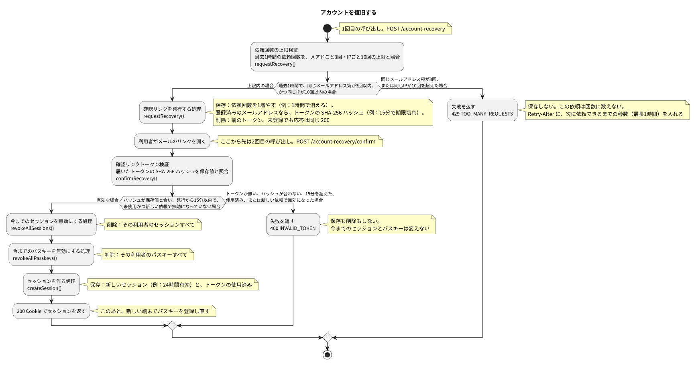

# 処理詳細

## 目次

- [前提用語](#前提用語)
- [処理の概要](#処理の概要)
- [処理のイメージ](#処理のイメージ)
- [処理詳細](#処理詳細-1)
  - [1. 確認リンクを送る処理。メールの持ち主だけ次へ進めるのが目的](#1-確認リンクを送る処理メールの持ち主だけ次へ進めるのが目的)
  - [2. 確認リンクトークン検証。届いたトークンの SHA-256 ハッシュを保存値と照合する。本人だけ復旧させるのが目的](#2-確認リンクトークン検証届いたトークンの-sha-256-ハッシュを保存値と照合する本人だけ復旧させるのが目的)
  - [3. 今までのセッションを無効にする処理。盗まれた端末のログインを切るのが目的](#3-今までのセッションを無効にする処理盗まれた端末のログインを切るのが目的)
  - [4. 今までのパスキーを無効にする処理。なくした端末でログインできなくするのが目的](#4-今までのパスキーを無効にする処理なくした端末でログインできなくするのが目的)
  - [5. セッションを作る処理。新しい端末でパスキーを登録するのが目的](#5-セッションを作る処理新しい端末でパスキーを登録するのが目的)
- [入力と結果](#入力と結果)
- [失敗するとき](#失敗するとき)
- [コード（ファイルパス）](#コードファイルパス)

## 前提用語

このAPIの言葉は [用語](用語.md) にあります。利用者、セッション、パスキーは [用語集](../../用語集.md) にあります。

## 処理の概要

登録したメールアドレスへ、1回限り・15分期限の確認リンクを送ります。依頼の回数には上限があります。リンクで本人確認できたら、今までのセッションとパスキーをすべて無効にし、新しいセッションを作ります。そのあと、利用者は新しい端末でパスキーを登録し直します。

## 処理のイメージ

ソース: [flow.puml](flow.puml)

## 処理詳細

### 1. 確認リンクを送る処理。メールの持ち主だけ次へ進めるのが目的

- 対応メソッド: `requestRecovery()`
- コード: `src/services/auth.ts`

`POST /account-recovery` で、まず依頼回数の上限検証をします。依頼した時刻から過去1時間の回数を、同じメールアドレス宛は3回、同じIPは10回と比べます。超えたら `429 TOO_MANY_REQUESTS` を返し、`Retry-After` に次に依頼できるまでの秒数（最長1時間）を入れます。リンクは送りません。何も保存せず、この依頼は回数に数えません。登録されていないメールアドレスも同じように数えます。

上限内なら、依頼回数を1増やして保存します（例：1時間で消える）。そのあと、確認リンクを発行します。期限は15分で、1回限りです。保存するのはトークンの SHA-256 ハッシュだけで、生の値は保存しません。新しく発行したら、前のトークンは使えなくします。リンクは登録したメールアドレスにだけ送ります。登録されていないメールアドレスのときは、トークンを発行せず、送信もしません。それでも応答は同じです。メールの送信は応答のあとに行い、応答時間の差からもアカウントの有無が分からないようにします。

### 2. 確認リンクトークン検証。届いたトークンの SHA-256 ハッシュを保存値と照合する。本人だけ復旧させるのが目的

- 対応メソッド: `confirmRecovery()`
- コード: `src/services/auth.ts`

`POST /account-recovery/confirm` で、届いたトークンの SHA-256 ハッシュを、保存したハッシュと比べます。発行から15分以内で未使用かも見ます。合わない、15分を超えた、使用済み、または新しい依頼で無効になったときは `INVALID_TOKEN` を返します。`400` で、何も保存・削除しません。今までのセッションとパスキーも変えません。通ったら、そのトークンを使用済みとして保存します。

### 3. 今までのセッションを無効にする処理。盗まれた端末のログインを切るのが目的

- 対応メソッド: `revokeAllSessions()`
- コード: `src/services/auth.ts`

その利用者の保存済みのセッションを、すべて削除して無効にします。例: なくしたスマホの `session_456` は、次のリクエストから `UNAUTHORIZED` になります。

### 4. 今までのパスキーを無効にする処理。なくした端末でログインできなくするのが目的

- 対応メソッド: `revokeAllPasskeys()`
- コード: `src/services/passkey.ts`

その利用者の保存済みのパスキーを、すべて削除して無効にします。1つずつ選ばせないのは、どれがなくした端末か、利用者が見分けられないことがあるためです。手元に残った端末も、登録し直します。

### 5. セッションを作る処理。新しい端末でパスキーを登録するのが目的

- 対応メソッド: `createSession()`
- コード: `src/services/auth.ts`

新しいセッションIDを作って保存し（例：ログインから24時間有効）、HttpOnly、Secure、SameSite=Lax の Cookie で返します。本文には入れません。例: Cookie の値 `session_789`。このあと、[パスキーを登録する](../register-passkey/README.md) で新しい端末を登録します。

## 入力と結果

| 入力 | 結果 | 保存・削除 |
| --- | --- | --- |
| 登録したメールアドレス `masato@example.com` で、過去1時間で、同じメールアドレス宛が3回以内、かつ同じIPが10回以内の場合 | `200`。確認リンクをその宛先へ送る | 保存：依頼回数を1増やす（例：1時間で消える）、トークンの SHA-256 ハッシュ（例：15分で期限切れ）。削除：前のトークン |
| 登録されていないメールアドレスで、上限内の場合 | `200`。上と同じ応答。リンクは送らない | 保存：依頼回数を1増やす（例：1時間で消える）。トークンは保存しない |
| トークンの SHA-256 ハッシュが保存値と合い、発行から15分以内で、未使用かつ新しい依頼で無効になっていない場合 | `200`。新しいセッションの Cookie `session_789` が付く | 保存：新しいセッション（例：24時間有効）、トークンの使用済み。削除：今までのセッション `session_456` とパスキーすべて |

## 失敗するとき

| 条件 | 結果 | 保存・削除 |
| --- | --- | --- |
| 過去1時間で、同じメールアドレス宛が3回を超えた（4回目）、または同じIPが10回を超えた（11回目）場合 | `TOO_MANY_REQUESTS`（`429`）。`Retry-After`（最長1時間）を返す。リンクは送らない | 何も保存しない。この依頼は回数に数えない |
| トークンが送られていない、ハッシュが合わない、発行から15分を超えた、既に使った、または新しい依頼で無効になった場合 | `INVALID_TOKEN`（`400`）。セッションは作らない | 何も保存・削除しない。今までのセッションとパスキーも変えない |

## コード（ファイルパス）

- `src/services/auth.ts` の `requestRecovery()`
- `src/services/auth.ts` の `confirmRecovery()`
- `src/services/auth.ts` の `revokeAllSessions()`
- `src/services/passkey.ts` の `revokeAllPasskeys()`
- `src/services/auth.ts` の `createSession()`

この5つのメソッドより細かい分岐は、設計書には書きません。実装は、上のコードを読んで判断します。
