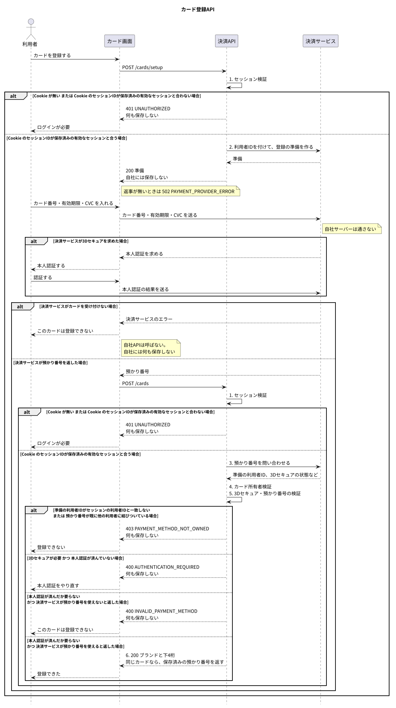

# カードを登録する

ログインしている利用者が、支払い用のカードを登録します。カード番号・有効期限・CVC は自社サーバーを通さず、画面に埋め込んだ決済サービスのフォームから、決済サービスへ直接送ります。自社が受け取って保存するのは、預かり番号、ブランド、下4桁、有効期限の月と年だけです。カード番号は保存も、ログへの記録もしません。カード番号を自社で持たないことで、PCI DSS の対象を小さくします。

例として、Stripe Elements と SetupIntent を使います。本文では「決済サービス」と書きます。

ソース: [入口.puml](入口.puml)

## 入力と結果

| 名前 | 必須 | 説明 |
| --- | --- | --- |
| セッションID | はい | 今のセッション。例: `session_789` |
| 預かり番号 | はい | 決済サービスが返す番号。例: `pm_1A2b3C`。2回目の `POST /cards` で送ります |

流れは2段階です。`POST /cards/setup` で決済サービスの準備を作り、画面がカード情報を決済サービスへ送ります。決済サービスが 3Dセキュアの本人認証を求めるときは、画面でそれを済ませます。認証できなければ、カードは登録しません。そのあと `POST /cards` で、預かり番号と表示用の情報だけを保存します。

成功すると、ブランドと下4桁が返ります。例: `Visa`、`4242`、有効期限 `2028年12月`。

## 失敗するとき

| コード | いつ | 結果 |
| --- | --- | --- |
| UNAUTHORIZED | ログインしていない | 登録しない |
| AUTHENTICATION_REQUIRED | 3Dセキュアの本人認証が済んでいない | 登録しない |
| INVALID_PAYMENT_METHOD | 預かり番号が使えない、または決済サービスがカードを受け付けない | 登録しない |

## 関連リンク

- [用語](用語.md)
- [処理詳細](処理詳細.md)
- [入口の図](入口.puml)
- [処理のイメージ](flow.puml)
- [変更履歴](変更履歴.md)
- [支払う](../create-payment/README.md)
- [カードで支払う](../../docs/business/カードで支払う/README.md)
- 共通の言葉は [用語集](../../用語集.md)

AI向け：書き方と補足

これは深さ2です。画面とAPIのつながりだけを書きます。

カード番号・有効期限・CVC は、自社のログ、データベース、図にも出しません。決済サービスから受け取る表示用の情報（ブランド、下4桁、有効期限の月と年）だけを保存します。

