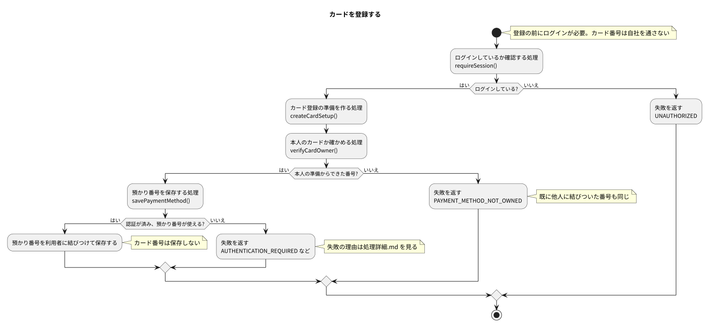

# 処理詳細

## 前提用語

このAPIの言葉は [用語](用語.md) にあります。利用者、セッション、決済サービス、預かり番号は [用語集](../../用語集.md) にあります。

## 処理の概要

ログインしている利用者だけ、カードを登録できます。カード番号・有効期限・CVC は自社サーバーを通さず、決済サービスへ直接送ります。自社が保存するのは預かり番号と表示用の情報だけです。預かり番号は、本人のために作った準備からできたものだけを、その利用者に結びつけて保存します。3Dセキュアが必要なときは、本人認証が済んでから保存します。

## 処理のイメージ

ソース: [flow.puml](flow.puml)

## 処理詳細

### 1. ログインしているか確認する処理。ログインした人だけ次へ進めるのが目的

- 対応メソッド: `requireSession()`
- コード: `src/services/auth.ts`

ログインしていなければ `UNAUTHORIZED` を返し、登録はしません。

### 2. カード登録の準備を作る処理。カード情報を決済サービスへ直接送れるようにするのが目的

- 対応メソッド: `createCardSetup()`
- コード: `src/services/payment.ts`

`POST /cards/setup` で、決済サービスに準備を作ります。例: SetupIntent。準備には利用者IDを付けます。画面は、その準備を使ってカード番号・有効期限・CVC を決済サービスへ送ります。自社サーバーは通しません。

### 3. 本人のカードか確かめる処理。他人のカードを登録させないのが目的

- 対応メソッド: `verifyCardOwner()`
- コード: `src/services/payment.ts`

`POST /cards` で受け取った預かり番号を、決済サービスに問い合わせます。その番号が、今の利用者のために作った準備からできたものかを確かめます。違うとき、または既に他の利用者に結びついているときは `PAYMENT_METHOD_NOT_OWNED` を返し、保存しません。

### 4. 預かり番号を保存する処理。表示に使う情報だけを残すのが目的

- 対応メソッド: `savePaymentMethod()`
- コード: `src/services/payment.ts`

決済サービスが返した預かり番号を、その利用者に結びつけて保存します。あわせて、ブランド、下4桁、有効期限の月と年を保存します。カード番号は保存も、ログへの記録もしません。3Dセキュアが必要で、本人認証が済んでいなければ `AUTHENTICATION_REQUIRED` を返し、保存しません。預かり番号が使えないときは `INVALID_PAYMENT_METHOD` を返します。

## 入力と結果

| 入力 | 結果 |
| --- | --- |
| セッション `session_789` と、預かり番号 `pm_1A2b3C` | 預かり番号、ブランド `Visa`、下4桁 `4242`、有効期限 2028年12月を保存する。カード番号は保存しない |

## 失敗するとき

| 条件 | 結果 |
| --- | --- |
| ログインしていない | `UNAUTHORIZED`。登録しない |
| 他人の準備からできた預かり番号、または既に他人に結びついた預かり番号 | `PAYMENT_METHOD_NOT_OWNED`。`403`。登録しない |
| 3Dセキュアの本人認証が済んでいない | `AUTHENTICATION_REQUIRED`。登録しない |
| 預かり番号が使えない、または決済サービスがカードを受け付けない | `INVALID_PAYMENT_METHOD`。登録しない |

## コード（ファイルパス）

- `src/services/auth.ts` の `requireSession()`
- `src/services/payment.ts` の `createCardSetup()`
- `src/services/payment.ts` の `verifyCardOwner()`
- `src/services/payment.ts` の `savePaymentMethod()`

この4つのメソッドより細かい分岐は、設計書には書きません。実装は、上のコードを読んで判断します。
