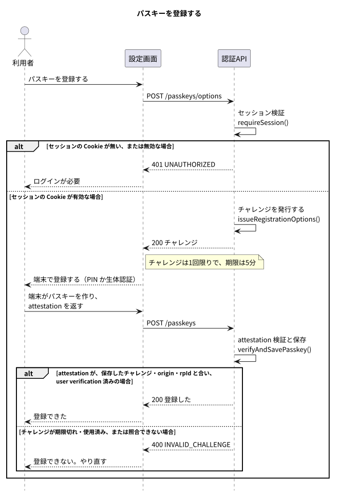

# パスキーを登録する

ログインしている利用者が、今の端末にパスキーを登録します。秘密鍵は端末から出ません。1人で、複数の端末を登録できます。登録したパスキーは、利用者が削除できます。

ソース: [入口.puml](入口.puml)

## 入力と結果

| 名前 | 必須 | 説明 |
| --- | --- | --- |
| セッションID | はい | 今のセッション。例: `session_789` |
| 端末名 | いいえ | 利用者が見る名前。例: `雅人のスマホ` |
| attestation | はい | 端末が作った登録の証明。2回目の `POST /passkeys` で送ります |

流れは2段階です。`POST /passkeys/options` でチャレンジを発行し、`POST /passkeys` で attestation を検証して公開鍵を保存します。チャレンジは1回限りで、期限は5分です。保存するのは公開鍵、credential ID、署名カウンタ、端末名だけです。

## 失敗するとき

| コード | いつ | 結果 |
| --- | --- | --- |
| UNAUTHORIZED | ログインしていない | 登録しない |
| INVALID_CHALLENGE | チャレンジが無い、期限切れ、既に使った、または attestation を検証できない | 登録しない |

## 関連リンク

- [用語](用語.md)
- [処理詳細](処理詳細.md)
- [入口の図](入口.puml)
- [処理のイメージ](flow.puml)
- [変更履歴](変更履歴.md)
- [パスキーでログインする](../login-passkey/README.md)
- [アカウントを復旧する](../recover-account/README.md)
- [パスキーの端末をなくす](../../docs/business/パスキーの端末をなくす/README.md)
- 共通の言葉は [用語集](../../用語集.md)

AI向け：書き方と補足

これは深さ2です。画面とAPIのつながりだけを書きます。

削除は `DELETE /passkeys/{credentialId}` です。ログインしている本人のパスキーだけ消せます。端末をなくして [アカウントを復旧する](../recover-account/README.md) を使ったときは、すべてのパスキーが無効になります。1つずつ消す必要はありません。

