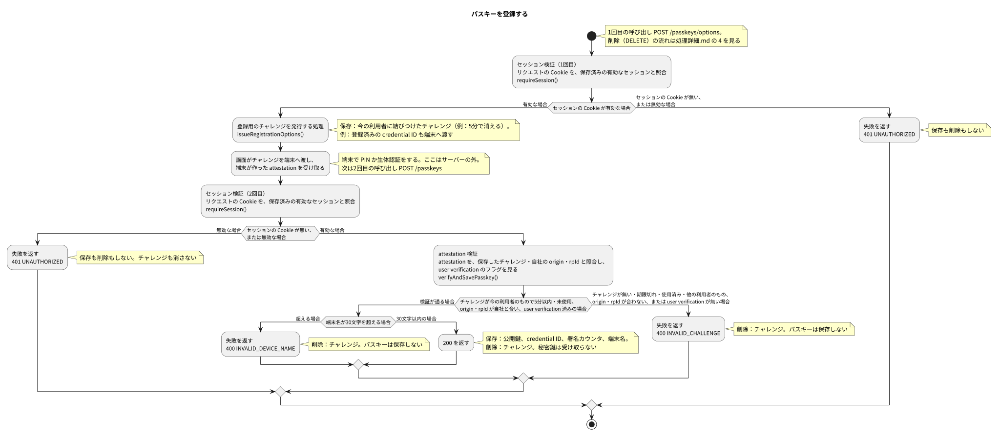

# 処理詳細

## 前提用語

このAPIの言葉は [用語](用語.md) にあります。利用者、セッション、パスキーは [用語集](../../用語集.md) にあります。

## 処理の概要

ログインしている利用者だけ、今の端末にパスキーを登録できます。秘密鍵は端末から出ません。公開鍵、credential ID（保存したパスキーを識別する値）、署名カウンタ、端末名を保存します。1人で、複数の端末を登録できます。登録したパスキーは、本人が削除できます。最後の1つは削除できません。

## 処理のイメージ

ソース: [flow.puml](flow.puml)

## 処理詳細

### 1. ログインしているか確認する処理。ログインした人だけ次へ進めるのが目的

- 対応メソッド: `requireSession()`
- コード: `src/services/auth.ts`

ログインしていなければ `UNAUTHORIZED` を返し、登録はしません。削除するときも、同じ確認をします。

### 2. 登録用のチャレンジを発行する処理。1回限りの確認に使うのが目的

- 対応メソッド: `issueRegistrationOptions()`
- コード: `src/services/passkey.ts`

`POST /passkeys/options` で、チャレンジ（この登録だけに使う一度きりの値）を発行します。チャレンジは画面に返し、今のログイン中の利用者に結びつけて、サーバーへ5分だけ保存します。使ったあと、または期限が切れたあとは、同じチャレンジでは登録できません。別の利用者のセッションでも使えません。

画面はチャレンジを端末に渡します。端末は、PIN か生体認証のあとパスキーを作り、attestation（パスキーを作った証明）を返します。

### 3. attestation を検証して保存する処理。公開鍵だけを残すのが目的

- 対応メソッド: `verifyAndSavePasskey()`
- コード: `src/services/passkey.ts`

`POST /passkeys` で、attestation が、発行して保存したチャレンジに対するものかを照合します。あわせて、origin（呼んだ画面のURL）と rpId（このサービスのドメイン）が自社のものか、端末で PIN か生体認証をしたか（user verification）を確かめます。すべて通れば、公開鍵、credential ID、署名カウンタ、端末名を保存します。秘密鍵は受け取りません。端末からも出ません。チャレンジが使えないとき、検証できないときは `INVALID_CHALLENGE` を返し、保存しません。同じ人の別の端末は、別に登録できます。

### 4. パスキーを削除する処理。使わなくなった端末でログインできなくするのが目的

- 対応メソッド: `deletePasskey()`
- コード: `src/services/passkey.ts`

`DELETE /passkeys/{credentialId}` で、本人のパスキーだけを削除します。他人のパスキーは消しません。最後の1つは消せません。消すとパスキーでログインできなくなり、メールの復旧に頼ることになるためです。

| 条件 | 結果 |
| --- | --- |
| ログインしていない | `UNAUTHORIZED`。`401`。消さない |
| その credential ID が無い、または他人のパスキー | `PASSKEY_NOT_FOUND`。`404`。消さない。他人のものか、無いのかは区別しない |
| 本人のパスキーが、これ1つだけ | `LAST_PASSKEY`。`409`。消さない |

## 入力と結果

| 入力 | 結果 |
| --- | --- |
| セッション `session_789` と、発行したチャレンジに対する attestation。端末名 `雅人のスマホ` | 公開鍵、credential ID `cred_88a1`、署名カウンタ、端末名を保存する。秘密鍵は保存しない |
| パスキーが2つある利用者が `DELETE /passkeys/cred_88a1` | `cred_88a1` を削除する。もう1つは残る |

## 失敗するとき

| 条件 | 結果 |
| --- | --- |
| ログインしていない | `UNAUTHORIZED`。登録しない |
| チャレンジが無い、期限切れ、既に使った、または attestation を検証できない | `INVALID_CHALLENGE`。登録しない |

## コード（ファイルパス）

- `src/services/auth.ts` の `requireSession()`
- `src/services/passkey.ts` の `issueRegistrationOptions()`
- `src/services/passkey.ts` の `verifyAndSavePasskey()`
- `src/services/passkey.ts` の `deletePasskey()`

この4つのメソッドより細かい分岐は、設計書には書きません。実装は、上のコードを読んで判断します。
