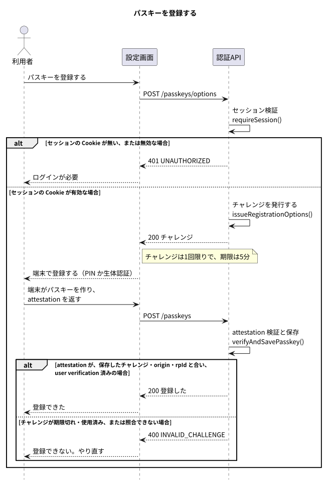

# パスキー登録API

## 目次

- [概要](#概要)
- [説明](#説明)
- [エンドポイント](#エンドポイント)
- [メソッド](#メソッド)
- [リクエスト例](#リクエスト例)
- [レスポンス例](#レスポンス例)
- [処理フローの図](#処理フローの図)
- [処理詳細](#処理詳細)
    - [1. セッション検証](#1-セッション検証)
    - [2. チャレンジ発行](#2-チャレンジ発行)
    - [3. attestation 検証](#3-attestation-検証)
    - [4. 端末名検証](#4-端末名検証)
    - [5. 保存して成功を返す](#5-保存して成功を返す)
    - [6. パスキー削除](#6-パスキー削除)

## 概要

ログインしている利用者の今の端末にパスキーを登録し、公開鍵だけを保存します。登録したパスキーの削除もします。

## 説明

- 呼ぶのは、設定画面です。どの呼び出しも、ログイン時に付いたセッションの Cookie が要ります。
- 登録の呼び出しは2回です。1回目でチャレンジを受け取り、端末が PIN か生体認証のあとパスキーを作って attestation を返し、2回目でその attestation を送ります。
- 決めたこと：
    - 秘密鍵は端末から出ません。保存するのは公開鍵、credential ID、署名カウンタ、端末名だけです。
    - 1人で、複数の端末を登録できます。例：同じ端末で2回登録させないよう、登録済みの credential ID も端末へ渡します（excludeCredentials）。
    - チャレンジは1回限りで、発行したときのログイン中の利用者に結びつけます。2回目の呼び出しでセッション検証を通ったあとは、成否にかかわらずチャレンジを消します。セッション検証で `401` になったときは消しません。
    - 削除できるのは本人のパスキーだけです。最後の1つは削除できません。消すとパスキーでログインできなくなり、メールアドレスでの復旧に頼ることになるためです。
    - 端末をなくして [アカウント復旧API](../recover-account/README.md) を使ったときは、すべてのパスキーが無効になります。1つずつ消す必要はありません。
- このAPIで使う言葉（チャレンジ、attestation、origin と rpId、user verification、credential ID、署名カウンタ、端末名、利用者、セッション、パスキー）は、[用語集](../../用語集.md) にあります。
- 関連：[入口](README.md)、[変更履歴](変更履歴.md)、[パスキーログインAPI](../login-passkey/README.md)

## エンドポイント

登録は呼ぶ順に2つ、削除は1つです。

1. `/passkeys/options`（登録用のチャレンジを受け取る）
2. `/passkeys`（attestation を送って登録する）
3. `/passkeys/{credentialId}`（パスキーを削除する）

ホストは環境ごとに変わります。例: `https://api.example.com`。

## メソッド

| エンドポイント | メソッド |
| --- | --- |
| `/passkeys/options` | `POST` |
| `/passkeys` | `POST` |
| `/passkeys/{credentialId}` | `DELETE` |

## リクエスト例

○＝必須、△＝条件付き必須、−＝任意

| 項目 | 名前 | 位置 | 型 | 必須 | 説明 |
| --- | --- | --- | --- | --- | --- |
| `Cookie` | セッションの Cookie | ヘッダー | 文字列 | ○ | ログイン時に付いた Cookie。例: `session=session_789` |
| `Content-Type` | 本文の形式 | ヘッダー | 文字列 | △（`POST /passkeys` の場合） | `application/json` |
| `attestation` | 登録の証明 | 本文 | オブジェクト | △（`POST /passkeys` の場合） | 端末が作った登録の証明。公開鍵、credential ID、署名カウンタ、origin、rpId、user verification のフラグを含む |
| `deviceName` | 端末名 | 本文 | 文字列 | − | `POST /passkeys` で送る。例: `雅人のスマホ`。例：30文字まで（Unicode のコードポイントで数える）。無い または 空なら「端末」を保存する |
| `credentialId` | credential ID | パス | 文字列 | △（`DELETE` の場合） | 削除するパスキー。例: `cred_88a1` |

```bash
curl -X POST https://api.example.com/passkeys/options \
  -H "Cookie: session=session_789"

curl -X POST https://api.example.com/passkeys \
  -H "Cookie: session=session_789" \
  -H "Content-Type: application/json" \
  -d '{"attestation": {"credentialId": "cred_88a1", "publicKey": "...", "signCount": 0}, "deviceName": "雅人のスマホ"}'

curl -X DELETE https://api.example.com/passkeys/cred_88a1 \
  -H "Cookie: session=session_789"
```

## レスポンス例

本文の形は例です。

チャレンジを返す（`200`、手順2）。

```json
{"challenge": "ch_7c20", "rpId": "example.com", "excludeCredentials": ["cred_5b10"]}
```

登録できた（`200`、手順5）。

```json
{"credentialId": "cred_88a1", "deviceName": "雅人のスマホ"}
```

削除できた（`200`、手順6.3）。

```json
{}
```

セッションの Cookie が無い または 保存済みの有効なセッションと合わない（`401`、手順1.2）。

```json
{"code": "UNAUTHORIZED"}
```

attestation が発行したチャレンジ・自社の origin・rpId と合わない（`400`、手順3.2）。

```json
{"code": "INVALID_CHALLENGE"}
```

端末名が例：30文字を超える（`400`、手順4.2）。

```json
{"code": "INVALID_DEVICE_NAME"}
```

削除する credential ID のパスキーが無い または 他人のパスキー（`404`、手順6.1）。

```json
{"code": "PASSKEY_NOT_FOUND"}
```

本人のパスキーがこれ1つだけ（`409`、手順6.2）。

```json
{"code": "LAST_PASSKEY"}
```

## 処理フローの図

画面とAPIのつながりです。削除の流れは、処理詳細の手順6にあります。



APIの中の手順です。


## 処理詳細

### 1. セッション検証

3つの呼び出しで同じ手順です。

- リクエストの Cookie のセッションIDを、保存済みの有効なセッションと照合する
- 1.1 Cookie のセッションIDが、保存済みの有効なセッションと合う場合
    - `POST /passkeys/options` なら手順2へ進む
    - `POST /passkeys` なら手順3へ進む
    - `DELETE /passkeys/{credentialId}` なら手順6へ進む
- 1.2 Cookie が無い または Cookie のセッションIDが保存済みの有効なセッションと合わない場合
    - 401 エラー（`UNAUTHORIZED`）を返す
    - 何も保存・削除しない。チャレンジも消さない
    - 例：有効なセッションは、ログインから24時間。ログインし直せば、期限内のチャレンジで送り直せる

### 2. チャレンジ発行

`POST /passkeys/options` の手順です。

- 1回限りのチャレンジを作り、今のログイン中の利用者に結びつけて保存する
    - 保存：チャレンジ（例：5分で消える）
    - 例：その利用者の登録済み credential ID も返し、端末へ渡す（excludeCredentials）
- 2.1 チャレンジの保存が終わった場合
    - `200` を返し、チャレンジを本文に入れる
    - 画面はチャレンジを端末に渡す。端末は PIN か生体認証のあとパスキーを作り、attestation を返す。ここはサーバーの外

### 3. attestation 検証

ここから `POST /passkeys` の手順です。

- attestation を、保存したチャレンジと照合する。あわせて、attestation の origin を自社画面の origin（スキーム・ホスト・ポート）と、rpId を自社ドメインと照合し、user verification のフラグを見る
- 3.1 attestation のチャレンジが今の利用者に発行した例：5分以内 かつ 未使用のチャレンジと合う かつ origin・rpId が自社と合う かつ user verification のフラグがある場合
    - 手順4へ進む
- 3.2 attestation のチャレンジが今の利用者に発行した有効なチャレンジと合わない または origin・rpId のいずれかが自社と合わない または user verification のフラグが無い場合
    - 400 エラー（`INVALID_CHALLENGE`）を返す。パスキーは保存しない
    - 削除：チャレンジ
    - 例: チャレンジが無い、期限切れ、使用済み、他の利用者のもの
    - 画面は `POST /passkeys/options` からやり直す

### 4. 端末名検証

- 本文の `deviceName` を、例：30文字（Unicode のコードポイント）と比べる
- 4.1 `deviceName` が例：30文字以内 または `deviceName` が無い または 空の場合
    - 手順5へ進む
- 4.2 `deviceName` が例：30文字を超える場合
    - 400 エラー（`INVALID_DEVICE_NAME`）を返す。パスキーは保存しない
    - 削除：チャレンジ
    - 画面は `POST /passkeys/options` からやり直す

### 5. 保存して成功を返す

- 公開鍵、credential ID、署名カウンタ、端末名を保存する。秘密鍵は受け取らない
    - `deviceName` が無い または 空なら、端末名に「端末」を保存する
    - 削除：チャレンジ
- 5.1 パスキーの保存が終わった場合
    - `200` を返す。本文の例は「レスポンス例」の、登録できた場合にある

### 6. パスキー削除

`DELETE /passkeys/{credentialId}` の手順です。

- パスの credential ID を、ログインしている本人の保存済みパスキーと照合する
- 6.1 パスの credential ID のパスキーが無い または そのパスキーの持ち主が本人でない場合
    - 404 エラー（`PASSKEY_NOT_FOUND`）を返す。無いのか他人のものかは区別しない
    - 何も削除しない
- 6.2 パスの credential ID が本人のパスキーと合う かつ 本人のパスキーがこれ1つだけの場合
    - 409 エラー（`LAST_PASSKEY`）を返す
    - 何も削除しない
- 6.3 パスの credential ID が本人のパスキーと合う かつ 本人のパスキーが2つ以上ある場合
    - `200` を返す
    - 削除：指定したパスキー（公開鍵、credential ID、署名カウンタ、端末名）
