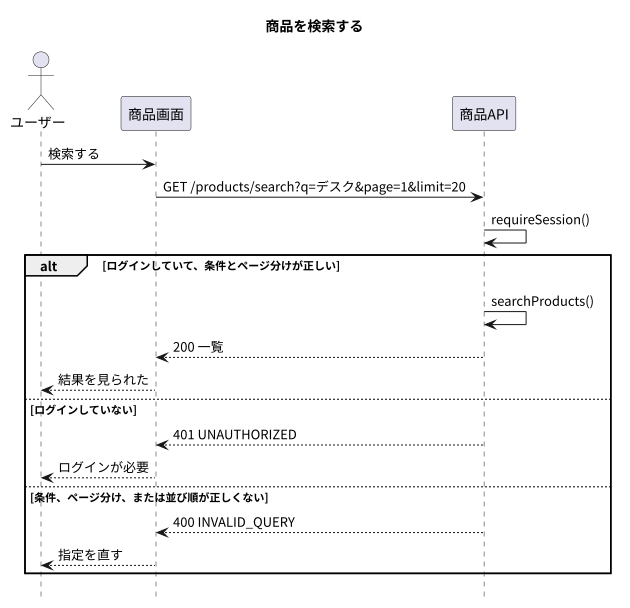

# 商品を検索する

ログインしている利用者に、商品名に検索語を含む、公開中の商品を返します。

ソース: [入口.puml](入口.puml)

## 入力と結果

| 名前 | 必須 | 説明 |
| --- | --- | --- |
| セッションの Cookie | はい | ログイン時に付いた Cookie。例: `session_789` |
| q | はい | 商品名に含まれる検索語。例: `デスク`。上限は100文字（Unicode のコードポイントで数える） |
| page | いいえ | 何ページ目か。既定は `1`。決まりは [ページ分け](../../用語集.md) |
| limit | いいえ | 1ページの件数。既定は `20`。上限は `100`。決まりは [ページ分け](../../用語集.md) |
| sort | いいえ | 並びのキー。既定は `created_at`。決まりは [並び順](../../用語集.md) |
| order | いいえ | 昇順か降順か。既定は `desc`。決まりは [並び順](../../用語集.md) |

成功すると、条件に合う公開中の商品の検索結果が返ります。例: `q=デスク` で「木製デスク」が1件。0件のときも、指定したページが最後より後ろのときも、空の検索結果です。

## 失敗するとき

| コード | いつ | 結果 |
| --- | --- | --- |
| UNAUTHORIZED | セッションの Cookie が無い、または無効な場合 | `401`。検索結果を返さない |
| INVALID_QUERY | 検索語が無い、空、または100文字を超える場合。ページ分けや並び順が決まりどおりでない場合 | `400`。検索結果を返さない |

## 関連リンク

- [用語](用語.md)
- [処理詳細](処理詳細.md)
- [入口の図](入口.puml)
- [処理のイメージ](flow.puml)
- [変更履歴](変更履歴.md)
- [ログインして商品を探す](../../docs/business/ログインして商品を探す/README.md)
- 共通の言葉は [用語集](../../用語集.md)

AI向け：書き方と補足

これは深さ2です。画面とAPIのつながりだけを書きます。

セッションが有効で、検索語・ページ分け・並び順が決まりどおりなら、名前にその検索語を含む公開中の商品を返します。0件のときも成功です。`%` と `_` は普通の文字として扱い、ワイルドカードにはしません。同じ日時や同じ価格のときは、商品IDの昇順です。

