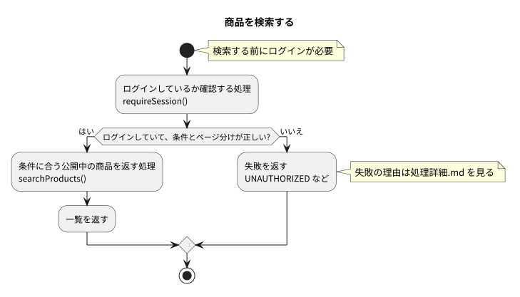

# 処理詳細

## 目次

- [前提用語](#前提用語)
- [処理の概要](#処理の概要)
- [処理のイメージ](#処理のイメージ)
- [処理詳細](#処理詳細-1)
    - [1. セッション検証。リクエストの Cookie を、保存済みの有効なセッションと照合する。ログインした人だけ次へ進めるのが目的](#1-セッション検証リクエストの-cookie-を保存済みの有効なセッションと照合するログインした人だけ次へ進めるのが目的)
    - [2. 検索語と指定の検証と、検索結果の返却。q の文字数と、page・limit・sort・order を、決まりと照合する。探している人に結果を見せるのが目的](#2-検索語と指定の検証と検索結果の返却q-の文字数とpagelimitsortorder-を決まりと照合する探している人に結果を見せるのが目的)
- [入力と結果](#入力と結果)
- [失敗するとき](#失敗するとき)
- [コード（ファイルパス）](#コードファイルパス)

## 前提用語

このAPIの言葉は [用語](用語.md) にあります。利用者、セッション、商品、公開中の商品、ページ分け、並び順は [用語集](../../用語集.md) にあります。

## 処理の概要

ログインしている利用者だけ、条件に合う公開中の商品を返します。セッションが無効な人と、指定が決まりどおりでない場合は、ここで止まります。0件でも成功します。

## 処理のイメージ

ソース: [flow.puml](flow.puml)

## 処理詳細

### 1. セッション検証。リクエストの Cookie を、保存済みの有効なセッションと照合する。ログインした人だけ次へ進めるのが目的

- 対応メソッド: `requireSession()`
- コード: `src/services/auth.ts`

リクエストの Cookie を、保存済みの有効なセッションと比べます。Cookie が無い、合わない、または無効（例：ログインから24時間を過ぎた）の場合は `UNAUTHORIZED`（`401`）を返し、検索結果は返しません。

### 2. 検索語と指定の検証と、検索結果の返却。q の文字数と、page・limit・sort・order を、決まりと照合する。探している人に結果を見せるのが目的

- 対応メソッド: `searchProducts()`
- コード: `src/services/product.ts`

検索語 `q` が無いとき、空のとき、100文字（コードポイントで数える）を超える場合は `INVALID_QUERY`（`400`）を返します。`%` と `_` は普通の文字として扱い、ワイルドカードにはしません。ページ分けと並び順の決まりは、商品一覧と同じで、[用語集](../../用語集.md) にあります。`created_at` や `price` が同じときは、商品IDの昇順で並べます。指定が決まりどおりでなければ `INVALID_QUERY`（`400`）を返します。公開中の商品のうち、名前に検索語を含むものだけを返します。0件のときも、指定したページが最後より後ろのときも、成功として空の検索結果を返します。このAPIは読むだけで、どの場合も保存も削除もしません。

## 入力と結果

| 入力 | 結果 | 保存・削除 |
| --- | --- | --- |
| セッション `session_789` が有効で、`q=デスク&page=1&limit=20`（既定の並び順）の場合 | `200`。名前に「デスク」を含む公開中の商品。例: 「木製デスク」が1件 | 保存も削除もしない |
| セッションが有効で、合う商品が0件、または指定したページが最後より後ろの場合 | `200`。空の検索結果 | 保存も削除もしない |

## 失敗するとき

| 条件 | 結果 | 保存・削除 |
| --- | --- | --- |
| セッションの Cookie が無い、または無効な場合 | `UNAUTHORIZED`（`401`）。検索結果は返さない | 保存も削除もしない |
| 検索語 `q` が無い、空、または100文字を超える場合 | `INVALID_QUERY`（`400`）。検索結果は返さない | 保存も削除もしない |
| `page`・`limit`・`sort`・`order` のどれかが、用語集の決まりどおりでない場合 | `INVALID_QUERY`（`400`）。検索結果は返さない | 保存も削除もしない |

## コード（ファイルパス）

- `src/services/auth.ts` の `requireSession()`
- `src/services/product.ts` の `searchProducts()`

この2つのメソッドより細かい分岐は、設計書には書きません。実装は、上のコードを読んで判断します。
