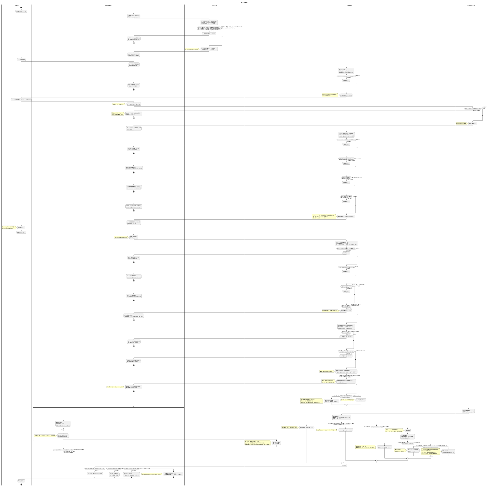

# カードで支払う

利用者がパスキーでログインし、カードを登録してから支払います。カード番号は決済サービスへ直接送り、自社は預かり番号だけを保存します。支払いAPIの応答は処理中です。決済サービスからの通知を確かめてから、支払い済みが確定します。

## 関連リンク

- [処理のイメージ](flow.puml)
- [パスキーログインAPIの入口](../../../apis/login-passkey/README.md)
- [カード登録APIの入口](../../../apis/register-card/README.md)
- [支払いAPIの入口](../../../apis/create-payment/README.md)
- [決済通知APIの入口](../../../apis/payment-webhook/README.md)
- [変更履歴](変更履歴.md)

AI向け：書き方と補足

これは深さ1の業務フローです。レーンは「利用者」「支払い画面」「認証API」「決済API」「決済サービス」です。

カード番号は自社サーバーを通しません。同じ注文の支払いボタンを2回押しても、同じ Idempotency-Key で二重に請求しません。3Dセキュアが必要なときの画面の動きは、[カード登録APIの入口](../../../apis/register-card/README.md) にあります。

