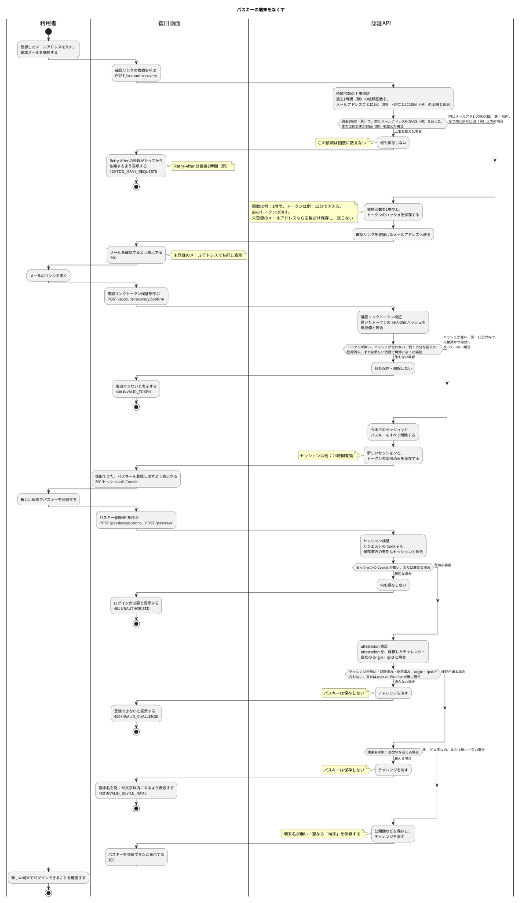

# パスキーの端末をなくす

パスキーの端末をなくした利用者が、登録したメールアドレスの確認リンクで本人確認します。**復旧すると、今までのセッションとパスキーはすべて使えなくなります**。そのあと、新しい端末でパスキーを登録し直します。

## 目次

- [分かれ道と結果](#分かれ道と結果)
- [関連リンク](#関連リンク)

## 分かれ道と結果

| 分かれ道 | 返すもの | 保存・削除 |
| --- | --- | --- |
| 過去1時間で、同じメールアドレス宛が3回を超えた、または同じIPが10回を超えた場合 | `TOO_MANY_REQUESTS`（`429`）（`Retry-After` は最長1時間） | 何も保存しない。この依頼は回数に数えない |
| 上限内の場合 | `200`（未登録のメールアドレスでも同じ） | 保存：依頼回数を1増やす（例：1時間で消える）、トークンのハッシュ（例：15分で期限切れ）。削除：前のトークン |
| トークンが無い、ハッシュが合わない、15分を超えた、使用済み、または新しい依頼で無効になった場合 | `INVALID_TOKEN`（`400`） | 何も保存・削除しない |
| トークンが使える場合 | `200` セッションの Cookie | 削除：今までのセッションとパスキーすべて。保存：新しいセッション（例：24時間有効）、トークンの使用済み |
| パスキー登録で、セッションの Cookie が無い、または無効な場合 | `UNAUTHORIZED`（`401`） | 何も保存しない |
| チャレンジが無い・期限切れ・使用済み、origin・rpId が合わない、または user verification が無い場合 | `INVALID_CHALLENGE`（`400`） | 削除：チャレンジ。パスキーは保存しない |
| 検証は通ったが、端末名が30文字を超える場合 | `INVALID_DEVICE_NAME`（`400`） | 削除：チャレンジ。パスキーは保存しない |
| 検証が通り、端末名が30文字以内、または無い・空の場合 | `200` | 保存：公開鍵、credential ID、署名カウンタ、端末名（無い・空なら「端末」）。削除：チャレンジ |

## 関連リンク

- [処理のイメージ](flow.puml)
- [アカウント復旧APIの入口](../../../apis/recover-account/README.md)
- [パスキー登録APIの入口](../../../apis/register-passkey/README.md)
- [パスキーログインAPIの入口](../../../apis/login-passkey/README.md)
- [変更履歴](変更履歴.md)

AI向け：書き方と補足

これは深さ1の業務フローです。レーンは「利用者」「復旧画面」「認証API」です。

確認リンクは1回限りで、期限は15分です。依頼は、依頼した時刻から過去1時間で、同じメールアドレス宛に3回、同じIPから10回までです。リンクで本人確認できたら、なくした端末を含むすべてのセッションとパスキーを無効にします。なくした端末を1つずつ選んで消す手順はありません。新しい端末の登録は、パスキー登録APIを使います。

