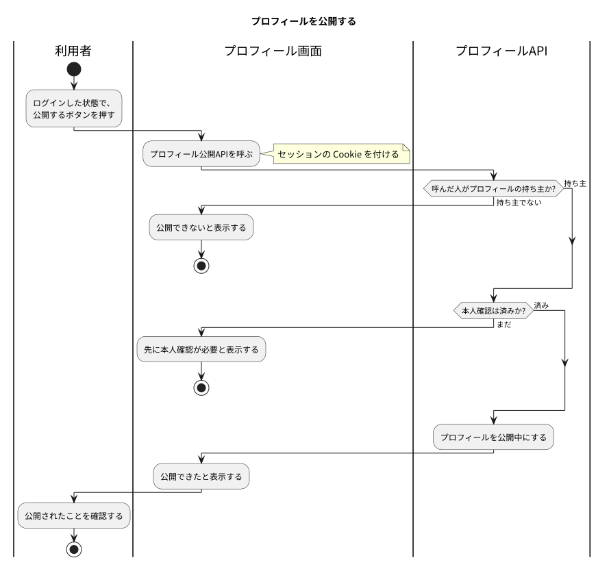

# プロフィールを公開する

ログインした利用者が公開すると、本人確認が済んでいるときだけ、プロフィールが公開中になります。本人確認の手段（例: 登録したメールアドレスの確認リンク）は未掲載です。

## 目次

- [分かれ道と結果](#分かれ道と結果)
- [関連リンク](#関連リンク)

## 分かれ道と結果

各APIの主な結果です。すべての分かれ道と、保存・削除するものは、各APIの処理詳細にあります。

| API | 主な結果 |
| --- | --- |
| [プロフィールを公開する](../../../apis/publish-profile/処理詳細.md#処理詳細) | 持ち主で本人確認が済んでいれば `200` で公開中にする。既に公開中でも `200`。本人確認が済んでいなければ `403` |

## 関連リンク

- [処理のイメージ](flow.puml)
- [変更履歴](変更履歴.md)

AI向け：書き方と補足

本文の「分かれ道と結果」は、各APIの主な結果だけです。分かれ道ごとの返すものと保存・削除は、各APIの処理詳細が正です。ここに写しません。

これは深さ1の業務フローです。レーンは「利用者」「プロフィール画面」「プロフィールAPI」です。

