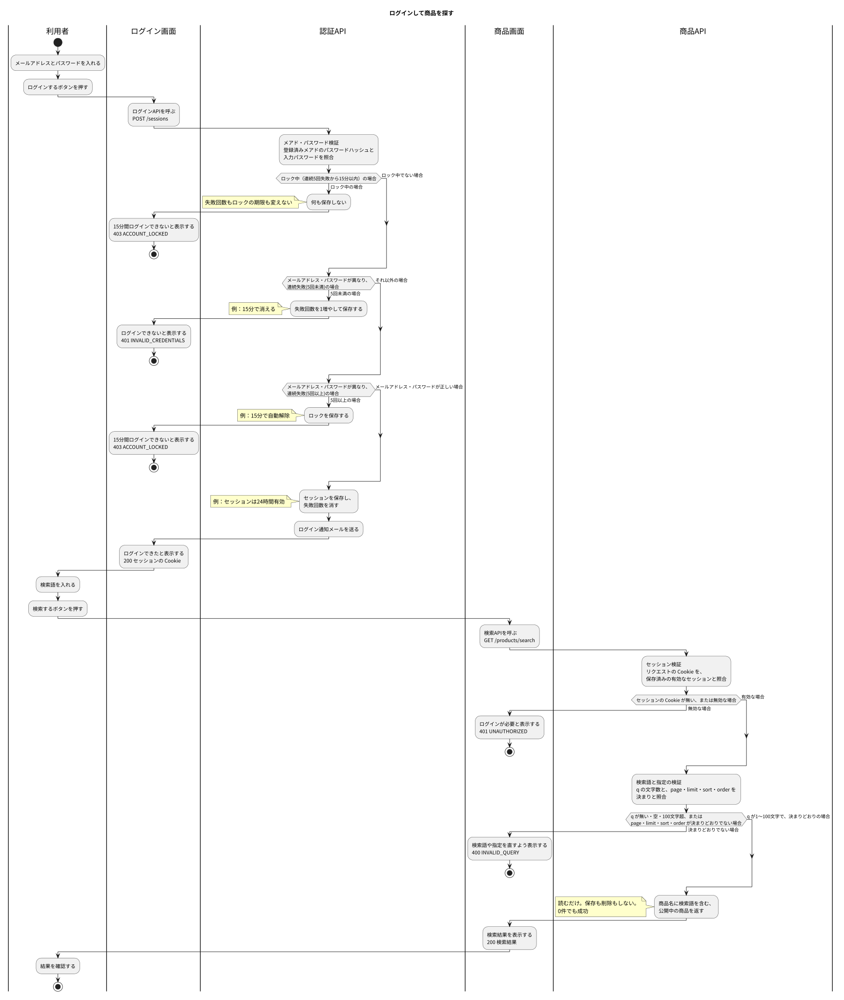

# ログインして商品を探す

利用者がログインしたあと、言葉を入れて公開中の商品を探します。ログインできなければ、検索には進みません。

## 関連リンク

- [処理のイメージ](flow.puml)
- [ログインAPIの入口](../../../apis/login/README.md)
- [商品検索APIの入口](../../../apis/search-products/README.md)
- [変更履歴](変更履歴.md)

AI向け：書き方と補足

これは深さ1の業務フローです。レーンは「ユーザー」「ログイン画面」「認証API」「商品画面」「商品API」です。

