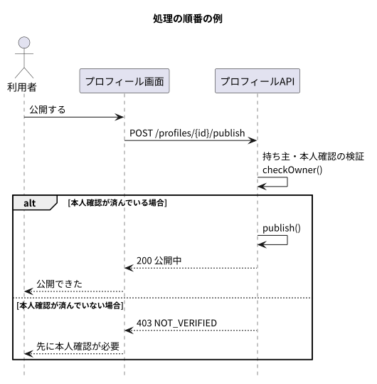
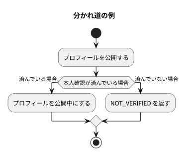
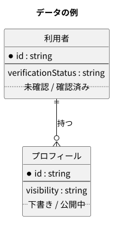
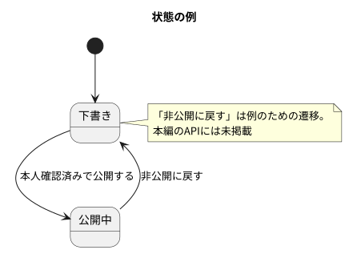

# 図の書き方の例

図は PlantUML だけです。Mermaid は使いません。書き方の決まりは [はじめに](../../README.md) にあります。

## 処理の順番

画面がAPIを呼び、本人確認のあとで公開する例です。

ソース: [処理の順番.puml](処理の順番.puml)

## 分かれ道

確認済みの人だけ公開中にする例です。

ソース: [分かれ道.puml](分かれ道.puml)

## データ

利用者がプロフィールを複数持てる例です。

ソース: [データ.puml](データ.puml)

## 状態

本人確認済みで公開すると、下書きから公開中になる例です。

ソース: [状態.puml](状態.puml)
