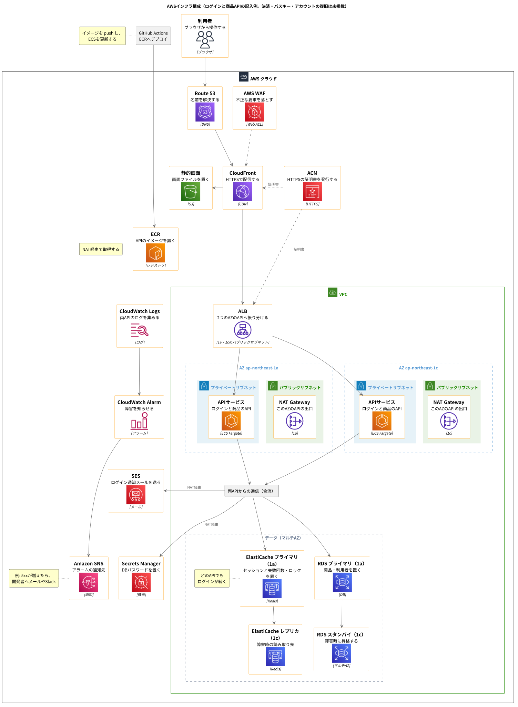

# AWSのインフラ構成

ログインと商品のAPIを動かす、AWSの構成です。記入例なので、決済、パスキー、アカウントの復旧は載せていません。

ソース: [構成図.puml](構成図.puml)

要求は、図の中央を上から下へ流れます。

1. 利用者の要求は、Route 53 と CloudFront を通ります。画面は S3 から返し、APIの要求は ALB へ回します。
2. ALB は、2つのAZにあるAPIサービス（ECS Fargate）へ振り分けます。
3. APIは、セッションを ElastiCache に、利用者と商品を RDS に置きます。ログイン通知メールは SES で送ります。

図の左側は、デプロイ（GitHub Actions、ECR）と監視（CloudWatch、SNS）です。

対象のAPI: [ログインする](../../apis/login/README.md)、[ログアウトする](../../apis/logout/README.md)、[商品詳細を取得する](../../apis/get-product/README.md)、[商品一覧を取得する](../../apis/list-products/README.md)、[商品を検索する](../../apis/search-products/README.md)

AI向け：図の描き方と各要素の細部

図の描き方です。

- 箱には、名前と役割を1行書きます。補足と具体例は黄色い付箋に書きます。付箋は対象の箱の真横か真下に置き、短い点線でつなぎます。付箋は対象と同じ枠（AWSクラウド、VPC、AZ、サブネット、データ帯）の内側に置き、枠はまたぎません。矢印は交差させません。
- 実線は通信の流れです。AWS WAF から CloudFront、ACM から CloudFront と ALB への点線は、付けている関係と証明書を示します。
- 2つのAPIからの線は「両APIからの通信（合流）」で合流し、ElastiCache、RDS、Secrets Manager、SES へ分かれます。片方のAPIだけがDBを使う、とは読みません。
- APIから NAT、ECR、CloudWatch Logs への線は、交差を避けるため省きます。ECR は付箋「NAT経由で取得する」で示します。
- GitHub Actions から ECR への線はデプロイです。CloudWatch Alarm の通知先は SNS で、SES には繋がりません。
- 図では、セキュリティグループと VPCエンドポイントを省きます。決済サービス（外部）、決済通知の受け口、通知の署名の秘密も載せていません。
- アイコンは、plantuml.jar に入っている awslib を使います。外部のURLは読み込みません。

各要素の細部です。

- Route 53: 例: `www.example.com`。
- S3（静的画面）: CloudFront からだけ読めます（OAC）。直接のURLでは開けません。例: `login.html`。
- ALB: 2つのAZのパブリックサブネットにまたがります。
- NAT Gateway: AZごとに1つ、そのAZのパブリックサブネットに置きます。そのAZのAPIが ECR、SES、Secrets Manager へ出るときに使います。
- ECS Fargate（APIサービス）: 各AZのプライベートサブネットに1つずつ置きます。例: `POST /sessions`、`GET /products/search`。
- ElastiCache: セッションの TTL は、ログインから例：24時間です。切れたら、もう一度ログインします。ログインの失敗回数とロックも置き、TTL は例：15分です。プライマリは `ap-northeast-1a`、レプリカは `ap-northeast-1c` です。
- RDS: 例: メールアドレス `masato@example.com`、商品 `product_1001`。プライマリは `ap-northeast-1a`、スタンバイは `ap-northeast-1c` です。
- Secrets Manager: DBパスワードを置きます。決済通知の署名の秘密も実際はここに置きますが、図には載せていません。値はコード、ログ、図に出しません。VPC の外（AWSクラウド内）に置き、APIからは NAT 経由で取ります。
- CloudWatch Logs: 両APIのログを集めます。パスワードは出しません。
- SES: VPC の外（AWSクラウド内）に置き、NAT 経由で使います。送信に失敗しても、ログインは成功のままです。
- Amazon SNS: 例: 5xx が増えたら、開発者にメールや Slack で知らせます。
- AZ: `ap-northeast-1a` と `ap-northeast-1c` の2つです。

